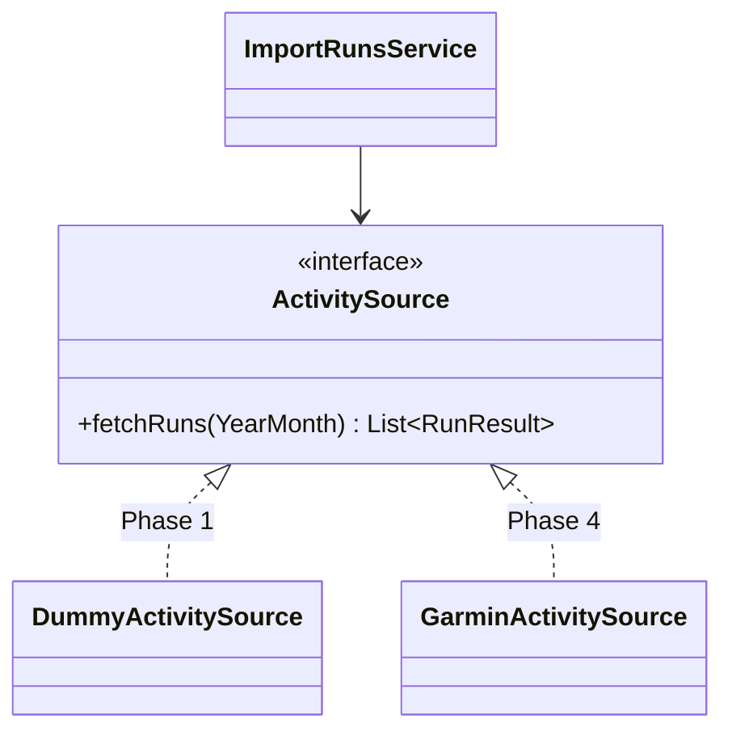

# ADR-0004: 外部サービス連携をポート&アダプタで分離し、Garminは最初ダミーにする

- ステータス: Accepted
- 日付: 2026-10-30

## コンテキスト

run-buddy は Garmin（ランの実績）、LLM（計画の相談）、スプレッドシート（Plan / Resultの同期）という3つの外部サービスに依存します。

- Garmin の API は利用申請や認証が必要で、最初から使えるとは限らない。
- 外部サービスに直接依存したコードは、テストがしにくく、遅く、不安定になりやすい。
- まずはダミーデータで「取り込み → Plan入力 → 比較 → ダッシュボード」という一通りの流れを確認したい。

## 決定

- ドメイン側に、外部サービスを抽象化したインターフェース（ポート）を置く。
  - 例: `ActivitySource`（ランの実績を取得する）、将来は `TrainingAdvisor`（AI相談）、`PlanSheetExporter`（スプレッドシート）
- 外部サービスに依存する実装（アダプタ）は別のパッケージに置き、Spring の DI で差し込む。
- Phase 1 では `ActivitySource` のダミー実装（決まったデータか、シード値を固定した疑似乱数で作るデータ）を使う。
- どの実装を使うかは Spring Profile か設定プロパティで切り替える。

## 結果（トレードオフ）

- 良い点: Garmin が使えなくても、frontend まで含めた一通りの流れを作ってテストできる。
- 良い点: ドメインのテストではポートをテストダブルに差し替えられ、速くて結果が安定したテストになる。
- 注意点: ダミーと本物の API で、データの形やエラーの起き方が違うことがある。Phase 4 では、アダプタ単体の契約テスト（記録したレスポンスを使うなど）で差を埋める。
