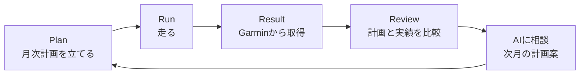
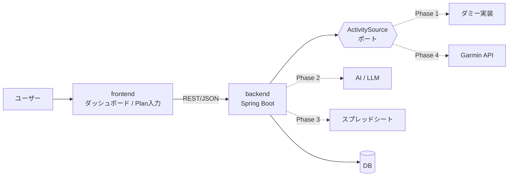

# run-buddy コンセプト

## 1. ビジョン

> 「走った記録」と「走る計画」を同じ場所に置き、毎月の振り返りと次の計画づくりを AI と一緒に回せるようにする。

ランナーはGarminなどのデバイスで記録（Result）をたくさん貯めています。
一方で、月ごとの計画（Plan）は頭の中やスプレッドシートに散らばっていて、
「計画したとおりに走れたか」を振り返ったり、それを次の計画に活かしたりしにくいのが課題です。

run-buddy では次のサイクルを回せるようにします。

## 2. 主なユースケース

| # | ユースケース | アクター | 対象フェーズ |
|---|---|---|---|
| UC-1 | Garminからランの実績（Result）を取り込む | システム（定期実行）/ ユーザー | Phase 1（ダミー） |
| UC-2 | 月次のトレーニング計画（Plan）を入力・編集する | ユーザー | Phase 1 |
| UC-3 | ダッシュボードで計画と実績の差を見る | ユーザー | Phase 1 |
| UC-4 | AIにトレーニング計画を相談する（実績と計画をもとに） | ユーザー | Phase 2 |
| UC-5 | 月次のPlan / Resultをスプレッドシートと同期する | システム / ユーザー | Phase 3 |
| UC-6 | 実際のGarmin APIとつなぐ | システム | Phase 4 |

## 3. ドメイン用語（ユビキタス言語）

| 用語 | 英語 / クラス名候補 | 意味 |
|---|---|---|
| ラン実績 | `RunResult` | 1回のランの記録。日時、距離、時間、平均ペース、平均心拍など |
| 月次計画 | `MonthlyPlan` | ある年月（`YearMonth`）のトレーニング計画。目標の月間距離と、予定ワークアウトの集まり |
| 予定ワークアウト | `PlannedWorkout` | 計画に入っている1回分の練習。日付、種別（Easy / Tempo / Interval / Long など）、目標距離 |
| 達成状況 | `PlanAchievement` | 月次計画と実績を突き合わせた結果（達成率、計画との差） |
| アクティビティ取得元 | `ActivitySource` | 実績を取ってくる外部サービスを抽象化したポート。Garminはその実装の一つ |

用語は、実装に合わせてここで更新していきます（ドキュメントとコードで同じ言葉を使うため）。

## 4. システム構成（全体像）

- 外部サービス（Garmin、LLM、スプレッドシート）とのやりとりはすべて backend に集め、ドメインからはポート（インターフェース）経由で使います（[ADR-0004](adr/0004-ports-and-adapters-for-external-services.md)）。
- frontend は backend の REST API だけを呼びます。

## 5. ロードマップ

| フェーズ | ゴール | 主な内容 |
|---|---|---|
| **Phase 1** | ダミーデータで一通りの流れを確認する | ダミーの `ActivitySource`、Result取り込み、MonthlyPlan の CRUD、計画と実績の比較API、frontend のダッシュボードとPlan入力 |
| Phase 2 | AIに相談できるようにする | 実績と計画をコンテキストにして次月の計画案を出す |
| Phase 3 | スプレッドシートと連携する | 月次Plan / Resultのエクスポート（と、必要ならインポート） |
| Phase 4 | 実際のGarminとつなぐ | 認証、レート制限への対応、差分同期 |

## 6. 品質方針

- **テスト:** ドメインロジック（達成率の計算など）は単体テストで厚めに書きます。Webの層は `@WebMvcTest` + MockMvc で、外部連携はポート単位で差し替えてテストします。
- **ドキュメント:** 重要な設計判断は ADR に残します。将来は自動ドキュメント生成ツールで `docs/` とコードからWikiを作る予定なので、`docs/` は素の Markdown + Mermaid で書きます。
