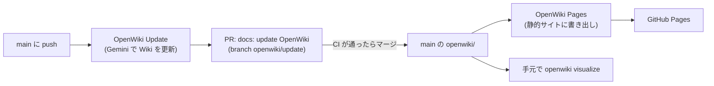

# OpenWiki でドキュメントを自動生成する

[OpenWiki](https://github.com/langchain-ai/openwiki)（LangChain のオープンソースの CLI）が、このリポジトリのソースと
ドキュメントを読んで、`openwiki/` に Wiki（Markdown）を書きます。
書く内容の方針は **[`openwiki/INSTRUCTIONS.md`](../../openwiki/INSTRUCTIONS.md)** に人間が書きます。
決定の経緯は [ADR-0011](../adr/0011-generate-wiki-with-openwiki-in-ci.md) にあります。



- **生成は CI で行います。** main に push があるたびに、前回から変わった部分だけを Gemini で書き直し、PR を作ります
  （同じ PR を上書きしていくので、PR は1つにまとまります）。`openwiki/` の中身の変更では再実行しません。
- **見る方法は2つ:** 公開された静的サイト（GitHub Pages）と、手元で起動するサーバー（`openwiki visualize`）。
- `openwiki/INSTRUCTIONS.md` 以外の `openwiki/` のファイルは生成物です。手で直さず、INSTRUCTIONS.md かソースを直してください。
- 読ませたくないパスは [`.openwikiignore`](../../.openwikiignore) に書きます（`.env`、生成コード、ビルド成果物を除外済み）。

## 最初にやること（オーナーの作業）

Claude はワークフローのファイルを push できないので、次の作業は手で行います。

1. **ワークフローを置く:** `docs/ci/` の2つのファイルを `.github/workflows/` にコピーして main に入れます（PR 経由）。

   ```bash
   cp docs/ci/openwiki-update.yml docs/ci/openwiki-pages.yml .github/workflows/
   ```

キーやトークンは、**GitHub リポジトリの Secrets**（GitHub の run-buddy リポジトリの設定画面にある、Actions 用の秘密の値）に登録します。
手元の `.env` や、Claude のクラウド環境の設定ではありません。CI（GitHub Actions）はここからしか値を読めません。

2. **Gemini のキーを GitHub リポジトリの Secrets に登録する:**
   GitHub の run-buddy リポジトリの **Settings** → **Secrets and variables** → **Actions** → **New repository secret**
   - Name: `GEMINI_API_KEY`、Secret: AI Studio のキー（アプリで使っているものと同じでよい）
3. **PR を作るためのトークン（PAT）を作り、GitHub リポジトリの Secrets に登録する:**
   1. GitHub の右上のアイコン → **Settings**（リポジトリではなく、個人の設定）→ いちばん下の **Developer settings** →
      **Personal access tokens** → **Fine-grained tokens** → **Generate new token**
      - Repository access: **Only select repositories** → `tis-abe-akira/run-buddy` だけ
      - Permissions: **Contents: Read and write**、**Pull requests: Read and write**（ほかは付けない）
      - 表示された `github_pat_...` をコピーする（この画面でしか見られない）
   2. 手順 2 と同じ画面（GitHub の run-buddy リポジトリの Settings → Secrets and variables → Actions）で
      **New repository secret** → Name: `OPENWIKI_PR_TOKEN`、Secret: コピーしたトークン
   - 理由: Actions 標準の `GITHUB_TOKEN` で作った PR では、他のワークフローが動きません。
     main のルールセットは `backend` と `frontend` のチェックを必須にしているので、それでは PR をマージできなくなります。
   - トークンには有効期限があります。切れたら作り直して（または Regenerate して）、GitHub リポジトリの Secrets の
     `OPENWIKI_PR_TOKEN` を上書きしてください。
4. **GitHub Pages を有効にする:** GitHub の run-buddy リポジトリの **Settings** → **Pages** → Build and deployment →
   Source: **GitHub Actions**
5. **初回を実行する:** GitHub の run-buddy リポジトリの **Actions** → **OpenWiki Update** → **Run workflow**
   （mode: `update` のままで初回の生成も行います）。

GitHub リポジトリの Secrets に `GEMINI_API_KEY` か `OPENWIKI_PR_TOKEN` がないときは、OpenWiki Update は警告を出して
何もせずに終わります（失敗にはしません）。

## 生成された Wiki を取り込む

1. OpenWiki Update が終わると、PR「docs: update OpenWiki」ができます。
2. 中身を確認して、CI（`backend` / `frontend`）が通ったらマージします。
3. マージすると OpenWiki Pages が動き、`https://tis-abe-akira.github.io/run-buddy/` に公開されます。

**Gemini のレート制限（429）で途中で止まったとき:** PR の本文に `result: failure` と出ます。
それまでに書けたページは PR に入っているので、そのままマージしてください。次の実行がその続きから進みます
（GitHub の Actions → OpenWiki Update → Run workflow で、すぐに続きを実行することもできます）。

PR をマージする前に main に別の push があると、OpenWiki は main を基準にもう一度実行して、同じ PR を上書きします。
Wiki の PR は溜めずに早めにマージすると、無駄な実行が減ります。

## Wiki を見る

### 静的サイト（GitHub Pages）

`https://tis-abe-akira.github.io/run-buddy/` を開きます。ページのつながりのグラフと、Markdown のリーダーがあります。
手で書き出すときは:

```bash
npx openwiki@0.7.2 visualize openwiki --export site
```

`site/` に `index.html` などが出力されます。好きな Web サーバーに置けます
（例: `cd site && python3 -m http.server 8000`。`file://` で直接開くと `graph.json` を読めないことがあります）。

### 手元のサーバー

```bash
npx openwiki@0.7.2 visualize openwiki
```

`http://127.0.0.1:4321` でブラウザが開きます（ポートが使用中なら次の番号）。
ファイルを書き換えると表示も更新されるので、生成された PR のブランチを checkout して確かめるのにも使えます。
ポートを決めたいときは `--port 4400`、ブラウザを開かないときは `--no-open` を付けます。

どちらのビューアーも、ライブラリ（mermaid など）を公開 CDN から読み込むので、インターネット接続が必要です。

## 方針を変える

- **書いてほしい内容を変える:** `openwiki/INSTRUCTIONS.md` を直して main に入れると、OpenWiki Update が動きます。
  構成を大きく変えたときは、Actions → OpenWiki Update → Run workflow で mode: **`init`** を選ぶと、Wiki 全体を書き直します
  （INSTRUCTIONS.md はそのまま残ります）。
- **モデルを変える:** GitHub の run-buddy リポジトリの Settings → Secrets and variables → Actions → **Variables** タブに `OPENWIKI_MODEL_ID`（例: Gemini のモデル ID）を作ります。
  なければ OpenWiki の Gemini の既定のモデルを使います。
- **OpenWiki のバージョン:** ワークフローとこのガイドでは `0.7.2` に固定しています。上げるときは両方を変えます。

## 注意

- このリポジトリは public なので、Wiki も公開されます。INSTRUCTIONS.md で、秘密情報・個人情報を書かないよう指示しています。
  PR をマージする前に、念のため目を通してください。
- AI Studio のキーで Gemini に送るのは、このリポジトリ（public）のソースとドキュメントです。`.env` は `.openwikiignore` で除外しています。
- OpenWiki が CI から送る匿名のテレメトリは、`OPENWIKI_TELEMETRY_DISABLED=1` で止めています。
- OpenWiki はリポジトリ直下に `AGENTS.md` を作り、`<!-- OPENWIKI:START -->` と `<!-- OPENWIKI:END -->` の間を管理します。
  コーディングエージェントが Wiki を読むための案内です。
