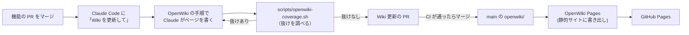

# OpenWiki で Wiki を作る（Claude Code から）

[OpenWiki](https://github.com/langchain-ai/openwiki)（LangChain のオープンソースの CLI）を Claude Code に組み込み、
Claude がこのリポジトリのソースとドキュメントを読んで `openwiki/` に Wiki（Markdown）を書きます。
書く内容の方針は **[`openwiki/INSTRUCTIONS.md`](../../openwiki/INSTRUCTIONS.md)** に人間が書きます。
決定の経緯は [ADR-0015](../adr/0015-generate-wiki-from-claude-code.md)（前は [ADR-0011](../adr/0011-generate-wiki-with-openwiki-in-ci.md) で CI と Gemini でした）。



- **生成は Claude Code から行います。** Claude Code のログインをそのまま使うので、API キーは要りません。
  OpenWiki はページの順番・根拠（Claims）の検証・索引を受け持ち、ページの調査と文章は Claude が書きます。
- **抜けは機械で調べます。** `INSTRUCTIONS.md` に書いたクラス名・メンバー名・ADR 番号が Wiki に出てこなければ、
  `scripts/openwiki-coverage.sh` が一覧にして失敗します。
- `openwiki/INSTRUCTIONS.md` 以外の `openwiki/` のファイルは生成物です。手で直さず、INSTRUCTIONS.md かソースを直してから更新してもらいます。
- 読ませたくないパスは [`.openwikiignore`](../../.openwikiignore) に書きます（`.env`、生成コード、ビルド成果物を除外済み）。

## 仕組み

`openwiki integrations install claude --project` で入れたものを、リポジトリにコミットしてあります（手で直さない）。

| ファイル | 役割 |
|---|---|
| `.mcp.json` | MCP サーバー `openwiki mcp --host claude`。生成の手順（`openwiki_begin` → 計画 → 1ページずつ書いて提出 → `openwiki_finish`）と、Wiki の検索・読み取りの道具を Claude Code に渡す |
| `.claude/skills/openwiki/` | Claude が従う手順（OpenWiki のスキル）。ソースを変えない、生成物を直接いじらない、などの規則も入っている |

`openwiki` コマンドが PATH にある必要があります（バージョンは **0.7.2** に固定）。

- **Mac の Claude Code:** `npm install -g openwiki@0.7.2`（Node.js 22.22 以上）
- **Claude Code のクラウド環境:** 環境のセットアップスクリプトで同じものを入れています（新しいセッションから有効）。

`.mcp.json` を初めて読み込むとき、Claude Code が MCP サーバーを使ってよいか確認することがあります。許可してください。

## Wiki を更新する

1. 機能の PR をマージしたら、Claude Code（このリポジトリ）で頼みます。例：
   > OpenWiki を更新して（mode は update）。終わったら scripts/openwiki-coverage.sh で抜けを確かめて、抜けがあれば書き足して、PR にして。
2. Claude が OpenWiki の手順で、変わったところに関係するページを書き直します。
3. 抜けがあれば、同じ実行の中か、もう一度 `update` を動かして書き足します（生成物は手で直しません）。
4. できた PR を確認してマージすると、OpenWiki Pages が動いて公開されます。

**抜けを調べるだけ:**

```bash
scripts/openwiki-coverage.sh
```

**Wiki 全体を作り直す:** 構成を大きく変えたいとき（`INSTRUCTIONS.md` を大きく直したときなど）は、
「OpenWiki を init で作り直して」と頼みます。重いので、普段は `update` にします。

## Wiki を見る

### 静的サイト（GitHub Pages）

`https://tis-abe-akira.github.io/run-buddy/` を開きます。ページのつながりのグラフと、Markdown のリーダーがあります。
手で書き出すときは:

```bash
npx openwiki@0.7.2 visualize openwiki --export site
```

`site/` に `index.html` などが出力されます。好きな Web サーバーに置けます
（例: `cd site && python3 -m http.server 8000`。`file://` で直接開くと `graph.json` を読めないことがあります）。

### 手元のサーバー

```bash
npx openwiki@0.7.2 visualize openwiki
```

`http://127.0.0.1:4321` でブラウザが開きます（ポートが使用中なら次の番号）。
ファイルを書き換えると表示も更新されるので、生成された PR のブランチを checkout して確かめるのにも使えます。
ポートを決めたいときは `--port 4400`、ブラウザを開かないときは `--no-open` を付けます。

どちらのビューアーも、ライブラリ（mermaid など）を公開 CDN から読み込むので、インターネット接続が必要です。

## 方針を変える

- **書いてほしい内容を変える:** `openwiki/INSTRUCTIONS.md` を直し、Claude Code に更新を頼みます。
  網羅チェックは `INSTRUCTIONS.md` に書いたクラス名・メンバー名（`` `ClassName` `` / `` `ClassName.member` ``）と ADR 番号を対象にするので、
  載せたいものは INSTRUCTIONS.md にこの形で書いておくと、抜けたときに気づけます。
- **OpenWiki のバージョン:** `0.7.2` に固定しています。上げるときは、`openwiki integrations install claude --project` を新しいバージョンで実行し直し、
  クラウド環境のセットアップスクリプトとこのガイドの番号も変えます。

## 注意

- このリポジトリは public なので、Wiki も公開されます。INSTRUCTIONS.md で、秘密情報・個人情報を書かないよう指示しています。
  PR をマージする前に、念のため目を通してください。
- OpenWiki はリポジトリ直下の `AGENTS.md` の `<!-- OPENWIKI:START -->` と `<!-- OPENWIKI:END -->` の間を管理します。
  コーディングエージェントが Wiki を読むための案内です（その間は手で直しません）。

## CI からの切り替え（一度だけ、オーナーの作業）

Wiki の CI 生成（ADR-0011）をやめます。Claude の GitHub App はワークフローを push できないので、手で行います。

1. **ワークフローを消す**（この切り替えの PR のブランチで実行して push するか、マージ後に main へ PR で）:

   ```bash
   git rm .github/workflows/openwiki-update.yml
   ```

   `openwiki-pages.yml`（GitHub Pages への公開）は残します。
2. **不要になった GitHub の Secrets を消す**（任意）: GitHub の run-buddy リポジトリの Settings → Secrets and variables → Actions で
   `GEMINI_API_KEY`（Wiki 専用に登録したもの）と `OPENWIKI_PR_TOKEN`。PAT 自体も、GitHub の個人の Settings → Developer settings で削除できます。
3. **CI が作った Wiki の PR（`docs: update OpenWiki`）を閉じる。** 次の更新は Claude Code から行います。
