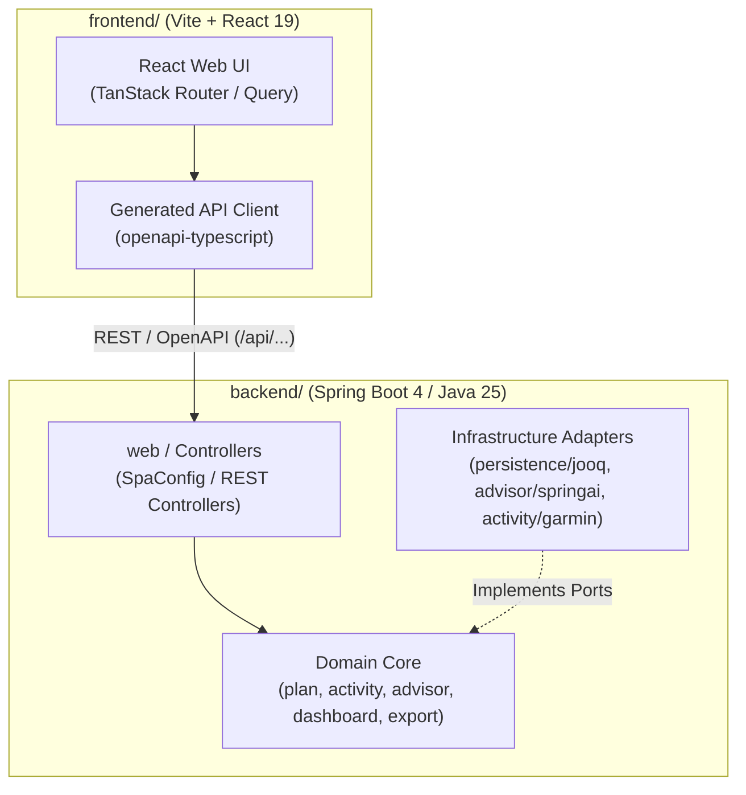
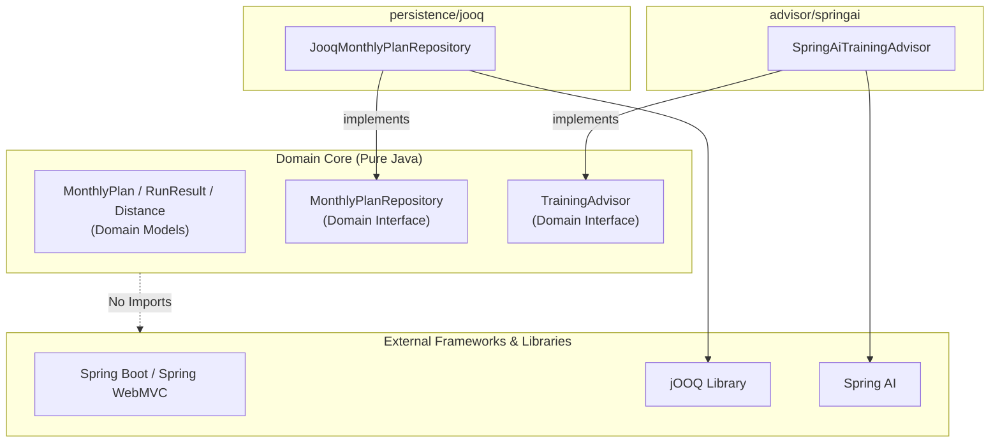
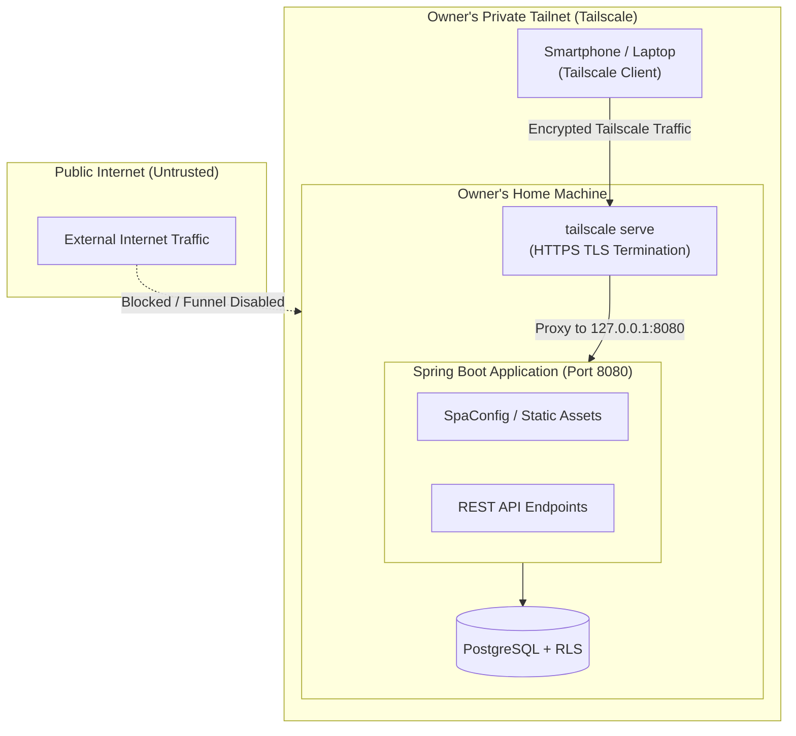

run-buddy は、ランニングの月間計画（Plan）作成、走行実績（Activity）の自動同期、ダッシュボード表示、および AI によるトレーニング相談（Advisor）を提供する個人向け Web アプリケーションです。

1 人の開発者（および AI エージェント）による高い開発速度と保守性を実現するため、リポジトリ構成、バックエンドのパッケージ設計、配信モデル、ネットワーク接続モデルにおいて一貫したアーキテクチャ方針を採用しています。

---

## モノレポ全体像と技術スタック

本プロジェクトは、Web UI と REST API を 1 つのリポジトリで管理するシンプル構造のモノレポ構成を採用しています（[ADR-0002: モノレポ構成](../../docs/adr/0002-monorepo-frontend-backend.md)）。複雑なモノレポ管理ツール（Nx や Turborepo など）は導入せず、エコシステムごとの標準ビルドツール（Maven および npm）でディレクトリを分割し、独立してビルド・テストできるようにしています。

```
run-buddy/
├── backend/    # Spring Boot 4 / Java 25 (Maven プロジェクト: backend/pom.xml)
├── frontend/   # Vite + React 19 + TanStack Router (Node.js / npm プロジェクト: frontend/package.json)
└── docs/       # 設計ドキュメント・ADR (Architecture Decision Records)
```

### 技術スタック概要

| 領域 | 技術・ライブラリ | 採用理由・役割 |
|---|---|---|
| **Backend** | Java 25 (LTS), Spring Boot 4.1.2 | `record` や `sealed interface` を用いた堅牢なドメインモデル設計（[ADR-0003](../../docs/adr/0003-backend-spring-boot-java.md)）、エントリーポイント: `backend/src/main/java/com/example/runbuddy/RunBuddyApplication.java` |
| **Frontend** | React 19, Vite, TanStack Router, TanStack Query | 型安全なルーター・状態管理および OpenAPI スキーマからの型自動生成 (`openapi-typescript`, `frontend/package.json`) |
| **Persistence** | PostgreSQL, Flyway, jOOQ | Row Level Security (RLS) を前提とした型安全な SQL クエリ（[ADR-0007](../../docs/adr/0007-persistence-library.md)） |
| **AI Integration** | Spring AI (2.0.2) | Google Gemini などの LLM プロバイダーとの統一的な Client/Tool Calling インターフェース |


*モノレポ全体の構成とフロントエンド・バックエンド間の相互作用*

---

## バックエンドのパッケージ構成とドメイン非依存ルール

バックエンド (`backend/src/main/java/com/example/runbuddy`) は、アプリケーションのエントリーポイント `RunBuddyApplication.java`（`backend/src/main/java/com/example/runbuddy/RunBuddyApplication.java`）を起点とし、機能単位でコードをまとめる **Package by Feature** 構造を採用しています。さらに、ドメインモデルの再利用性とテスト容易性を高めるため、ヘキサゴナルアーキテクチャ（ポート＆アダプター）の思想に基づいた**ドメイン非依存ルール**（Domain-Independence Rule）を厳格に適用しています。

### パッケージ設計と責務

| パッケージ名 | 責務と主要コンポーネント |
|---|---|
| `plan` | 月間計画およびセッション（`MonthlyPlan`, `PlannedWorkout`, `WorkoutType`）のドメインモデル (`backend/src/main/java/com/example/runbuddy/plan/MonthlyPlan.java`) と永続化ポート (`MonthlyPlanRepository.java`)、REST API (`PlanController.java`) |
| `activity` | 走行実績（`RunResult`）のドメインモデル (`backend/src/main/java/com/example/runbuddy/activity/RunResult.java`)、アクティビティ取得ポート (`ActivitySource.java`)、Garmin 連携 (`garmin/GarminActivitySource.java`)、リポジトリポート (`RunResultRepository.java`) |
| `dashboard` | 計画対実績の達成状況や進捗データ（`DailyProgress`, `PlanAchievement`）を集計・提供するリードモデル |
| `advisor` | AI 相談機能のドメイン抽象（`TrainingAdvisor.java` [`backend/src/main/java/com/example/runbuddy/advisor/TrainingAdvisor.java`]、`Consultation`, `Advice`）、Tool 定義 (`AdvisorTools.java`)、Spring AI 実装 (`springai/SpringAiTrainingAdvisor.java`)、モック実装 (`fake/FakeTrainingAdvisor.java`) |
| `export` | データエクスポートドメイン（`DailyLog`, `DailyLogCsv`, `Csv`）および CSV 出力 API (`ExportController.java`) |
| `shared` | 共通ドメイン概念（`Distance.java`）およびシステム共通コンテキスト（`CurrentUser.java`, `ClockConfig.java`） |
| `persistence` | データベース設定 (`DatabaseConfig.java`)、RLS トランザクション管理 (`RlsTransactionManager.java`)、jOOQ アダプター実装 (`jooq/JooqMonthlyPlanRepository.java`, `jooq/JooqRunResultRepository.java`) |
| `web` | SPA 配信用設定 (`SpaConfig.java` [`backend/src/main/java/com/example/runbuddy/web/SpaConfig.java`])、OpenAPI 仕様定義 (`OpenApiConfig.java`)、共通例外ハンドラー (`ApiExceptionHandler.java`) |

### ドメイン非依存ルール (Domain Independence)

コア・ドメインモデルおよびリポジトリ／外部ソースのインターフェース（ポート）は、フレームワーク（Spring Framework, jOOQ, Spring AI など）に対するコンパイル時依存を一切持ちません。

1. **純粋な Java によるドメイン表現**: `MonthlyPlan`（`backend/src/main/java/com/example/runbuddy/plan/MonthlyPlan.java`）や `RunResult`（`backend/src/main/java/com/example/runbuddy/activity/RunResult.java`）、`Distance` などのドメインクラスは Java 標準ライブラリ (`java.time`, `java.util`) のみで記述され、Spring のアノテーションやデータベースライブラリの型を含みません。
2. **依存性逆転の原則 (DIP)**: `MonthlyPlanRepository`（`backend/src/main/java/com/example/runbuddy/plan/MonthlyPlanRepository.java`）、`RunResultRepository`、`TrainingAdvisor`（`backend/src/main/java/com/example/runbuddy/advisor/TrainingAdvisor.java`）、`ActivitySource` などのインターフェースはドメインパッケージ側に定義され、具体的な技術スタック（jOOQ や Spring AI）はサブパッケージや `persistence` パッケージのアダプターが実装します。
3. **高速なテスト**: コア・ドメインのロジックおよびリポジトリインターフェースは、`InMemoryMonthlyPlanRepository` や `FakeTrainingAdvisor` などのインメモリ／フェイク実装を用いることで、データベースや外部 API に依存せず即座に単体テストを実行できます（詳細は [アーキテクチャパターン](./patterns.md) を参照）。


*ドメインコアのフレームワーク非依存性とアダプターによる依存性逆転*

---

## 本番配信構成 (SpaConfig と単一オリジン配備)

本システムは、フロントエンドのビルド資産（Vite による SPA）とバックエンド（Spring Boot REST API）を 1 つの Java プロセス（単一オリジン）から配信する構成を採用しています。

### Maven `-Papp` プロファイルによるビルド手順

プロダクション実行時、Maven の `-Papp` プロファイル（[backend/pom.xml](../../backend/pom.xml)）を使用することで、以下のビルドパイプラインが自動実行されます：

1. `exec-maven-plugin` が `frontend/` ディレクトリで `npm ci` および `npm run build` を実行。
2. `maven-resources-plugin` が生成された `frontend/dist` 配下の静的資産を `target/classes/static`（クラスパス上の `classpath:/static/`）にコピー。
3. 単一の実行可能 JAR ファイル内に API と Web UI 資産が同梱される。

### `SpaConfig` によるルーティング制御

[SpaConfig.java](../../backend/src/main/java/com/example/runbuddy/web/SpaConfig.java) の `SpaResourceResolver` は、ブラウザでの SPA ルーティングとバックエンド API / 静的ファイルを明確に分離・制御します。

* **静的ファイルが存在する場合**: `/assets/app.js` など実ファイルが存在する場合はそのまま静的ファイルを返却。
* **サーバー API または拡張子付きファイルの場合**: `/api/...`, `/v3/...`, `/health` のパスや、拡張子を含む存在しないファイル（例: `/assets/missing.js`）は 404 Not Found を返却。API 呼び出しエラーが誤って `index.html` として返却されることを防ぎます。
* **SPA クライアントルート**: `/plans/2026-11` や `/dashboard` などの画面パスは、物理ファイルが存在しないため `classpath:/static/index.html` を返却し、ブラウザ側の TanStack Router にルーティングを委ねます。
* **コントローラー優先**: `@RestController` で定義されたエンドポイントは `SpaResourceResolver` より常に優先されます。

---

## Tailscale 接続モデルと個人アクセス運用

run-buddy は個人利用を想定しており、アプリ自体にはユーザーログイン機能（認証機能）を実装していません（すべての操作は設定ファイル `backend/src/main/resources/application.properties` 上のデフォルトユーザー `runbuddy.default-user-id` として処理されます）。

不特定多数へのインターネット公開によるデータ漏洩や API キーの不正利用を防ぎつつ、外出先やスマートフォンから安全にアクセスするため、Tailscale を活用したプライベートネットワーク運用を採用しています（[ADR-0010: Tailscale 運用](../../docs/adr/0010-run-at-home-over-tailscale.md)）。


*Tailscale serve によるプライベートネットワーク経由の安全なアクセス構成*

### セキュリティとネットワーク設計原則

1. **ローカルホスト限定バインド (`127.0.0.1`)**:
   バックエンドはデフォルトで `server.address=127.0.0.1`（`backend/src/main/resources/application.properties`）のみで待機します（環境変数 `RUNBUDDY_BIND_ADDRESS` で変更可能）。同一 LAN 内の第三者からの直接アクセスを遮断します。
2. **`tailscale serve` による中継**:
   手元のマシン上で `./mvnw spring-boot:run -Papp` を起動し、`tailscale serve` を使用して Tailnet 内だけに HTTPS で公開します。Tailscale が証明書管理と暗号化トンネルを自動処理します。
3. **`tailscale funnel` の禁止**:
   インターネットへの一般公開 (`tailscale funnel`) は明示的に禁止・不使用としています。これにより、複雑な OAuth/IAP 認証機能を組み込むことなく、高い安全性を維持できます。

---

## 関連ページ

* [アーキテクチャパターンと設計原則](./patterns.md) - リポジトリパターン、インメモリ／フェイク実装、テスト戦略の詳細
* [データ永続化と Row Level Security](./persistence-rls.md) - PostgreSQL RLS と jOOQ によるデータ隔離メカニズム
* [クイックスタートガイド](../quickstart.md) - ローカル開発環境の構築手順および実行方法
