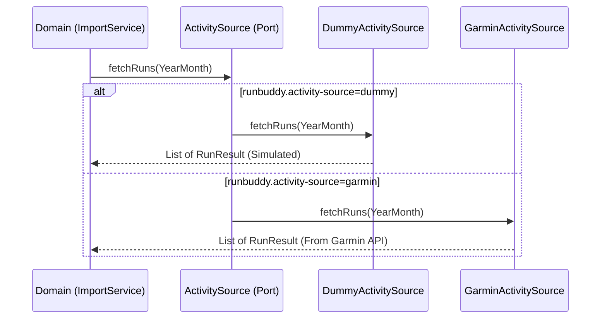
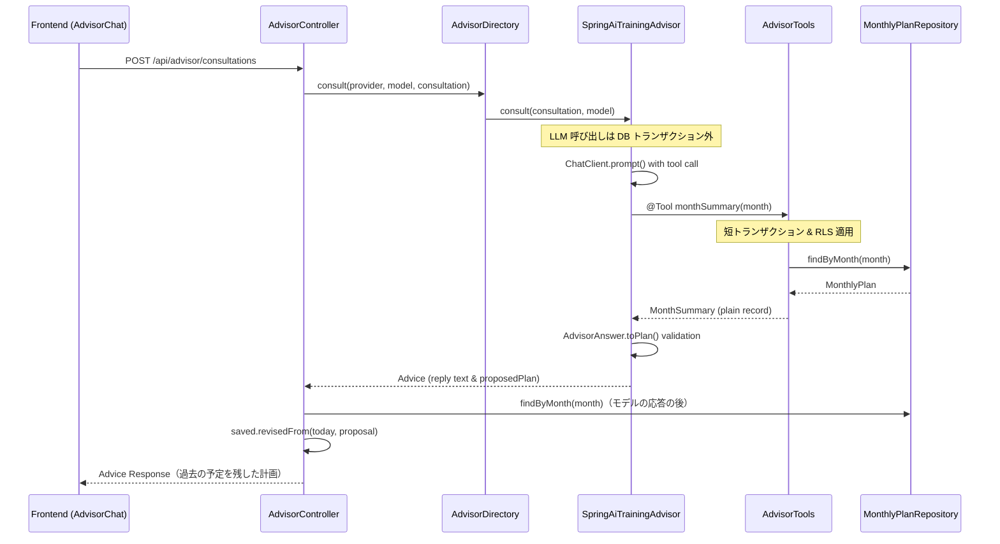
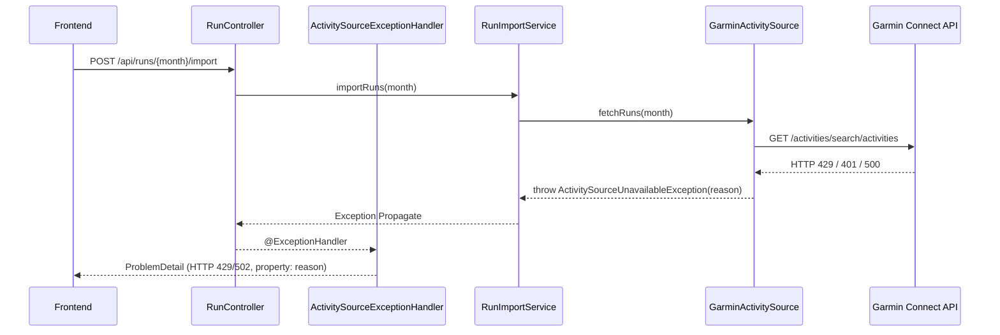

# その他のアーキテクチャ上の工夫

本ページでは、`run-buddy` が採用している主要な設計パターン、外部サービス連携メカニズム、テスト戦略、およびフロントエンド/バックエンド間の協調構造を解説します。システム全体の構成については [アーキテクチャ概要](overview.md)、データベースの権限設計については [永続化と RLS](persistence-rls.md) を併せて参照してください。

---

## 1. Ports & Adapters (オニオン/ヘキサゴナルアーキテクチャ)

### 問題
Garmin API や LLM、永続化ストレージなどの外部サービスにドメインロジックが直接依存すると、外部 API の仕様変更や認証未準備（API キー未発行など）、ネットワーク遅延・障害によって開発やテストがストップする課題があります。

### 工夫
ドメイン層に外部サービスとの結合境界となるインターフェース（**Port**）を配置し、具体の接続実装（**Adapter**）を外部パッケージに分離しました（[ADR-0004: Ports & Adapters](../../docs/adr/0004-ports-and-adapters-for-external-services.md)）。起動時の設定プロパティ（`runbuddy.activity-source`、`runbuddy.persistence` など）や Spring プロファイルによって、インメモリ/ダミー実装と本物のアダプタを柔軟に切り替え可能です。


図 1: 設定プロパティによる ActivitySource 実装の切り替えフロー

### コードの場所
- **Port 定義**:
  - `backend/src/main/java/com/example/runbuddy/activity/ActivitySource.java`
  - `backend/src/main/java/com/example/runbuddy/plan/MonthlyPlanRepository.java`
  - `backend/src/main/java/com/example/runbuddy/race/RaceRepository.java`
  - `backend/src/main/java/com/example/runbuddy/advisor/TrainingAdvisor.java`
- **Adapter 実装**:
  - `backend/src/main/java/com/example/runbuddy/activity/garmin/GarminActivitySource.java`
  - `backend/src/main/java/com/example/runbuddy/plan/InMemoryMonthlyPlanRepository.java`
  - `backend/src/main/java/com/example/runbuddy/persistence/jooq/JooqMonthlyPlanRepository.java`
  - `backend/src/main/java/com/example/runbuddy/advisor/fake/FakeTrainingAdvisor.java`
  - `backend/src/main/java/com/example/runbuddy/advisor/springai/SpringAiTrainingAdvisor.java`
- **設定による切り替え構造**:
  - `backend/src/main/resources/application.properties`
  - `docs/adr/0004-ports-and-adapters-for-external-services.md`

### 守っているテスト
- `backend/src/test/java/com/example/runbuddy/plan/InMemoryMonthlyPlanRepositoryTest.java`
- `backend/src/test/java/com/example/runbuddy/advisor/fake/FakeTrainingAdvisorTest.java`
- `backend/src/test/java/com/example/runbuddy/activity/garmin/GarminActivitySourceTest.java`
- `backend/src/test/java/com/example/runbuddy/activity/RunControllerTest.java`、`RunDetailControllerTest.java`（`reason` 付きの ProblemDetail）

---

## 2. 契約テスト (Contract Testing)

### 問題
インメモリリポジトリと jOOQ 永続化リポジトリなど、複数存在するアダプタ実装間でテストロジックを個別に記述すると、検証内容に差異が生じたり、行レベルセキュリティ (RLS) やトランザクション境界におけるデータ隔離の検証が漏れたりするリスクがあります。

### 工夫
テスト用インターフェース（例: `MonthlyPlanRepositoryContract`、`RaceRepositoryContract`、`RowLevelSecurityContract`）に JUnit 5 の `default` テストメソッドとして共通の振る舞い検証を 1 回だけ定義し、各アダプタのテストクラス（インメモリ版および jOOQ 版）がこれを実装する構成にしました。また `DatabaseSafetyTest` を配置し、トランザクション外での DB アクセスが即座に例外となることを検証しています。

### コードの場所
- **契約インターフェース**:
  - `backend/src/test/java/com/example/runbuddy/plan/MonthlyPlanRepositoryContract.java`
  - `backend/src/test/java/com/example/runbuddy/race/RaceRepositoryContract.java`
  - `backend/src/test/java/com/example/runbuddy/persistence/RowLevelSecurityContract.java`
- **安全検証テスト**:
  - `backend/src/test/java/com/example/runbuddy/persistence/DatabaseTest.java`
  - `backend/src/test/java/com/example/runbuddy/persistence/DatabaseSafetyTest.java`

### 守っているテスト
- `backend/src/test/java/com/example/runbuddy/plan/InMemoryMonthlyPlanRepositoryTest.java` (契約を実装)
- `backend/src/test/java/com/example/runbuddy/persistence/jooq/JooqMonthlyPlanRepositoryTest.java` (契約を実装)
- `backend/src/test/java/com/example/runbuddy/race/InMemoryRaceRepositoryTest.java` (契約を実装)
- `backend/src/test/java/com/example/runbuddy/persistence/jooq/JooqPersistenceTest.java` (契約を実装)
- `backend/src/test/java/com/example/runbuddy/persistence/DatabaseSafetyTest.java`

---

## 3. 不変ドメインモデル (Immutable Domain Model)

### 問題
ドメインオブジェクトに不整合なデータ（負の走行距離、月外のトレーニング日付、NaN や Double.INFINITY）が混入すると、ダッシュボードの集計計算や AI 相談、スプレッドシート出力時に不具合が発生します。

### 工夫
Java `record` や `final` クラスのコンパクトコンストラクタを活用し、オブジェクト生成時に不変条件を自律的にバリデーションしています。例えば `Distance` は浮動小数点の丸め誤差を排除するため内部を `long` 型のミリメートル数で保持し、`MonthlyPlan` や `DailyLog` は含まれるワークアウトやランが指定月内であることを強制します。

### コードの場所
- **不変ドメインモデル**:
  - `backend/src/main/java/com/example/runbuddy/plan/MonthlyPlan.java`
  - `backend/src/main/java/com/example/runbuddy/shared/Distance.java`
  - `backend/src/main/java/com/example/runbuddy/export/DailyLog.java`
  - `backend/src/main/java/com/example/runbuddy/race/Race.java`

### 守っているテスト
- `backend/src/test/java/com/example/runbuddy/plan/MonthlyPlanTest.java`
- `backend/src/test/java/com/example/runbuddy/shared/DistanceTest.java`
- `backend/src/test/java/com/example/runbuddy/export/DailyLogTest.java`
- `backend/src/test/java/com/example/runbuddy/race/RaceTest.java`

---

## 4. Spring AI 統合と AI 相談メカニズム

### 問題
LLM とのやり取りでは、長時間に及ぶ API 呼び出し中に DB トランザクションを維持すると接続プールが枯渇する問題や、非信頼なテキスト出力がドメインモデルの不変条件を破るリスクがあります。また、利用者がプロバイダ（Gemini 等）やモデルを動的に選択できる仕組みが必要です（[ADR-0008: AI 統合](../../docs/adr/0008-ai-integration.md)）。

### 工夫
1. **Spring AI 閉塞**: `ChatClient` やプロバイダ特有の型は `advisor/springai` パッケージ内に隠蔽し、ドメイン層の `TrainingAdvisor` ポートには Spring AI の型を出さない。
2. **トランザクション外のモデル呼び出しと短トランザクションツール実行**: LLM への呼び出し（`ChatClient.prompt()`）は DB トランザクションの外で実行する。LLM がデータ参照のために `AdvisorTools` の `@Tool` メソッド（例: `monthSummary`）を呼び出した際、ツールメソッド内でリポジトリを個別の短トランザクションで呼び出し、RLS (行レベルセキュリティ) を安全に適用する。
3. **非信頼出力のドメイン検証**: LLM から返却された JSON レスポンスは `AdvisorAnswer.toPlan(YearMonth)` でドメインモデル `MonthlyPlan` に変換し、不変条件違反があれば不採用として安全に例外処理する。
4. **動的ルーティング**: `AdvisorDirectory` が利用可能なプロバイダとモデルを保持し、リクエストに応じて適切な `TrainingAdvisor` 実装に処理を振り分ける。
5. **目標のレースから逆算する**: ツール `AdvisorTools.upcomingRaces` は、今日以降のレースを日付順に、距離・目標（完走、または目標タイムとそれに必要なペース）・残りの日数と週数つきで返す。週数は `daysLeft / 7` の切り捨てで、モデルに週を数えさせない。
   ```java
   // backend/src/main/java/com/example/runbuddy/advisor/AdvisorTools.java
   public List<RaceView> upcomingRaces() {
       LocalDate today = LocalDate.now(clock);
       return races.findAll().stream()
               .filter(race -> race.isUpcoming(today))
               .map(race -> {
                   long daysLeft = race.daysFrom(today);
                   return new RaceView(race.name(), race.date(), weekday(race.date()),
                           race.distance().toKilometers(), goal(race), daysLeft, daysLeft / 7);
               })
               .toList();
   }
   ```
   `SpringAiTrainingAdvisor` のシステムプロンプトは、レースが近ければツールが返す残り週数を使って逆算し、最後の 2〜3 週はテーパリング（距離を落とし、短いレースペース走と休養）を入れ、目標タイムがあればそのペースをレースペース走・テンポ走の基準にするよう指示している。
6. **月の途中の見直しは過去を残す（#31）**: モデルの提案は `AdvisorController` がそのまま返さず、保存済みの計画と `MonthlyPlan.revisedFrom(today, proposal)` で合成してから返す。今日より前の予定は保存済みのまま残し、今日以降だけを提案で置き換える（目標距離は提案のもの）。月が終わっていれば保存済みの計画をそのまま返し、別の月の提案は `IllegalArgumentException`。どのプロバイダが答えても「画面に見えるもの＝採用すると保存されるもの」になり、保存済みの計画はモデルの応答の**後**に読むのでモデルが考えている間にトランザクションは開いていない。
   ```java
   // backend/src/main/java/com/example/runbuddy/plan/MonthlyPlan.java
   List<PlannedWorkout> kept = workouts.stream().filter(w -> w.date().isBefore(today)).toList();
   List<PlannedWorkout> ahead = proposal.workouts().stream().filter(w -> !w.date().isBefore(today)).toList();
   return new MonthlyPlan(month, proposal.targetDistance(), Stream.concat(kept.stream(), ahead.stream()).toList());
   ```


図 2: LLM 呼び出し（非トランザクション）と Tool 実行（短トランザクション + RLS）の協調フロー

### コードの場所
- **AI 統合コンポーネント**:
  - `backend/src/main/java/com/example/runbuddy/advisor/springai/SpringAiTrainingAdvisor.java`
  - `backend/src/main/java/com/example/runbuddy/advisor/AdvisorTools.java`
  - `backend/src/main/java/com/example/runbuddy/advisor/springai/AdvisorAnswer.java`
  - `backend/src/main/java/com/example/runbuddy/advisor/AdvisorDirectory.java`
  - `backend/src/main/java/com/example/runbuddy/advisor/AdvisorController.java`（`asRevision` で `MonthlyPlan.revisedFrom` を呼ぶ）
  - `backend/src/main/java/com/example/runbuddy/plan/MonthlyPlan.java`
  - `docs/adr/0008-ai-integration.md`

### 守っているテスト
- `backend/src/test/java/com/example/runbuddy/advisor/springai/SpringAiTrainingAdvisorTest.java`
- `backend/src/test/java/com/example/runbuddy/advisor/AdvisorToolsTest.java`
- `backend/src/test/java/com/example/runbuddy/advisor/AdvisorToolsDatabaseTest.java`
- `backend/src/test/java/com/example/runbuddy/advisor/AdvisorDirectoryTest.java`
- `AdvisorToolsTest` の `upcomingRacesTellTheGoalTheTimeLeftAndThePaceNeeded`・`racesAlreadyRunAreNotUpcoming`（終わったレースは出さない）
- `AdvisorControllerTest.aMidMonthRevisionKeepsThePastAsPlannedAndOnlyChangesTodayOnwards` と `MonthlyPlanTest`（`revisedFrom` の境界: 月が終わった後・始まる前、別の月の提案）

---

## 5. Garmin API 連携とエラー変換フロー

### 問題
Garmin Connect Personal API の特殊な認証仕様（テキスト応答の JWT トークン交換、24 時間有効期間）、現地時刻扱い、ページング、およびレート制限や認証エラーをそのまま UI に露出すると、密結合とバグの原因になります（[ADR-0009: Garmin 連携](../../docs/adr/0009-garmin-personal-api.md)）。

### 工夫
Garmin の知識を `activity/garmin` パッケージ（`GarminActivitySource`）内に隠蔽。トークン有効期限の 23 時間キャッシュや `401` 再試行、現地時刻ベースでのアクティビティ取得・変換を行います。エラー発生時はドメイン例外 `ActivitySourceUnavailableException`（`Reason`: `CREDENTIALS_REJECTED`, `RATE_LIMITED`, `UNAVAILABLE`）へ変換し、`@RestControllerAdvice` の `ActivitySourceExceptionHandler` が RFC 9457 `ProblemDetail`（`reason` プロパティ付き、`RATE_LIMITED` は 429、それ以外は 502）に整形してフロントエンドへ返却します。ハンドラをコントローラから切り出してあるので、月の取り込み（`RunController`）、最新の取り込み（`LatestImportController`）、ランの詳細（`RunDetailController`）のどれも同じ形で失敗を返します。読めない FIT ファイルは同じハンドラが `reason: UNREADABLE_FILE` の 502 にします。

`GarminActivitySource` は `ActivitySource` に加えて活動ファイルのポート `ActivityFileSource` も実装し、FIT ファイルのダウンロードも同じエラー変換を通ります（詳細は [ランの測定値・日別詳細・ラップと地図](../features/run-detail.md)）。


図 3: Garmin Connect API エラー発生時の例外変換と ProblemDetail 返却フロー

### コードの場所
- **Garmin アダプタ & 例外ハンドラ**:
  - `backend/src/main/java/com/example/runbuddy/activity/garmin/GarminActivitySource.java`
  - `backend/src/main/java/com/example/runbuddy/activity/ActivitySourceUnavailableException.java`
  - `backend/src/main/java/com/example/runbuddy/activity/ActivitySourceExceptionHandler.java`
  - `backend/src/main/java/com/example/runbuddy/activity/RunController.java`
  - `docs/adr/0009-garmin-personal-api.md`

### 守っているテスト
- `backend/src/test/java/com/example/runbuddy/activity/garmin/GarminActivitySourceTest.java`

---

## 6. OpenAPI 型共有 (OpenAPI Type Sharing)

### 問題
バックエンドの API レスポンスやリクエストボディの型を変更した際、フロントエンドの TypeScript 型定義との不一致が発生し、実行時エラーになる課題があります。

### 工夫
バックエンドの `springdoc-openapi` が出力する OpenAPI 仕様書（`/v3/api-docs`、Controller の `@Schema` 注釈付き DTO）から、`npm run gen:api`（`openapi-typescript`）を実行して TypeScript 型定義ファイル `src/api/schema.gen.ts` を自動生成しています。フロントエンドは `src/api/client.ts` 内で `components['schemas']` としてこの型を参照し、コンパイル時に API 型不一致を検知します。

### コードの場所
- **型共有設定 & コントローラ**:
  - `frontend/package.json` (`gen:api` スクリプト)
  - `backend/src/main/java/com/example/runbuddy/activity/RunController.java` (`@Schema` 注釈)
  - `frontend/src/api/schema.gen.ts` (生成成果物)
  - `frontend/src/api/client.ts` (生成型の利用)

### 守っているテスト
- `frontend/package.json`（`npm run build` 時の `tsc --noEmit` 型チェック）

---

## 7. フロントエンドコンポーネント設計とデザインシステム

### 問題
画面間でのデータ取得の重複、月切替時の編集状態・下書きの混入、および UI 記述における色や余白の不整合（デザインの散逸）が発生する問題があります（[ADR-0006: デザインシステム](../../docs/adr/0006-design-system.md)）。

### 工夫
1. **ルーティングとデータ取得の分離**: TanStack Router のルート定義（`plans.$month.tsx` や `races.tsx`）で `loader` と TanStack Query (`useQuery`) を組み合わせ、`remountDeps: ({ params }) => params.month` により月切替時にコンポーネントを再構築し、下書き状態の混入を防止。
2. **Props 専用コンポーネント**: `NextRaceCard.tsx` や `PlanEditor.tsx` などの UI コンポーネントは取得ロジックや状態管理を抱え込まず、Pure な props 受取専用として設計し、単体テストを容易化。
3. **デザイントークン**: `DESIGN.md` で定義されたデザインガイドライン（温かいクリーム地、セリフ体、コーラル色など）を `src/styles/tokens.css` の CSS 変数やユーティリティクラスに展開し、コンポーネント内でのカラーコード直接記述を禁止。

### コードの場所
- **フロントエンドコンポーネント & デザイン体系**:
  - `frontend/src/routes/plans.$month.tsx`
  - `frontend/src/routes/races.tsx`
  - `frontend/src/components/NextRaceCard.tsx`
  - `frontend/src/components/PlanEditor.tsx`
  - `frontend/src/styles/tokens.css`
  - `frontend/DESIGN.md`
  - `docs/adr/0006-design-system.md`

### 守っているテスト
- `frontend/src/components/PlanEditor.test.tsx`
- `frontend/src/components/NextRaceCard.test.tsx`

---

## 8. 設定と秘密情報管理 (Configuration & Environment Variables)

### 問題
Docker Compose、Spring Boot、ローカル開発環境で異なる環境変数設定ファイルを個別に管理すると、不整合や API キー等の秘密情報の漏洩が起きやすくなります。

### 工夫
リポジトリルートの `.env` ファイル（`.env.example` からコピー作成）を唯一の構成源として設定。Docker Compose が自動読み込みするとともに、Spring Boot 側も `application.properties` 内の `spring.config.import=optional:file:.env[.properties],optional:file:../.env[.properties]` により直接参照します。また「OS 環境変数 > `.env` > デフォルト値」という優先順位ルールを定めています。

### コードの場所
- **環境設定**:
  - `/.env.example`
  - `backend/src/main/resources/application.properties`
  - `/compose.yaml`

### 守っているテスト
- `backend/src/test/java/com/example/runbuddy/activity/ActivitySourceStartupLogTest.java`

---

## 関連ドキュメント
- [アーキテクチャ概要](overview.md)
- [ランの測定値・日別詳細・ラップと地図](../features/run-detail.md)（`RunMetrics`、ADR-0012 の FIT ファイル、ADR-0013 の地図）
- [ダッシュボードの「いまやること」](../features/next-steps.md)（ADR-0014）
- [永続化と RLS](persistence-rls.md)
- [新機能追加チュートリアル](../tutorials/add-feature.md)
