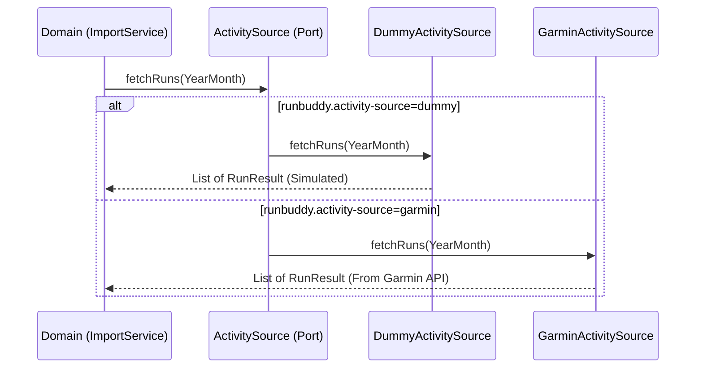
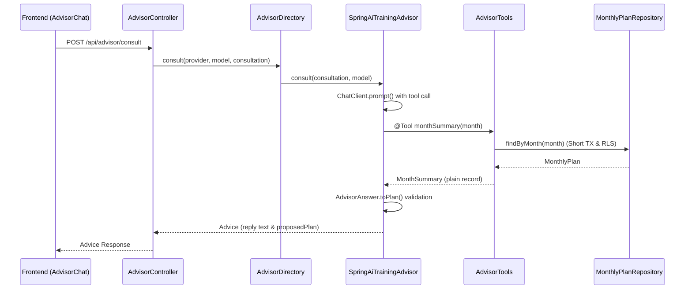
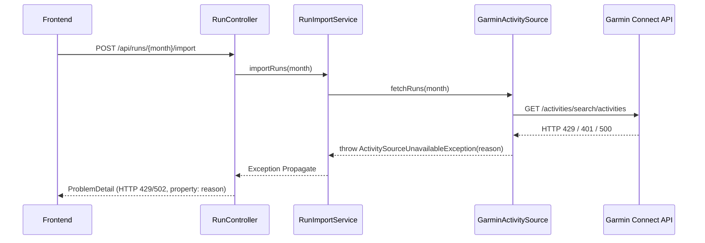

# 主要設計パターンと連携メカニズム

本ページでは、`run-buddy` が採用している主要な設計パターン、外部サービス連携メカニズム、テスト戦略、およびフロントエンド/バックエンド間の協調構造を解説します。システム全体の構成については [アーキテクチャ概要](overview.md)、データベースの権限設計については [永続化と RLS](persistence-rls.md) を併せて参照してください。

---

## 1. Ports & Adapters (オニオン/ヘキサゴナルアーキテクチャ)

### 問題
Garmin API や LLM、永続化ストレージなどの外部サービスにドメインロジックが直接依存すると、外部 API の仕様変更や認証未準備（API キー未発行など）、ネットワーク遅延・障害によって開発やテストがストップする課題があります。

### 工夫
ドメイン層に外部サービスとの結合境界となるインターフェース（**Port**）を配置し、具体の接続実装（**Adapter**）を外部パッケージに分離しました。起動時の設定プロパティ（`runbuddy.activity-source`、`runbuddy.persistence` など）や Spring プロファイルによって、インメモリ/ダミー実装と本物のアダプタを切り替え可能です。

ポートによる外部サービス抽象化と設定によるアダプタ切替の制御フロー

### コードの場所
- **Port 定義**:
  - `backend/src/main/java/com/example/runbuddy/activity/ActivitySource.java`
  - `backend/src/main/java/com/example/runbuddy/plan/MonthlyPlanRepository.java`
  - `backend/src/main/java/com/example/runbuddy/advisor/TrainingAdvisor.java`
- **Adapter 実装**:
  - `backend/src/main/java/com/example/runbuddy/activity/garmin/GarminActivitySource.java`
  - `backend/src/main/java/com/example/runbuddy/plan/InMemoryMonthlyPlanRepository.java`
  - `backend/src/main/java/com/example/runbuddy/persistence/jooq/JooqMonthlyPlanRepository.java`
  - `backend/src/main/java/com/example/runbuddy/advisor/fake/FakeTrainingAdvisor.java`
  - `backend/src/main/java/com/example/runbuddy/advisor/springai/SpringAiTrainingAdvisor.java`
- **設定による切り替え構造**:
  - `backend/src/main/resources/application.properties`
  - `docs/adr/0004-ports-and-adapters-for-external-services.md`

### 守っているテスト
- `backend/src/test/java/com/example/runbuddy/plan/InMemoryMonthlyPlanRepositoryTest.java`
- `backend/src/test/java/com/example/runbuddy/advisor/fake/FakeTrainingAdvisorTest.java`
- `backend/src/test/java/com/example/runbuddy/activity/garmin/GarminActivitySourceTest.java`

---

## 2. 契約テスト (Contract Testing)

### 問題
インメモリリポジトリと jOOQ 永続化リポジトリなど、複数存在するアダプタ実装間でテストロジックを個別に記述すると、検証内容に差異が生じたり、行レベルセキュリティ (RLS) やトランザクション境界におけるデータ漏洩の検証が漏れたりするリスクがあります。

### 工夫
テスト用インターフェース（例: `MonthlyPlanRepositoryContract`、`RowLevelSecurityContract`）に JUnit 5 の `default` テストメソッドとして共通の振る舞い検証を定義し、各アダプタのテストクラスがこれを実装する構成にしました。また `DatabaseSafetyTest` を配置し、トランザクション外での DB アクセスが即座に例外となることを検証しています。

### コードの場所
- **契約インターフェース**:
  - `backend/src/test/java/com/example/runbuddy/plan/MonthlyPlanRepositoryContract.java`
  - `backend/src/test/java/com/example/runbuddy/persistence/RowLevelSecurityContract.java`
- **安全検証テスト**:
  - `backend/src/test/java/com/example/runbuddy/persistence/DatabaseTest.java`
  - `backend/src/test/java/com/example/runbuddy/persistence/DatabaseSafetyTest.java`

### 守っているテスト
- `backend/src/test/java/com/example/runbuddy/plan/InMemoryMonthlyPlanRepositoryTest.java` (契約を実装)
- `backend/src/test/java/com/example/runbuddy/persistence/jooq/JooqMonthlyPlanRepositoryTest.java` (契約を実装)
- `backend/src/test/java/com/example/runbuddy/persistence/DatabaseSafetyTest.java`

---

## 3. 不変ドメインモデル (Immutable Domain Model)

### 問題
ドメインオブジェクトに不整合なデータ（負の走行距離、月外のトレーニング日付、NaN や Double.INFINITY）が混入すると、ダッシュボードの集計計算や AI 相談、スプレッドシート出力時に不具合が発生します。

### 工夫
Java `record` や `final` クラスのコンパクトコンストラクタを活用し、オブジェクト生成時に不変条件を自律的にバリデーションしています。例えば `Distance` は浮動小数点の丸め誤差を排除するため内部を `long` 型のミリメートル数で保持し、`MonthlyPlan` や `DailyLog` は含まれるワークアウトやランが指定月内であることを強制します。

### コードの場所
- **不変ドメインモデル**:
  - `backend/src/main/java/com/example/runbuddy/plan/MonthlyPlan.java`
  - `backend/src/main/java/com/example/runbuddy/shared/Distance.java`
  - `backend/src/main/java/com/example/runbuddy/export/DailyLog.java`

### 守っているテスト
- `backend/src/test/java/com/example/runbuddy/plan/MonthlyPlanTest.java`
- `backend/src/test/java/com/example/runbuddy/shared/DistanceTest.java`
- `backend/src/test/java/com/example/runbuddy/export/DailyLogTest.java`

---

## 4. Spring AI 統合と AI 相談メカニズム

### 問題
LLM とのやり取りでは、長時間に及ぶ API 呼び出し中に DB トランザクションを維持すると接続プールが枯渇する問題や、非信頼なテキスト出力がドメインモデルの不変条件を破るリスクがあります。また、利用者がプロバイダ（Gemini 等）やモデルを動的に選択できる仕組みが必要です。

### 工夫
1. **Spring AI 閉塞**: `ChatClient` やプロバイダ特有の型は `advisor/springai` パッケージ内に隠蔽し、ドメイン層の `TrainingAdvisor` ポートには Spring AI の型を出さない。
2. **短トランザクション**: `AdvisorTools` の `@Tool` メソッドが呼び出されるたびにリポジトリを個別の短トランザクションで実行し、RLS (行レベルセキュリティ) を適用。
3. **非信頼出力検証**: LLM から返却された JSON は `AdvisorAnswer.toPlan(YearMonth)` でドメインモデル `MonthlyPlan` に変換し、不変条件違反があれば不採用として安全に処理。
4. **動的ルーティング**: `AdvisorDirectory` が利用可能なプロバイダとモデルを保持し、リクエストに応じて適切な `TrainingAdvisor` に処理を振る。

AI 相談におけるプロバイダ動的ルーティング、短トランザクションでのツール呼び出し、不変ドメインモデル検証の流れ

### コードの場所
- **AI 統合コンポーネント**:
  - `backend/src/main/java/com/example/runbuddy/advisor/springai/SpringAiTrainingAdvisor.java`
  - `backend/src/main/java/com/example/runbuddy/advisor/AdvisorTools.java`
  - `backend/src/main/java/com/example/runbuddy/advisor/springai/AdvisorAnswer.java`
  - `backend/src/main/java/com/example/runbuddy/advisor/AdvisorDirectory.java`
  - `docs/adr/0008-ai-integration.md`

### 守っているテスト
- `backend/src/test/java/com/example/runbuddy/advisor/springai/SpringAiTrainingAdvisorTest.java`
- `backend/src/test/java/com/example/runbuddy/advisor/AdvisorToolsTest.java`
- `backend/src/test/java/com/example/runbuddy/advisor/AdvisorToolsDatabaseTest.java`
- `backend/src/test/java/com/example/runbuddy/advisor/AdvisorDirectoryTest.java`

---

## 5. Garmin API 連携とエラー変換フロー

### 問題
Garmin Connect Personal API の特殊な認証仕様（テキスト応答の JWT トークン交換、24 時間有効期間）、現地時刻扱い、ページング、およびレート制限や認証エラーをそのまま UI に露出すると、密結合とバグの原因になります。

### 工夫
Garmin の全知識を `activity/garmin` パッケージ内に隠蔽。トークン有効期限の 23 時間キャッシュや `401` 再試行、現地時刻ベースでのアクティビティ取得・変換を行います。エラー発生時はドメイン例外 `ActivitySourceUnavailableException`（`Reason`: `CREDENTIALS_REJECTED`, `RATE_LIMITED`, `UNAVAILABLE`）へ変換し、`RunController` の `@ExceptionHandler` で RFC 9457 `ProblemDetail`（`reason` プロパティ付き）に整形してフロントエンドへ返却します。

Garmin API 連携における外部通信例外のドメイン例外・ProblemDetail (reason) への変換フロー

### コードの場所
- **Garmin アダプタ & 例外ハンドラ**:
  - `backend/src/main/java/com/example/runbuddy/activity/garmin/GarminActivitySource.java`
  - `backend/src/main/java/com/example/runbuddy/activity/ActivitySourceUnavailableException.java`
  - `backend/src/main/java/com/example/runbuddy/activity/RunController.java`
  - `docs/adr/0009-garmin-personal-api.md`

### 守っているテスト
- `backend/src/test/java/com/example/runbuddy/activity/garmin/GarminActivitySourceTest.java`

---

## 6. OpenAPI 型共有 (OpenAPI Type Sharing)

### 問題
バックエンドの API レスポンスやリクエストボディの型を変更した際、フロントエンドの TypeScript 型定義との不一致が発生し、実行時エラーになる課題があります。

### 工夫
バックエンドの `springdoc-openapi` が出力する OpenAPI 仕様書（`/v3/api-docs`）から、`npm run gen:api`（`openapi-typescript`）を実行して TypeScript 型定義ファイル `src/api/schema.gen.ts` を自動生成しています。フロントエンドはこの型を参照することで、コンパイル時に API 型不一致を検知できます。

### コードの場所
- **型共有設定 & コントローラ**:
  - `frontend/package.json` (`gen:api` スクリプト)
  - `backend/src/main/java/com/example/runbuddy/activity/RunController.java` (`@Schema` 注釈)
  - `frontend/src/api/schema.gen.ts` (生成成果物)

### 守っているテスト
- `frontend/package.json`（`npm run build` 時の `tsc --noEmit` 型チェック）

---

## 7. フロントエンドコンポーネント設計とデザインシステム

### 問題
画面間でのデータ取得の重複、月切替時の編集状態・下書きの混入、および UI 記述における色や余白の不整合（デザインの散逸）が発生する問題があります。

### 工夫
1. **ルーティングとデータ取得**: TanStack Router のルート定義（`plans.$month.tsx`）で `loader` と TanStack Query (`useQuery`) を組み合わせ、`remountDeps: ({ params }) => params.month` により月切替時にコンポーネントを再構築し、下書き状態の混入を防止。
2. **Props 専用コンポーネント**: `PlanEditor` などのUIコンポーネントは状態管理を抱え込まず、Pure な props 受取専用として設計し、単体テストを容易に化。
3. **デザイントークン**: `DESIGN.md` で定義されたデザインガイドライン（温かいクリーム地、セリフ体、コーラル色など）を `src/styles/tokens.css` の CSS 変数に展開し、カラーコードの直接記述を禁止。

### コードの場所
- **フロントエンドコンポーネント & デザイン体系**:
  - `frontend/src/routes/plans.$month.tsx`
  - `frontend/src/components/PlanEditor.tsx`
  - `frontend/DESIGN.md`
  - `docs/adr/0006-design-system.md`

### 守っているテスト
- `frontend/src/components/PlanEditor.test.tsx`

---

## 8. 設定と秘密情報管理 (Configuration & Environment Variables)

### 問題
Docker Compose、Spring Boot、ローカル開発環境で異なる環境変数設定ファイルを個別に管理すると、不整合や API キー等の秘密情報の漏洩が起きやすくなります。

### 工夫
リポジトリルートの `.env` ファイル（`.env.example` からコピー作成）を唯一の構成源として設定。Docker Compose が自動読み込みするとともに、Spring Boot 側も `spring.config.import=optional:file:.env[.properties],optional:file:../.env[.properties]` により直接参照します。また「OS 環境変数 > `.env` > デフォルト値」という優先順位ルールを定めています。

### コードの場所
- **環境設定**:
  - `/.env.example`
  - `backend/src/main/resources/application.properties`
  - `/compose.yaml`

### 守っているテスト
- `backend/src/test/java/com/example/runbuddy/activity/ActivitySourceStartupLogTest.java`

---

## 関連ドキュメント
- [アーキテクチャ概要](overview.md)
- [永続化と RLS](persistence-rls.md)
- [新機能追加チュートリアル](../tutorials/add-feature.md)
