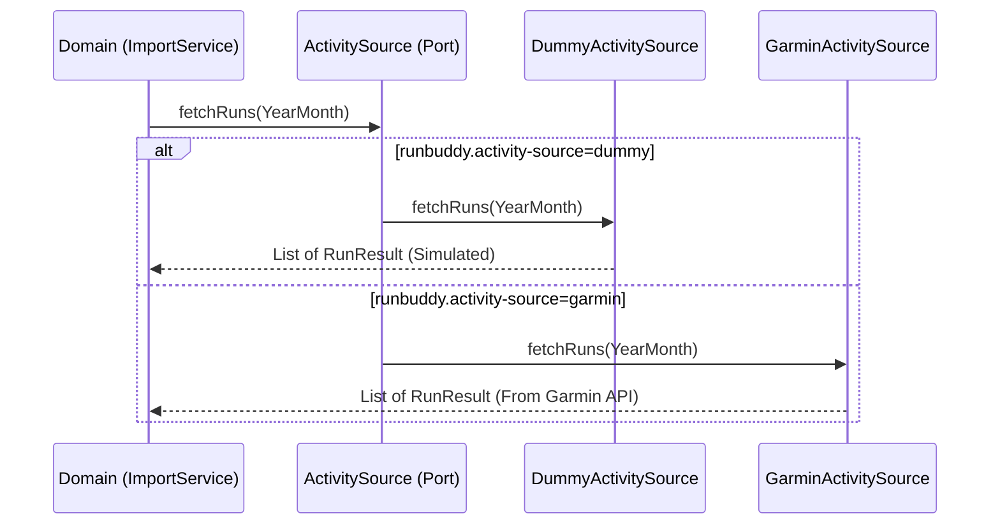
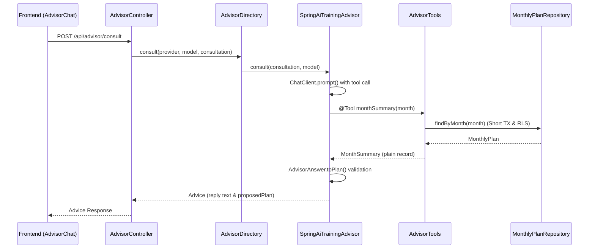
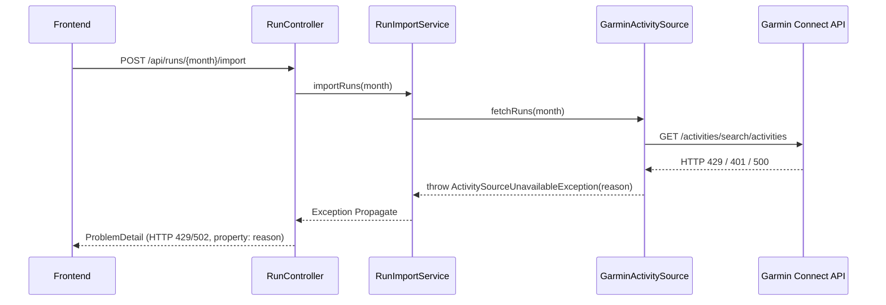

# アーキテクチャパターンと設計の工夫

本ページでは、`run-buddy` が採用している主要な設計パターン、外部サービス連携メカニズム、テスト戦略、およびフロントエンド/バックエンド間の協調構造を解説します。システム全体の構造については [アーキテクチャ概要](overview.md)、データベースの権限およびトランザクション制御については [永続化と RLS](persistence-rls.md) を併せて参照してください。

---

## 1. Ports & Adapters (ヘキサゴナルアーキテクチャ)

### 設計の目的と課題
Garmin API や LLM、永続化ストレージ（PostgreSQL / jOOQ）などの外部サービスにドメインロジックが直接依存すると、外部 API の仕様変更や認証未準備（API キー未発行など）、ネットワーク障害によって開発やテストが停止するリスクが生じます。

### 実装方針
ドメイン層に外部サービスとの結合境界となるインターフェース（**Port**）を配置し、具象接続実装（**Adapter**）を外部パッケージに分離しています。起動時の設定プロパティ（`runbuddy.activity-source`、`runbuddy.persistence` など）や Spring プロファイルによって、インメモリ/ダミー実装と本物のアダプタを透過的に切り替え可能です。

ポートによる外部サービス抽象化と設定によるアダプタ切替の制御フロー

### 主要コンポーネントとコード配置
- **Port 定義**:
  - `backend/src/main/java/com/example/runbuddy/activity/ActivitySource.java`
  - `backend/src/main/java/com/example/runbuddy/plan/MonthlyPlanRepository.java`
  - `backend/src/main/java/com/example/runbuddy/advisor/TrainingAdvisor.java`
- **Adapter 実装**:
  - `backend/src/main/java/com/example/runbuddy/activity/garmin/GarminActivitySource.java`
  - `backend/src/main/java/com/example/runbuddy/plan/InMemoryMonthlyPlanRepository.java`
  - `backend/src/main/java/com/example/runbuddy/persistence/jooq/JooqMonthlyPlanRepository.java`
  - `backend/src/main/java/com/example/runbuddy/advisor/fake/FakeTrainingAdvisor.java`
  - `backend/src/main/java/com/example/runbuddy/advisor/springai/SpringAiTrainingAdvisor.java`
- **切り替え設定と設計ドキュメント**:
  - `backend/src/main/resources/application.properties` (`runbuddy.activity-source`, `runbuddy.persistence`)
  - `docs/adr/0004-ports-and-adapters-for-external-services.md`

### 関連テスト
- `backend/src/test/java/com/example/runbuddy/plan/InMemoryMonthlyPlanRepositoryTest.java`
- `backend/src/test/java/com/example/runbuddy/advisor/fake/FakeTrainingAdvisorTest.java`
- `backend/src/test/java/com/example/runbuddy/activity/garmin/GarminActivitySourceTest.java`

---

## 2. 契約テスト (Contract Testing) による実装検証

### 設計の目的と課題
インメモリ実装（開発・ユニットテスト用）と jOOQ / PostgreSQL 永続化実装（本番・統合テスト用）など、複数存在するアダプタ間で個別にテストを記述すると、検証内容の乖離や行レベルセキュリティ (RLS)、トランザクション境界におけるセキュリティ検証漏れが発生します。

### 実装方針
JUnit 5 の `default` テストメソッドを備えたテスト用インターフェース（`MonthlyPlanRepositoryContract`、`RowLevelSecurityContract`）を定義し、各アダプタのテストクラス（`InMemoryMonthlyPlanRepositoryTest` および `JooqMonthlyPlanRepositoryTest`）が同一の契約テストを共有実装しています。

また、`DatabaseSafetyTest` を配置し、トランザクション外（`app.user_id` が未設定の状態）での DB アクセスが即座に例外を発生させることを検証し、データ漏洩を防止しています。

### 主要コンポーネントとコード配置
- **契約インターフェース**:
  - `backend/src/test/java/com/example/runbuddy/plan/MonthlyPlanRepositoryContract.java`
  - `backend/src/test/java/com/example/runbuddy/persistence/RowLevelSecurityContract.java`
- **安全検証テスト**:
  - `backend/src/test/java/com/example/runbuddy/persistence/DatabaseSafetyTest.java`

### 関連テスト
- `backend/src/test/java/com/example/runbuddy/plan/InMemoryMonthlyPlanRepositoryTest.java` (契約を実装)
- `backend/src/test/java/com/example/runbuddy/persistence/jooq/JooqMonthlyPlanRepositoryTest.java` (契約を実装)
- `backend/src/test/java/com/example/runbuddy/persistence/DatabaseSafetyTest.java`

---

## 3. 不変ドメインモデル (Immutable Domain Model) と自己検証

### 設計の目的と課題
ドメインモデルに不整合なデータ（負の走行距離、月外のトレーニング日付、NaN や Double.INFINITY、矛盾した心拍数・ピッチ）が混入すると、集計計算や AI 相談、スプレッドシート出力時にサイレントエラーや例外が発生します。

### 実装方針
Java `record` やコンパクトコンストラクタを活用し、オブジェクト生成時に不変条件を自律的にバリデーションしています。

- **`MonthlyPlan`**: 含まれる全ワークアウトが計画対象の `YearMonth` 内にあることを検証し、日付順に自動ソートします。
- **`Distance`**: 浮動小数点の丸め誤差を排除するため内部を `long` 型のメートル数で保持し、負の数や非有限値（NaN / INFINITY）の混入を遮断します。
- **`DailyLog`**: 計画と実績ランを同一日付で集計する際、ランの日付が対象月外であれば即座に拒否します。
- **`RunMetrics`**: ピッチ・心拍数・ストライド・獲得標高の正数判定を行い、最高ピッチが平均ピッチを下回る矛盾を検証します。

### 主要コンポーネントとコード配置
- **不変ドメインモデル**:
  - `backend/src/main/java/com/example/runbuddy/plan/MonthlyPlan.java`
  - `backend/src/main/java/com/example/runbuddy/shared/Distance.java`
  - `backend/src/main/java/com/example/runbuddy/export/DailyLog.java`
  - `backend/src/main/java/com/example/runbuddy/activity/RunMetrics.java`

### 関連テスト
- `backend/src/test/java/com/example/runbuddy/plan/MonthlyPlanTest.java`
- `backend/src/test/java/com/example/runbuddy/shared/DistanceTest.java`
- `backend/src/test/java/com/example/runbuddy/export/DailyLogTest.java`
- `backend/src/test/java/com/example/runbuddy/activity/RunMetricsTest.java`

---

## 4. Spring AI 統合と AI 相談メカニズム

### 設計の目的と課題
LLM とのやり取りでは、長時間の外部 API 呼び出し中に DB トランザクションを維持すると接続プールが枯渇する問題や、不信頼な AI 出力がドメインモデルの不変条件を破壊するリスクがあります。また、利用者がプロバイダ（Gemini / OpenAI 等）やモデルを動的に選択できる構成が求められます。

### 実装方針
1. **Spring AI のパッケージ閉塞**: `ChatClient` やプロバイダ固有の依存関係は `advisor/springai` パッケージに集約し、ドメイン層の `TrainingAdvisor` ポートへは Spring AI の型を露出させません。
2. **短トランザクションと RLS**: `AdvisorTools` の `@Tool` メソッド（`monthSummary` 等）が呼び出されるたびにリポジトリを短トランザクションで個別に実行し、RLS（行レベルセキュリティ）を適用します。長時間の LLM 通信中に DB トランザクションを開き続けることはありません。
3. **構造化出力と不信頼入力検証**: LLM からの応答 JSON は `AdvisorAnswer` として受け取り、`AdvisorAnswer.toPlan(YearMonth)` でドメインモデル `MonthlyPlan` に変換します。日付不一致や未知のワークアウト種別などの不変条件違反があれば即座に例外化して不採用とし、安全性を維持します。
4. **プロバイダ動的ルーティング**: `AdvisorDirectory` が利用可能なプロバイダとモデルを保持し、リクエストに応じて適切な `TrainingAdvisor` に処理を振り分けます。

AI 相談におけるプロバイダ動的ルーティング、短トランザクションでのツール呼び出し、不変ドメインモデル検証の流れ

### 主要コンポーネントとコード配置
- **AI 統合コンポーネント**:
  - `backend/src/main/java/com/example/runbuddy/advisor/springai/SpringAiTrainingAdvisor.java`
  - `backend/src/main/java/com/example/runbuddy/advisor/AdvisorTools.java`
  - `backend/src/main/java/com/example/runbuddy/advisor/springai/AdvisorAnswer.java`
  - `backend/src/main/java/com/example/runbuddy/advisor/AdvisorDirectory.java`
  - `docs/adr/0008-ai-integration.md`

### 関連テスト
- `backend/src/test/java/com/example/runbuddy/advisor/springai/SpringAiTrainingAdvisorTest.java`
- `backend/src/test/java/com/example/runbuddy/advisor/AdvisorToolsTest.java`
- `backend/src/test/java/com/example/runbuddy/advisor/AdvisorDirectoryTest.java`

---

## 5. Garmin API 連携と例外・ProblemDetail ハンドリング

### 設計の目的と課題
Garmin Connect Personal API の認証仕様（API キーによる JWT トークン交換）、現地時刻ベースの検索、ページング処理、ならびにレート制限や認証エラーをそのまま UI に露出すると、密結合とバグの原因になります。

### 実装方針
Garmin 特有の通信処理・トークンキャッシュ・ページングロジックはすべて `activity/garmin` パッケージ内に閉塞しています。

外部 API との通信でエラーが発生した場合、`GarminActivitySource` は外部の例外（HTTP 401/403, 429, 500, 通信タイムアウト等）をキャッチし、適切なドメイン例外 `ActivitySourceUnavailableException`（`Reason`: `CREDENTIALS_REJECTED`, `RATE_LIMITED`, `UNAVAILABLE`）に変換してハンドリングします。

`RunController` の `@ExceptionHandler` がこの例外を捕捉し、RFC 9457 に準拠した `ProblemDetail` へ整形します。レスポンスには `reason` プロパティ（例: `"RATE_LIMITED"`）が付与され、HTTP 429 (TOO_MANY_REQUESTS) または HTTP 502 (BAD_GATEWAY) としてフロントエンドへ通知されます。

Garmin API 連携における外部通信例外のドメイン例外・ProblemDetail (reason) への変換フロー

### 主要コンポーネントとコード配置
- **Garmin アダプタ & 例外ハンドラ**:
  - `backend/src/main/java/com/example/runbuddy/activity/garmin/GarminActivitySource.java`
  - `backend/src/main/java/com/example/runbuddy/activity/ActivitySourceUnavailableException.java`
  - `backend/src/main/java/com/example/runbuddy/activity/RunController.java`
  - `docs/adr/0009-garmin-personal-api.md`

### 関連テスト
- `backend/src/test/java/com/example/runbuddy/activity/garmin/GarminActivitySourceTest.java`

---

## 6. OpenAPI 型共有とフロントエンドコンポーネント設計

### 設計の目的と課題
バックエンドの API レスポンスやリクエストボディの型を変更した際、フロントエンドの TypeScript 型定義との不一致が発生し、実行時エラーになる課題があります。また、画面間での状態混入や、UI テスト実行時にネットワークモックが必要になる構造的課題を解決する必要があります。

### 実装方針
1. **OpenAPI 型自動生成**: バックエンドの `springdoc-openapi` が出力する OpenAPI 仕様書（`/v3/api-docs`）に対し、`npm run gen:api`（`openapi-typescript`）を実行して `src/api/schema.gen.ts` を自動生成します。`src/api/client.ts` はこの生成型をインポートし、API クライアントの型安全性を保証します。コントローラ側では `RunController` のように `@Schema` 注釈を付与して null 許容性等を厳格に定義します。
2. **コンポーネント/コンテナ分離（ネットワーク独立テスト）**: `PlanEditor.tsx` などの UI コンポーネントは状態管理やネットワーク通信を抱え込まず、Pure な props 受取専用として設計しています。これにより、Vitest / Testing Library を用いた単体テスト（`PlanEditor.test.tsx`）をネットワークモック（MSW 等）なしで高速・独立に実行できます。
3. **ルーティングと状態分離**: TanStack Router のルート（`plans.$month.tsx`）で loader および TanStack Query (`useQuery`) を組み合わせ、`remountDeps: ({ params }) => params.month` を指定することで、月切替時にコンポーネントを再構築し、編集中の下書き状態が別月に混入するのを防止します。
4. **デザイントークン**: `DESIGN.md` で定義されたデザイン（温かいクリーム地、セリフ体、コーラル色など）を `src/styles/tokens.css` の CSS 変数に展開し、スタイルの不整合を防ぎます。

### 主要コンポーネントとコード配置
- **型共有設定 & クライアント**:
  - `frontend/package.json` (`gen:api` スクリプト)
  - `backend/src/main/java/com/example/runbuddy/activity/RunController.java` (`@Schema` 注釈)
  - `frontend/src/api/schema.gen.ts` (自動生成ファイル)
  - `frontend/src/api/client.ts`
- **コンポーネント & ルーティング**:
  - `frontend/src/routes/plans.$month.tsx`
  - `frontend/src/components/PlanEditor.tsx`
  - `frontend/DESIGN.md`
  - `docs/adr/0006-design-system.md`

### 関連テスト
- `frontend/src/components/PlanEditor.test.tsx` (props 受取コンポーネントのネットワーク独立テスト)

---

## 7. 設定と秘密情報管理 (Configuration & Environment Variables)

### 設計の目的と課題
Docker Compose、Spring Boot、ローカル開発環境で異なる環境変数設定ファイルを個別に管理すると、設定の不整合や API キー等の秘密情報の漏洩リスクが高まります。

### 実装方針
リポジトリルートの `.env` ファイル（`.env.example` からコピー作成）を唯一の構成源として一元管理します。
- Docker Compose は `.env` を自動読み込みします。
- Spring Boot 側も `spring.config.import=optional:file:.env[.properties],optional:file:../.env[.properties]` により直接参照します。
- 設定の優先順位は「OS 環境変数 > `.env` > デフォルト値」の階層構造を厳密に遵守します。

### 主要コンポーネントとコード配置
- **環境設定**:
  - `/.env.example`
  - `backend/src/main/resources/application.properties`
  - `/compose.yaml`

### 関連テスト
- `backend/src/test/java/com/example/runbuddy/activity/ActivitySourceStartupLogTest.java`

---

## 関連ドキュメント
- [アーキテクチャ概要](overview.md)
- [永続化と RLS](persistence-rls.md)
- [新機能追加チュートリアル](../tutorials/add-feature.md)
