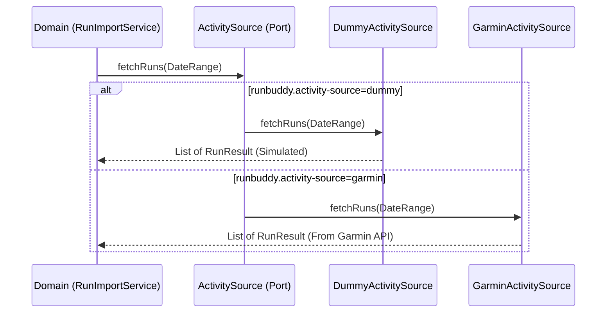
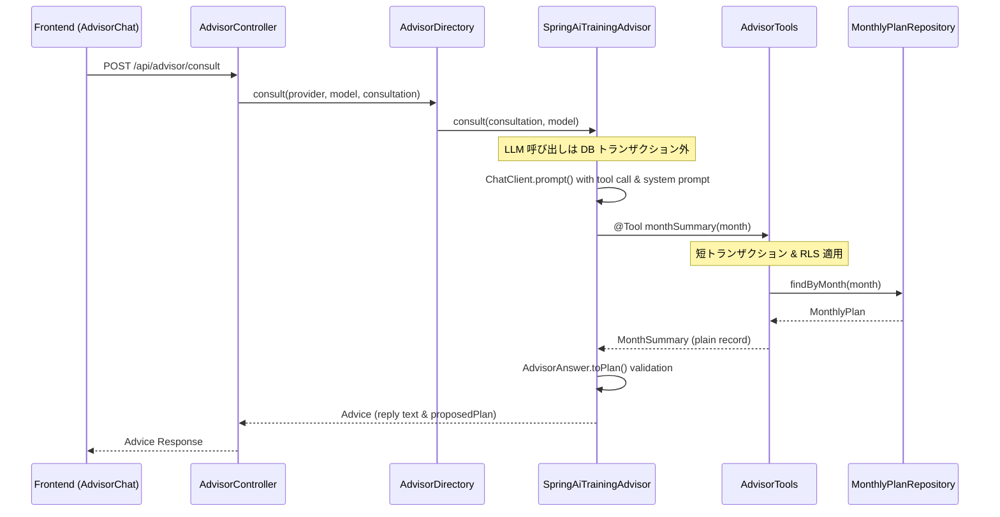
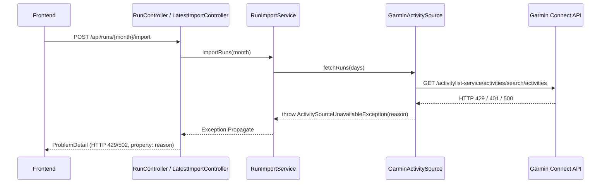
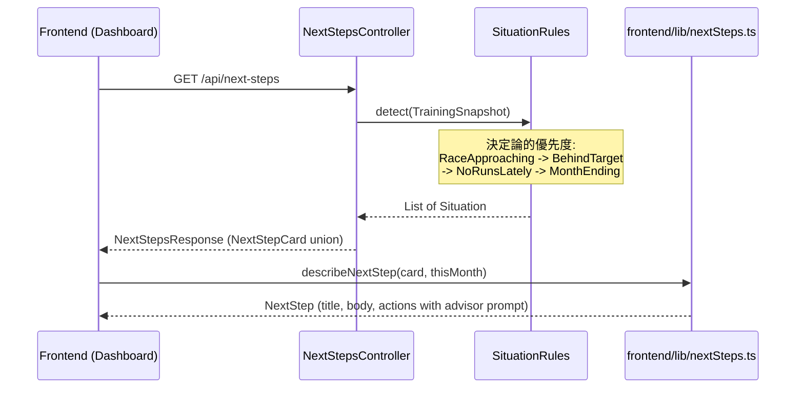

# アーキテクチャ上の工夫と設計パターン

本ページでは、`run-buddy` が採用している主要な設計パターン、外部サービス連携メカニズム、データ可視化と判定ロジック、テスト戦略、およびフロントエンド/バックエンド間の協調構造を解説します。システム全体の構成については [アーキテクチャ概要](overview.md)、データベースの権限設計については [永続化と RLS](persistence-rls.md) を併せて参照してください。

---

## 1. Ports & Adapters (オニオン/ヘキサゴナルアーキテクチャ)

### 問題
Garmin API や LLM、永続化ストレージなどの外部サービスにドメインロジックが直接依存すると、外部 API の仕様変更や認証未準備（API キー未発行など）、ネットワーク遅延・障害によって開発やテストがストップする課題があります。

### 工夫
ドメイン層に外部サービスとの結合境界となるインターフェース（**Port**）を配置し、具体の接続実装（**Adapter**）を外部パッケージに分離しました（[ADR-0004: Ports & Adapters](../../docs/adr/0004-ports-and-adapters-for-external-services.md)）。起動時の設定プロパティ（`runbuddy.activity-source`、`runbuddy.persistence` など）や Spring プロファイルによって、インメモリ/ダミー実装と本物のアダプタを柔軟に切り替え可能です。

図 1: 設定プロパティによる ActivitySource 実装の切り替えフロー

### コードの場所
- **Port 定義**:
  - `backend/src/main/java/com/example/runbuddy/activity/ActivitySource.java`
  - `backend/src/main/java/com/example/runbuddy/activity/ActivityFileSource.java`
  - `backend/src/main/java/com/example/runbuddy/plan/MonthlyPlanRepository.java`
  - `backend/src/main/java/com/example/runbuddy/race/RaceRepository.java`
  - `backend/src/main/java/com/example/runbuddy/advisor/TrainingAdvisor.java`
- **Adapter 実装**:
  - `backend/src/main/java/com/example/runbuddy/activity/garmin/GarminActivitySource.java`
  - `backend/src/main/java/com/example/runbuddy/plan/InMemoryMonthlyPlanRepository.java`
  - `backend/src/main/java/com/example/runbuddy/persistence/jooq/JooqMonthlyPlanRepository.java`
  - `backend/src/main/java/com/example/runbuddy/advisor/fake/FakeTrainingAdvisor.java`
  - `backend/src/main/java/com/example/runbuddy/advisor/springai/SpringAiTrainingAdvisor.java`
- **設定による切り替え構造**:
  - `backend/src/main/resources/application.properties`
  - `docs/adr/0004-ports-and-adapters-for-external-services.md`

### 守っているテスト
- `backend/src/test/java/com/example/runbuddy/plan/InMemoryMonthlyPlanRepositoryTest.java`
- `backend/src/test/java/com/example/runbuddy/advisor/fake/FakeTrainingAdvisorTest.java`
- `backend/src/test/java/com/example/runbuddy/activity/garmin/GarminActivitySourceTest.java`

---

## 2. 契約テスト (Contract Testing) による多重アダプタ・境界検証

### 問題
インメモリリポジトリと jOOQ 永続化リポジトリなど、複数存在するアダプタ実装間でテストロジックを個別に記述すると、検証内容に差異が生じたり、行レベルセキュリティ (RLS) やトランザクション境界におけるデータ隔離の検証が漏れたりするリスクがあります。

### 工夫
テスト用インターフェース（例: `MonthlyPlanRepositoryContract`、`RaceRepositoryContract`、`RowLevelSecurityContract`）に JUnit 5 の `default` テストメソッドとして共通の振る舞い検証を 1 回だけ定義し、各アダプタのテストクラス（インメモリ版および jOOQ 版）がこれを実装する構成にしました。また `DatabaseSafetyTest` を配置し、トランザクション外での DB アクセスが即座に例外となることを検証しています。

### コードの場所
- **契約インターフェース**:
  - `backend/src/test/java/com/example/runbuddy/plan/MonthlyPlanRepositoryContract.java`
  - `backend/src/test/java/com/example/runbuddy/race/RaceRepositoryContract.java`
  - `backend/src/test/java/com/example/runbuddy/persistence/RowLevelSecurityContract.java`
- **安全検証テスト**:
  - `backend/src/test/java/com/example/runbuddy/persistence/DatabaseTest.java`
  - `backend/src/test/java/com/example/runbuddy/persistence/DatabaseSafetyTest.java`

### 守っているテスト
- `backend/src/test/java/com/example/runbuddy/plan/InMemoryMonthlyPlanRepositoryTest.java` (契約を実装)
- `backend/src/test/java/com/example/runbuddy/persistence/jooq/JooqMonthlyPlanRepositoryTest.java` (契約を実装)
- `backend/src/test/java/com/example/runbuddy/race/InMemoryRaceRepositoryTest.java` (契約を実装)
- `backend/src/test/java/com/example/runbuddy/persistence/jooq/JooqPersistenceTest.java` (契約を実装)
- `backend/src/test/java/com/example/runbuddy/persistence/DatabaseSafetyTest.java`

---

## 3. 不変ドメインモデル (Immutable Domain Model) と自己検証・改訂機構

### 問題
ドメインオブジェクトに不整合なデータ（負の走行距離、月外のトレーニング日付、NaN や Double.INFINITY）が混入すると、ダッシュボードの集計計算や AI 相談、スプレッドシート出力時に不具合が発生します。また、月途中でプランを改訂する際に過去の完了済み計画まで上書きされてしまう問題があります。

### 工夫
Java `record` や `final` クラスのコンパクトコンストラクタを活用し、オブジェクト生成時に不変条件を自律的にバリデーションしています。例えば `Distance` は浮動小数点の丸め誤差を排除するため内部を `long` 型のミリメートル数で保持し、`MonthlyPlan` や `DailyLog` は含まれるワークアウトやランが指定月内であることを強制します。
さらに `MonthlyPlan.revisedFrom(today, proposal)` は、指定日（`today`）より過去の計画ワークアウトをそのまま保持しつつ、当日以降の提案ワークアウトのみを結合・改訂するロジックを備えており、過去の履歴を保護します。

### コードの場所
- **不変ドメインモデル & 改訂機構**:
  - `backend/src/main/java/com/example/runbuddy/plan/MonthlyPlan.java` (`revisedFrom` メソッド含む)
  - `backend/src/main/java/com/example/runbuddy/shared/Distance.java`
  - `backend/src/main/java/com/example/runbuddy/export/DailyLog.java`
  - `backend/src/main/java/com/example/runbuddy/race/Race.java`

### 守っているテスト
- `backend/src/test/java/com/example/runbuddy/plan/MonthlyPlanTest.java`
- `backend/src/test/java/com/example/runbuddy/shared/DistanceTest.java`
- `backend/src/test/java/com/example/runbuddy/export/DailyLogTest.java`
- `backend/src/test/java/com/example/runbuddy/race/RaceTest.java`

---

## 4. Spring AI 統合と AI 相談メカニズム

### 問題
LLM とのやり取りでは、長時間に及ぶ API 呼び出し中に DB トランザクションを維持すると接続プールが枯渇する問題や、非信頼なテキスト出力がドメインモデルの不変条件を破るリスクがあります。また、レース前のテーパリング指導や、利用者がプロバイダ（Gemini / Claude / OpenAI / Bedrock）やモデルを動的に選択できる仕組みが必要です（[ADR-0008: AI 統合](../../docs/adr/0008-ai-integration.md)）。

### 工夫
1. **Spring AI 閉塞**: `ChatClient` やプロバイダ特有の型は `advisor/springai` パッケージ内に隠蔽し、ドメイン層の `TrainingAdvisor` ポートには Spring AI の型を出さない。
2. **トランザクション外のモデル呼び出しと短トランザクションツール実行**: LLM への呼び出し（`ChatClient.prompt()`）は DB トランザクションの外で実行する。LLM がデータ参照のために `AdvisorTools` の `@Tool` メソッド（例: `monthSummary`）を呼び出した際、ツールメソッド内でリポジトリを個別の短トランザクションで呼び出し、RLS (行レベルセキュリティ) を安全に適用する。
3. **テーパリングプロンプト & 目標レース計算**: システムプロンプト内でレース直前 2〜3 週間のテーパリング（走行距離の減量・レースペース調整）ルールやカレンダー情報を自動注入し、目標レースの距離・目標ペースに合わせたプラン生成を指導する。
4. **非信頼出力のドメイン検証 & 1 回の自動再試行**: LLM から返却された JSON レスポンスは `AdvisorAnswer.toPlan(YearMonth)` でドメインモデル `MonthlyPlan` に変換し、不変条件違反があれば不採用として一度だけ修正プロンプトで自動再試行し、それでも失敗した場合は文章のみの応答にフォールバックする。
5. **動的ルーティング**: `AdvisorDirectory` が利用可能なプロバイダとモデルを保持し、リクエストに応じて適切な `TrainingAdvisor` 実装に処理を振り分ける。

図 2: LLM 呼び出し（非トランザクション）と Tool 実行（短トランザクション + RLS）の協調フロー

### コードの場所
- **AI 統合コンポーネント**:
  - `backend/src/main/java/com/example/runbuddy/advisor/springai/SpringAiTrainingAdvisor.java`
  - `backend/src/main/java/com/example/runbuddy/advisor/AdvisorTools.java`
  - `backend/src/main/java/com/example/runbuddy/advisor/springai/AdvisorAnswer.java`
  - `backend/src/main/java/com/example/runbuddy/advisor/AdvisorDirectory.java`
  - `docs/adr/0008-ai-integration.md`

### 守っているテスト
- `backend/src/test/java/com/example/runbuddy/advisor/springai/SpringAiTrainingAdvisorTest.java`
- `backend/src/test/java/com/example/runbuddy/advisor/AdvisorToolsTest.java`
- `backend/src/test/java/com/example/runbuddy/advisor/AdvisorToolsDatabaseTest.java`
- `backend/src/test/java/com/example/runbuddy/advisor/AdvisorDirectoryTest.java`

---

## 5. Garmin API 連携と ProblemDetail エラー変換

### 問題
Garmin Connect Personal API の特殊な認証仕様（`text/plain` 応答の JWT トークン交換、24 時間有効期間）、現地時刻扱い、ページング、およびレート制限や認証エラーをそのまま UI に露出すると、密結合とバグの原因になります（[ADR-0009: Garmin 連携](../../docs/adr/0009-garmin-personal-api.md)）。

### 工夫
Garmin の知識を `activity/garmin` パッケージ（`GarminActivitySource`）内に隠蔽。トークン有効期限の 23 時間キャッシュや `401` 再試行、現地時刻ベースでのアクティビティ取得・変換を行います。エラー発生時はドメイン例外 `ActivitySourceUnavailableException`（`Reason`: `CREDENTIALS_REJECTED`, `RATE_LIMITED`, `UNAVAILABLE`）へ変換し、`ActivitySourceExceptionHandler`（`@RestControllerAdvice`）で RFC 9457 `ProblemDetail`（`reason` プロパティ付き）に整形してフロントエンドへ通知します。

図 3: Garmin Connect API エラー発生時の例外変換と ProblemDetail 返却フロー

### コードの場所
- **Garmin アダプタ & 例外ハンドラ**:
  - `backend/src/main/java/com/example/runbuddy/activity/garmin/GarminActivitySource.java`
  - `backend/src/main/java/com/example/runbuddy/activity/ActivitySourceUnavailableException.java`
  - `backend/src/main/java/com/example/runbuddy/activity/ActivitySourceExceptionHandler.java`
  - `docs/adr/0009-garmin-personal-api.md`

### 守っているテスト
- `backend/src/test/java/com/example/runbuddy/activity/garmin/GarminActivitySourceTest.java`
- `backend/src/test/java/com/example/runbuddy/activity/RunControllerTest.java`

---

## 6. FIT ファイル解析とオンデマンド処理 (run_fit_file / SyntheticFit)

### 問題
アクティビティ一覧の取り込み時に個別の FIT ファイル（ラップ詳細および GPS 軌跡）まで一括ダウンロードすると、 Garimn API への大量アクセスによるレート制限や取り込み遅延が発生します（[ADR-0012: FIT ファイル解析](../../docs/adr/0012-fit-files-for-laps-and-tracks.md)）。

### 工夫
1. **遅延読み込みと原本 DB 保存**: ラン一覧取り込み時には FIT ファイルを取得せず、日別詳細画面で該当ランを開いた際に初めて `ActivityFileSource` 経由で取得し、`run_fit_file` テーブルに zip 原本（`bytea`）として保存します。
2. **オンデマンド解析**: 2 回目以降の参照時は DB から zip 原本を読み出し、`FitRunDetailReader`（Garmin FIT SDK 封じ込めコンポーネント）でオンデマンド解析を行って `RunDetail`（ラップ一覧および軌跡）を構築します。
3. **テスト用合成データ**: テストコードではプライバシー保護のため実在の位置情報を含まない合成 FIT データを `SyntheticFit` クラスで動的にエンコード生成して使用します。

### コードの場所
- **FIT 解析 & 保存構造**:
  - `backend/src/main/java/com/example/runbuddy/activity/fit/FitRunDetailReader.java`
  - `backend/src/main/java/com/example/runbuddy/activity/RunDetail.java`
  - `backend/src/main/java/com/example/runbuddy/activity/RunDetailService.java`
  - `backend/src/test/java/com/example/runbuddy/activity/fit/SyntheticFit.java`
  - `docs/adr/0012-fit-files-for-laps-and-tracks.md`

### 守っているテスト
- `backend/src/test/java/com/example/runbuddy/activity/fit/FitRunDetailReaderTest.java`
- `backend/src/test/java/com/example/runbuddy/activity/RunDetailServiceTest.java`
- `backend/src/test/java/com/example/runbuddy/activity/RunDetailControllerTest.java`

---

## 7. Leaflet 地図表示とラップ強調 (間引き・区間強調)

### 問題
1 ランあたり約 1,800 点に及ぶ GPS 軌跡データをそのままフロントエンドで描画するとパフォーマンス低下を引き起こします。また、短距離のラップ区間を地図上で視認しやすく強調表示する制御が必要です（[ADR-0013: Leaflet 地図表示](../../docs/adr/0013-route-map-with-leaflet-and-osm.md)）。

### 工夫
1. **軌跡の均等間引き (約 300 点)**: ドメインモデル `RunDetail.route(maxPoints)` で、スタート・ゴールおよび各ラップの開始点を必ず維持しつつ軌跡を約 300 点に均等間引きして API レスポンス（`RoutePoint`）を生成します。
2. **Leaflet + OSM ラスタータイル**: `RunRoute.tsx` で Leaflet を用い OpenStreetMap ラスタータイル上にコースポリラインを描画します（位置情報を持たないトレッドミル等のランではタイルリクエスト自体を行いません）。
3. **ラップ強調表示 (`route-highlight`)**: ラップ表で特定ラップを選択した際、`highlightLap` に基づき `lapSegment` を計算し、地図全体の表示範囲を無駄に変更することなくポリラインを重畳して該当区間を太線で強調します。

### コードの場所
- **地図描画 & 軌跡計算**:
  - `backend/src/main/java/com/example/runbuddy/activity/RunDetail.java` (`route` メソッド)
  - `backend/src/main/java/com/example/runbuddy/activity/RunDetailController.java` (`MAX_ROUTE_POINTS` 定数)
  - `frontend/src/components/RunRoute.tsx`
  - `frontend/src/lib/route.ts`
  - `docs/adr/0013-route-map-with-leaflet-and-osm.md`

### 守っているテスト
- `backend/src/test/java/com/example/runbuddy/activity/RunDetailTest.java`
- `frontend/src/components/RunRoute.test.tsx`
- `frontend/src/lib/route.test.ts`

---

## 8. ダッシュボード「いまやること」の確定判定と AI 見せ方分離 (SituationRules / ユニオン型 API)

### 問題
ダッシュボードで runner が今優先して行うべき行動（目標の遅れ取り戻し、次月計画の作成、レース前調整など）を判定する際、画面生成全体を AI に委ねると、間違った数値の表示や表示崩れのリスクがあります（[ADR-0014: ダッシュボード「いまやること」](../../docs/adr/0014-next-steps-situations-in-code-presentation-by-ai.md)）。

### 工夫
1. **コードによる確定判定 (`SituationRules`)**: 判定ロジックをドメインコード `SituationRules.detect()` に集約し、優先度順（`RaceApproaching` → `BehindTarget` → `NoRunsLately` → `MonthEnding`）で決定論的に状況を判定します。「今日」の日付を引数で受け取るため、時計依存なしで境界値テストが可能です。
2. **判別可能なユニオン型 API (`NextStepCard`)**: `GET /api/next-steps` はカードの種類（`kind`）と必要な数値データのみを返却し、OpenAPI `oneOf`（Java Sealed Interface）として定義されます。
3. **フロントエンドによる文言・アクション生成 (`nextSteps.ts`)**: フロントエンド `describeNextStep()` が `kind` に応じた表示文言やボタンアクション（AI 相談画面への誘導 `ask` パラメータ設定やプラン画面遷移）を付与します。

図 4: ダッシュボードカード決定論的判定と UI 文言展開フロー

### コードの場所
- **状況判定 & API コントローラ**:
  - `backend/src/main/java/com/example/runbuddy/dashboard/SituationRules.java`
  - `backend/src/main/java/com/example/runbuddy/dashboard/NextStepsController.java`
  - `frontend/src/lib/nextSteps.ts`
  - `docs/adr/0014-next-steps-situations-in-code-presentation-by-ai.md`

### 守っているテスト
- `backend/src/test/java/com/example/runbuddy/dashboard/SituationRulesTest.java`
- `backend/src/test/java/com/example/runbuddy/dashboard/NextStepsControllerTest.java`
- `frontend/src/lib/nextSteps.test.ts`

---

## 9. OpenAPI 型自動共有 (OpenAPI Type Sharing)

### 問題
バックエンドの API レスポンスやリクエストボディの型を変更した際、フロントエンドの TypeScript 型定義との不一致が発生し、実行時エラーになる課題があります。

### 工夫
バックエンドの `springdoc-openapi` が出力する OpenAPI 仕様書（`/v3/api-docs`、Controller の `@Schema` 注釈付き DTO）から、`npm run gen:api`（`openapi-typescript`）を実行して TypeScript 型定義ファイル `src/api/schema.gen.ts` を自動生成しています。フロントエンドは `src/api/client.ts` 内で `components['schemas']` としてこの型を参照し、コンパイル時に API 型不一致を検知します。

### コードの場所
- **型共有設定 & コントローラ**:
  - `frontend/package.json` (`gen:api` スクリプト)
  - `backend/src/main/java/com/example/runbuddy/activity/RunController.java` (`@Schema` 注釈)
  - `frontend/src/api/schema.gen.ts` (生成成果物)
  - `frontend/src/api/client.ts` (生成型の利用)

### 守っているテスト
- `frontend/package.json`（`npm run build` 時の `tsc --noEmit` 型チェック）

---

## 10. フロントエンドコンポーネント設計とデザインシステム

### 問題
画面間でのデータ取得の重複、月切替時の編集状態・下書きの混入、および UI 記述における色や余白の不整合（デザインの散逸）が発生する問題があります（[ADR-0006: デザインシステム](../../docs/adr/0006-design-system.md)）。

### 工夫
1. **ルーティングとデータ取得の分離**: TanStack Router のルート定義（`plans.$month.tsx` や `races.tsx`）で `loader` と TanStack Query (`useQuery`) を組み合わせ、`remountDeps: ({ params }) => params.month` により月切替時にコンポーネントを再構築し、下書き状態の混入を防止。
2. **Props 専用コンポーネント**: `NextRaceCard.tsx` や `PlanEditor.tsx` などの UI コンポーネントは取得ロジックや状態管理を抱え込まず、Pure な props 受取専用として設計し、単体テストを容易化。
3. **デザイントークン**: `DESIGN.md` で定義されたデザインガイドライン（温かいクリーム地、セリフ体、コーラル色など）を `src/styles/tokens.css` の CSS 変数やユーティリティクラスに展開し、コンポーネント内でのカラーコード直接記述を禁止。

### コードの場所
- **フロントエンドコンポーネント & デザイン体系**:
  - `frontend/src/routes/plans.$month.tsx`
  - `frontend/src/routes/races.tsx`
  - `frontend/src/components/NextRaceCard.tsx`
  - `frontend/src/components/PlanEditor.tsx`
  - `frontend/src/styles/tokens.css`
  - `frontend/DESIGN.md`
  - `docs/adr/0006-design-system.md`

### 守っているテスト
- `frontend/src/components/PlanEditor.test.tsx`
- `frontend/src/components/NextRaceCard.test.tsx`

---

## 11. 設定と秘密情報管理 (Configuration & Environment Variables)

### 問題
Docker Compose、Spring Boot、ローカル開発環境で異なる環境変数設定ファイルを個別に管理すると、不整合や API キー等の秘密情報の漏洩が起きやすくなります。

### 工夫
リポジトリルートの `.env` ファイル（`.env.example` からコピー作成）を唯一の構成源として設定。Docker Compose が自動読み込みするとともに、Spring Boot 側も `application.properties` 内の `spring.config.import=optional:file:.env[.properties],optional:file:../.env[.properties]` により直接参照します。また「OS 環境変数 > `.env` > デフォルト値」という優先順位ルールを定めています。

### コードの場所
- **環境設定**:
  - `/.env.example`
  - `backend/src/main/resources/application.properties`
  - `/compose.yaml`

### 守っているテスト
- `backend/src/test/java/com/example/runbuddy/activity/ActivitySourceStartupLogTest.java`

---

## 関連ドキュメント
- [アーキテクチャ概要](overview.md)
- [永続化と RLS](persistence-rls.md)
- [新機能追加チュートリアル](../tutorials/add-feature.md)
