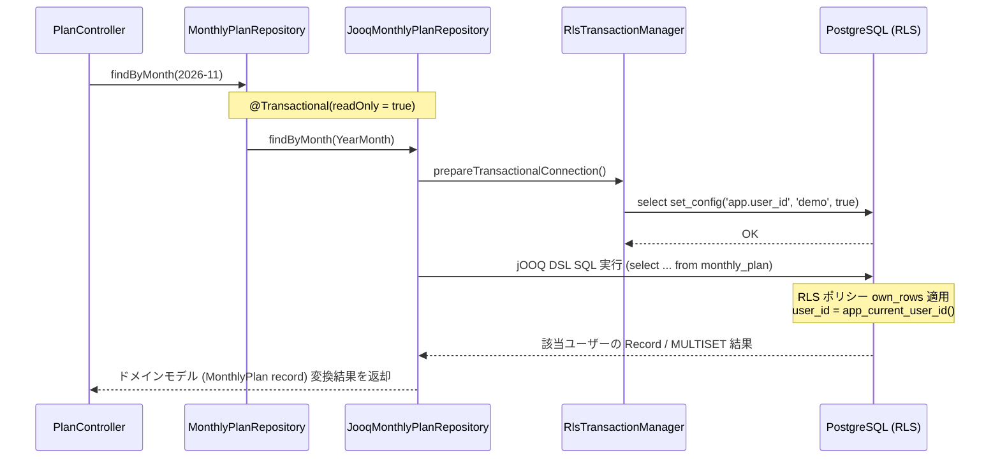

# 永続化: jOOQ と行レベルセキュリティ

本ドキュメントでは、RunBuddy バックエンドにおける永続化層（Persistence Layer）の設計方針、アーキテクチャ構造、および実装詳細について解説します。
RunBuddy では、データベースに PostgreSQL 17 を使用し、アクセスライブラリとして **jOOQ**、マルチテナンシー（ユーザー間の完全なデータ隔離）のために **PostgreSQL Row Level Security (RLS)** を採用しています。

全体アーキテクチャの概要は [アーキテクチャ概要](overview.md)、設計パターンやポート＆アダプタ構造の詳細は [設計パターン](patterns.md)、新機能追加の手順は [機能追加チュートリアル](../tutorials/add-feature.md) を参照してください。

---

## 1. jOOQ 選定理由 (ADR-0007 要約)

永続化ライブラリの選定にあたっては、[ADR-0007: 永続化ライブラリの選定](../../docs/adr/0007-persistence-library.md) に基づき、JPA (Hibernate)、MyBatis、Spring Data JDBC、JdbcClient、Doma、jOOQ の比較検討およびプロトタイプ（スパイク）検証を行いました。

### 選定時の重要要件

1. **イミュータブルなドメインモデルの維持**:
   ドメインモデル（`MonthlyPlan` や `RunResult`）は Java 25 の不変 `record` であり、コンストラクタで不変条件を検証しています。永続化のために無引数コンストラクタや可変フィールドを追加（ミュータブル化）することを完全に回避する必要がありました。
2. **AI エージェント主導開発における安全性の向上**:
   開発コードの多くを AI エージェントが記述・修正するため、SQL の記述ミスや型ミスマッチ、カラム名の誤りを実行時ではなく**コンパイル時**に検知できることが不可欠でした。
3. **PostgreSQL 特有機能の活用**:
   RLS（セッション変数設定）、`INSERT ... ON CONFLICT`（upsert 処理）、`MULTISET` 階層クエリなどの PostgreSQL 固有機能を自然かつ型安全に表現できることが求められました。
4. **ポート＆アダプタ構造との親和性**:
   ドメイン層はリポジトリインターフェース（ポート）のみに依存し、永続化技術の詳細をアダプタ層に閉じ込める設計としています。

### 各ライブラリとの比較と決定理由

| ライブラリ | 不変 `record` との相性 | コンパイル時検査 | SQL の制御性・機能 | AI 開発での誤り検出速度 |
|---|---|---|---|---|
| **JPA (Hibernate)** | ✕（可変エンティティ要求、詰め替えが必要） | △（起動時レベル） | △（N+1 問題や自動更新の隠蔽） | △（実行時・テスト時） |
| **MyBatis** | ○（マッピング設定） | ✕（XML/文字列は実行時） | ◎（手書き SQL） | △（テスト実行時） |
| **Spring Data JDBC** | ○（集約コンストラクタ） | △（派生クエリは起動時） | △（upsert や集計は生 SQL） | △（テスト実行時） |
| **jOOQ** | **◎（`record` 変換が容易）** | **◎（コード生成による型・カラム完全検査）** | **◎（upsert, MULTISET などを DSL で表現）** | **◎（コンパイルエラーとして即座に通知）** |
| **JdbcClient** | ○（RowMapper 変換） | ✕（SQL 文字列は実行時） | ◎（生 SQL） | △（テスト実行時） |

スパイク検証の結果、`JdbcClient` は「書くとき」は最も容易であるものの、誤りに「テスト実行時」しか気付けない点が課題となりました。一方 **jOOQ** は、データベーススキーマから生成された型安全な Java DSL を使用するため、カラム名のタイポや型の誤り、スキーマ変更時の修正漏れがすべて**コンパイルエラー**として提示されます。これにより、AI エージェントが自律的に誤りを修正しやすく、非常に高い安全性が確保できるため jOOQ の採用を決定しました。

---

## 2. リクエスト毎の RLS トランザクション制御フロー

RunBuddy では、アプリケーションコードの SQL 条件（`WHERE` 句など）に `user_id` を明示的に記述しません。代わりに PostgreSQL の行レベルセキュリティ（RLS）機能と、トランザクションローカルなセッション変数 `app.user_id` を組み合わせてユーザー分離を実現しています。

### トランザクション制御の仕組み (`RlsTransactionManager`)

すべてのデータベーストランザクションの開始時に、[`RlsTransactionManager`](../../backend/src/main/java/com/example/runbuddy/persistence/RlsTransactionManager.java) が PostgreSQL に対して `select set_config('app.user_id', ?, true)` を実行します。

```java
public class RlsTransactionManager extends JdbcTransactionManager {

    private final CurrentUser currentUser;

    public RlsTransactionManager(DataSource dataSource, CurrentUser currentUser) {
        super(dataSource);
        this.currentUser = currentUser;
    }

    @Override
    protected void prepareTransactionalConnection(Connection connection, TransactionDefinition definition)
            throws SQLException {
        super.prepareTransactionalConnection(connection, definition);
        try (PreparedStatement statement = connection.prepareStatement("select set_config('app.user_id', ?, true)")) {
            statement.setString(1, currentUser.id());
            statement.execute();
        }
    }
}
```

- **スコープの安全性**: `set_config` の第 3 引数に `true`（`is_local`）を指定しているため、設定された `app.user_id` の値は**現在のトランザクション内限定**となります。トランザクション終了（コミット/ロールバック）時には自動的にクリアされるため、コネクションプールで別のリクエストにユーザー ID が残存・漏洩するリスクはありません。
- **透明性**: Spring の standard JDBC トランザクションインフラ（`@Transactional`）と統合されているため、jOOQ の DSL クエリは意識することなく RLS の保護下で動作します。

### リクエスト処理シーケンス

以下に、HTTP リクエスト受信からデータベース検索・ドメインオブジェクト返却までの制御フローを示します。


*図 1: リクエストから DB 問い合わせまでの RLS トランザクション制御フローと jOOQ 検索シーケンス*

---

## 3. アプリケーション SQL から `user_id` を排除する仕組み

データベーススキーマ定義（[`V1__create_plans_and_runs.sql`](../../backend/src/main/resources/db/migration/V1__create_plans_and_runs.sql)）において、安全で自動化された RLS の仕組みが構築されています。

### 1. `app_current_user_id()` 関数と Fail-Fast 設計

`app_current_user_id()` は、セッション変数 `app.user_id` から現在のユーザー ID を取得するカスタム PL/pgSQL 関数です。

```sql
create function app_current_user_id() returns text
    language plpgsql stable
as $$
declare
    user_id text := nullif(current_setting('app.user_id', true), '');
begin
    if user_id is null then
        raise exception 'app.user_id is not set; database access must run in a transaction (RlsTransactionManager)';
    end if;
    return user_id;
end
$$;
```

- **Fail-Fast 原則**: トランザクション外で DB アクセスが行われ `app.user_id` が設定されていない場合、単に 0 件を返すのではなく**即座に例外を発生**させます。これにより、トランザクション設定漏れバグが黙って隠蔽されるのを防止します。`nullif` を挟むことで、トランザクション終了後に PostgreSQL がセッション変数を `''` として残す挙動にも対処しています。

### 2. DEFAULT 値と RLS ポリシー

すべてのテーブル（`monthly_plan`, `planned_workout`, `run_result`）は、`user_id` カラムの既定値と `own_rows` ポリシーを共有しています。

```sql
create table monthly_plan (
    user_id       text   not null default app_current_user_id(),
    month         text   not null check (month ~ '^\d{4}-(0[1-9]|1[0-2])$'),
    target_meters bigint not null check (target_meters >= 0),
    primary key (user_id, month)
);

alter table monthly_plan enable row level security;
alter table monthly_plan force row level security;
create policy own_rows on monthly_plan
    using (user_id = (select app_current_user_id()))
    with check (user_id = (select app_current_user_id()));
```

- **自動設定 (`default`)**: `INSERT` 実行時に `user_id` カラムを省略しても、`app_current_user_id()` によって自動的に現在のログインユーザー ID が設定されます。
- **行レベルでの制限 (`using` / `with check`)**: データの参照・更新・削除時、PostgreSQL エンジンが `user_id = (select app_current_user_id())` を自動的に透過適用します。スカラサブクエリ `(select app_current_user_id())` にすることで、クエリ全体の実行につき関数呼び出しを 1 回に最適化しています。`FORCE ROW LEVEL SECURITY` を指定することで、テーブル所有者以外のすべてのアクセスに RLS を強制します。

### 3. DB ロールと所有権の分離

RLS の効果を保証するため、データベースのロール設計を分離しています。

- **`runbuddy` (所有者/マイグレーション用)**: テーブルの作成・変更を行うロール。PostgreSQL の仕様上、所有者やスーパーユーザーは RLS をバイパスするため、Flyway マイグレーション時のみ使用します。
- **`runbuddy_app` (アプリケーション接続用)**: バックエンドアプリケーションおよび統合テスト（Testcontainers）が接続する専用ロール。テーブル所有者ではないため、RLS ポリシーおよび `FORCE ROW LEVEL SECURITY` が強制適用されます。

---

## 4. ポートにおける `default` メソッド禁止原則

RunBuddy の設計規約として、ドメイン層のリポジトリインターフェース（ポート）に **`default` メソッドを定義することを厳禁**としています。

### 背景と障害経緯

開発初期（ADR-0007 スパイク時）、リポジトリポートに `default` メソッド（例: `getOrEmpty`）を実装していました。この `default` メソッドの中でポート自身の別メソッド（`findByMonth` など）を呼び出していたところ、以下のアスペクト指向プログラミング（AOP）の制限に起因する障害が発生しました。

1. クライアントがインターフェースの `default` メソッドを呼び出す。
2. Spring の AOP プロキシ（`@Transactional`）はインターフェースの実装クラスの外側をラップしているため、`default` メソッド内部からの別メソッド呼び出しは**自クラス内呼び出し（self-invocation）** となり、プロキシを通過しない。
3. その結果、`@Transactional` が起動せず、`RlsTransactionManager` による `set_config('app.user_id', ...)` が実行されない。
4. トランザクション外での DB アクセスとなり、`app_current_user_id()` が例外をスロー（またはデータが空になる）する。

この経験から、ポートには具象メソッドや `default` メソッドを持たせず、すべて抽象メソッドとして宣言し、必ず Spring AOP プロキシ経由で `@Transactional` アダプタメソッドが直接実行される設計を厳格に徹底しています。

---

## 5. jOOQ コード生成と CI での差分チェック

jOOQ は PostgreSQL のスキーマ情報に基づいて Java DSL クラス群を生成します。

### コード生成スクリプト ([`backend/scripts/generate-jooq.sh`](../../backend/scripts/generate-jooq.sh))

マイグレーションファイル（`V1__create_plans_and_runs.sql`, `V2__add_run_metrics.sql` など）を変更した際、次のスクリプトを実行して jOOQ クラスを再生成します。

```bash
#!/usr/bin/env bash
# backend/scripts/generate-jooq.sh
set -euo pipefail
cd "$(dirname "$0")/.."

name="runbuddy-jooq-codegen-$$"
docker run -d --rm --name "$name" \
  -e POSTGRES_DB=runbuddy -e POSTGRES_USER=runbuddy -e POSTGRES_PASSWORD=runbuddy \
  -v "$PWD/db/init:/docker-entrypoint-initdb.d:ro" \
  -p 127.0.0.1::5432 postgres:17-alpine >/dev/null
trap 'docker stop "$name" >/dev/null' EXIT

until docker exec "$name" pg_isready -q -h 127.0.0.1 -U runbuddy -d runbuddy; do sleep 1; done
port="$(docker port "$name" 5432/tcp | head -1 | sed 's/.*://')"

rm -rf src/main/java/com/example/runbuddy/persistence/jooq/generated
./mvnw -B -q -Pjooq-codegen generate-sources -Ddb.url="jdbc:postgresql://127.0.0.1:${port}/runbuddy"
echo "jOOQ classes regenerated."
```

1. 使い捨ての Docker コンテナ（PostgreSQL 17）を起動し、初期化 SQL を適用。
2. Flyway で最新マイグレーションを流し、スキーマを完成。
3. Maven プロファイル `jooq-codegen` を起動し、`src/main/java/com/example/runbuddy/persistence/jooq/generated` 配下にソースコードを出力。
4. 生成されたコードは Git リポジトリにコミットします。これにより、通常のビルドやテスト実行時に Docker 環境が不要となります。

### CI での自動検証 (`.github/workflows/ci.yml`)

マイグレーションを変更したにもかかわらず jOOQ コードの再生成を忘れる事故を防ぐため、GitHub Actions CI で以下のチェックが自動実行されます。

```yaml
- name: jOOQ classes match the migrations
  run: |
    ./scripts/generate-jooq.sh
    if [ -n "$(git status --porcelain -- src/main/java/com/example/runbuddy/persistence/jooq/generated)" ]; then
      git status --porcelain -- src/main/java/com/example/runbuddy/persistence/jooq/generated
      echo "::error::Generated jOOQ classes are out of date. Run backend/scripts/generate-jooq.sh and commit the result."
      exit 1
    fi
```

生成コードとマイグレーションに乖離がある場合、CI ビルドは失敗します。手動で `generated` 配下のコードを直接編集することは厳禁とされています。

---

## 6. DSL クエリと Record / ドメインモデルマッピング実装

以下に、実際のアダプタにおける jOOQ DSL の活用パターンと、不変ドメイン `record` へのマッピング実装例を示します。

### 1. `JooqMonthlyPlanRepository` の実装

[`JooqMonthlyPlanRepository`](../../backend/src/main/java/com/example/runbuddy/persistence/jooq/JooqMonthlyPlanRepository.java) では、複合集約（`MonthlyPlan` と子要素 `PlannedWorkout`）の永続化と復元を行っています。

#### 保存 (`save`): Upsert と親子の全件更新

```java
@Override
public void save(MonthlyPlan plan) {
    String month = plan.month().toString();
    long targetMeters = plan.targetDistance().meters();

    // 親テーブルの upsert (ON CONFLICT)
    dsl.insertInto(MONTHLY_PLAN)
            .set(MONTHLY_PLAN.MONTH, month)
            .set(MONTHLY_PLAN.TARGET_METERS, targetMeters)
            .onConflict(MONTHLY_PLAN.USER_ID, MONTHLY_PLAN.MONTH)
            .doUpdate()
            .set(MONTHLY_PLAN.TARGET_METERS, targetMeters)
            .execute();

    // 子テーブル（ワークアウト一覧）の置き換え (一括削除 -> Insert)
    dsl.deleteFrom(PLANNED_WORKOUT).where(PLANNED_WORKOUT.MONTH.eq(month)).execute();
    List<PlannedWorkout> workouts = plan.workouts();
    if (workouts.isEmpty()) {
        return;
    }
    var insert = dsl.insertInto(
            PLANNED_WORKOUT,
            PLANNED_WORKOUT.MONTH,
            PLANNED_WORKOUT.POSITION,
            PLANNED_WORKOUT.WORKOUT_DATE,
            PLANNED_WORKOUT.TYPE,
            PLANNED_WORKOUT.DISTANCE_METERS,
            PLANNED_WORKOUT.NOTE);
    for (int position = 0; position < workouts.size(); position++) {
        PlannedWorkout workout = workouts.get(position);
        insert = insert.values(
                month,
                position,
                workout.date(),
                workout.type().name(),
                workout.distance().meters(),
                workout.note());
    }
    insert.execute();
}
```

#### 検索 (`findByMonth`): `MULTISET` による単一クエリ階層マッピング

N+1 クエリを防止するため、jOOQ の `multiset` 構文を利用して 1 本の SQL で親と子のリストを同時に取得し、ドメインのイミュータブル `record` にマッピングします。

```java
@Override
@Transactional(readOnly = true)
public Optional<MonthlyPlan> findByMonth(YearMonth month) {
    return dsl.select(
                    MONTHLY_PLAN.TARGET_METERS,
                    multiset(select(
                                            PLANNED_WORKOUT.WORKOUT_DATE,
                                            PLANNED_WORKOUT.TYPE,
                                            PLANNED_WORKOUT.DISTANCE_METERS,
                                            PLANNED_WORKOUT.NOTE)
                                    .from(PLANNED_WORKOUT)
                                    .where(PLANNED_WORKOUT.USER_ID.eq(MONTHLY_PLAN.USER_ID))
                                    .and(PLANNED_WORKOUT.MONTH.eq(MONTHLY_PLAN.MONTH))
                                    .orderBy(PLANNED_WORKOUT.POSITION))
                            .convertFrom(rows -> rows.map(row -> new PlannedWorkout(
                                    row.value1(),
                                    WorkoutType.valueOf(row.value2()),
                                    Distance.ofMeters(row.value3()),
                                    row.value4()))))
            .from(MONTHLY_PLAN)
            .where(MONTHLY_PLAN.MONTH.eq(month.toString()))
            .fetchOptional(row -> new MonthlyPlan(month, Distance.ofMeters(row.value1()), row.value2()));
}
```

- **`multiset(...)`**: サブクエリの結果をネストしたコレクションとして取得します。
- **`convertFrom(...)`**: ネストされた Record の各行をドメインオブジェクト `PlannedWorkout`（および値オブジェクト `Distance`）に変換します。
- **`fetchOptional(...)`**: 最終結果をドメインオブジェクト `MonthlyPlan` の `Optional` として構築して返します。

### 2. `JooqRunResultRepository` の実装

[`JooqRunResultRepository`](../../backend/src/main/java/com/example/runbuddy/persistence/jooq/JooqRunResultRepository.java) では、走破実績の一括保存における `excluded` を用いた Upsert パターンを実装しています。

```java
@Override
public int saveAll(Collection<RunResult> runs) {
    Map<String, RunResult> byId = new LinkedHashMap<>();
    runs.forEach(run -> byId.put(run.activityId(), run));
    if (byId.isEmpty()) {
        return 0;
    }

    Set<String> existing = dsl.select(RUN_RESULT.ACTIVITY_ID)
            .from(RUN_RESULT)
            .where(RUN_RESULT.ACTIVITY_ID.in(byId.keySet()))
            .fetchSet(RUN_RESULT.ACTIVITY_ID);

    var insert = dsl.insertInto(
            RUN_RESULT,
            RUN_RESULT.ACTIVITY_ID,
            RUN_RESULT.STARTED_AT,
            RUN_RESULT.DISTANCE_METERS,
            RUN_RESULT.DURATION_MILLIS,
            RUN_RESULT.AVERAGE_HEART_RATE,
            RUN_RESULT.MAX_HEART_RATE,
            RUN_RESULT.AVERAGE_CADENCE,
            RUN_RESULT.MAX_CADENCE,
            RUN_RESULT.AVERAGE_STRIDE_LENGTH_CM,
            RUN_RESULT.ELEVATION_GAIN_METERS);
    for (RunResult run : byId.values()) {
        RunMetrics metrics = run.metrics();
        insert = insert.values(
                run.activityId(),
                run.startedAt(),
                run.distance().meters(),
                run.duration().toMillis(),
                run.averageHeartRate(),
                metrics.maxHeartRate(),
                metrics.averageCadence(),
                metrics.maxCadence(),
                metrics.averageStrideLengthCm(),
                metrics.elevationGainMeters());
    }
    insert.onConflict(RUN_RESULT.USER_ID, RUN_RESULT.ACTIVITY_ID)
            .doUpdate()
            .set(RUN_RESULT.STARTED_AT, excluded(RUN_RESULT.STARTED_AT))
            .set(RUN_RESULT.DISTANCE_METERS, excluded(RUN_RESULT.DISTANCE_METERS))
            .set(RUN_RESULT.DURATION_MILLIS, excluded(RUN_RESULT.DURATION_MILLIS))
            .set(RUN_RESULT.AVERAGE_HEART_RATE, excluded(RUN_RESULT.AVERAGE_HEART_RATE))
            .set(RUN_RESULT.MAX_HEART_RATE, excluded(RUN_RESULT.MAX_HEART_RATE))
            .set(RUN_RESULT.AVERAGE_CADENCE, excluded(RUN_RESULT.AVERAGE_CADENCE))
            .set(RUN_RESULT.MAX_CADENCE, excluded(RUN_RESULT.MAX_CADENCE))
            .set(RUN_RESULT.AVERAGE_STRIDE_LENGTH_CM, excluded(RUN_RESULT.AVERAGE_STRIDE_LENGTH_CM))
            .set(RUN_RESULT.ELEVATION_GAIN_METERS, excluded(RUN_RESULT.ELEVATION_GAIN_METERS))
            .execute();

    return byId.size() - existing.size();
}
```

- **重複排除と「最後勝ち」**: 同一のリクエスト内に同じアクティビティ ID が含まれる場合、`LinkedHashMap` で後勝ちなマップに集約します（同一行を 1 つの ON CONFLICT 文で二度更新しようとすると PostgreSQL がエラーを発生させるため）。
- **`excluded(...)`**: PostgreSQL の `EXCLUDED.col_name` テーブル（挿入を試みた値）を参照する jOOQ 表現であり、同一アクティビティ ID の重複取り込み時に既存データを最新値で安全かつ冪等に更新します。
- **拡張指標 ([`RunMetrics`](../../backend/src/main/java/com/example/runbuddy/activity/RunMetrics.java))**: `V2__add_run_metrics.sql` で追加された心拍数・ピッチ・ストライド長・獲得標高のオプション指標も一括で Upsert します。

---

## 7. データベース安全性テスト

RunBuddy の永続化設計は、**jOOQ による型安全な SQL 構築** と **PostgreSQL RLS による透過的なマルチテナンシー** を統合した構成になっています。これを保証するため、2 種類の主要テストが整備されています。

### 1. データベース設定セーフティテスト ([`DatabaseSafetyTest.java`](../../backend/src/test/java/com/example/runbuddy/persistence/DatabaseSafetyTest.java))

`DatabaseSafetyTest` は、永続化ライブラリとは独立してデータベース自体の設定および `RlsTransactionManager` の挙動を検証します。

- **トランザクション外アクセスの Fail-Fast 検証**:
  `writingOutsideATransactionFailsLoudly` および `readingOutsideATransactionFailsLoudlyInsteadOfSeeingNothing` では、`@Transactional` スコープ外で SQL（またはリポジトリメソッド）を実行した際に、`app_current_user_id()` が例外（`app.user_id is not set`）を即座にスローすることを確認します。
- **トランザクション内アクセスの分離検証**:
  `readingInsideATransactionSeesOnlyTheCurrentUsersRows` では、トランザクション内で正常にログインユーザーの行のみが返されることを検証します。

### 2. RLS 契約テスト ([`RowLevelSecurityContract.java`](../../backend/src/test/java/com/example/runbuddy/persistence/RowLevelSecurityContract.java))

`RowLevelSecurityContract` は、すべてのアダプタ（jOOQ 実装および InMemory 実装）に共通して適用される契約テストインターフェースです。

- **他ユーザーデータ不可視の検証 (`anotherUserSeesNothing`)**:
  あるユーザー（Alice）が保存したプラン・走破実績が、別ユーザーにコンテキストを切り替えた際に一切見えなくなること、かつ Alice に戻した際に正しく取得できることを検証します。
- **同一キーの分離検証 (`sameMonthAndActivityIdDoNotCollideAcrossUsers`)**:
  異なるユーザー間で同一の年月 (`month`) やアクティビティ ID (`activityId`) を持つデータを作成しても、プライマリキー衝突が発生せず独立して保存されることを検証します。

これらの自動テストにより、ドメインモデルの不変性とデータの安全性を損なうことなく、高信頼なマルチテナント永続化基盤が維持されています。
