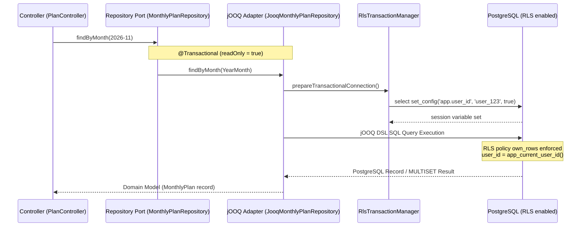

# 永続化: jOOQ と行レベルセキュリティ (RLS)

[関連ナビゲーション: アーキテクチャ概要](./overview.md) | [設計パターン](./patterns.md) | [クイックスタート](../quickstart.md) | [機能追加チュートリアル](../tutorials/add-feature.md)

RunBuddy では、データベースに PostgreSQL 17 を使用し、データアクセスライブラリとして **jOOQ**、マルチテナンシー（ユーザー毎のデータ保護・隔離）のために **PostgreSQL Row Level Security (RLS)** を採用しています。本ドキュメントでは、永続化層の設計思想、RLS 適用メカニズム、型安全なマッピング実例、および ArchUnit によるアーキテクチャ検証について解説します。

---

## 1. jOOQ 選定理由 (ADR-0007)

永続化ライブラリの選定にあたっては、[ADR-0007: 永続化ライブラリの選定](../../docs/adr/0007-persistence-library.md) に基づき、JPA (Hibernate)、MyBatis、Spring Data JDBC、JdbcClient、Doma、jOOQ の比較検討を行いました。

### 選定時の前提条件と重要要件

1. **イミュータブルなドメインモデルの維持**:
   ドメイン型（`MonthlyPlan` や `RunResult`）は Java 25 の不変 `record` であり、コンストラクタで不変条件を直接検証しています。永続化フレームワークの都合で無引数コンストラクタや可変フィールドを追加（ミュータブル化）することは避ける必要がありました。
2. **AI エージェント主導開発における誤り検出速度**:
   開発コードの多くを AI エージェントが記述・修正するため、SQL やマッピングのタイポ・型の不整合を実行時やテスト実行時ではなく**コンパイル時**に即座に検知できることが不可欠でした。
3. **PostgreSQL 特有機能のフル活用**:
   RLS のセッション変数設定（`set_config`）、`INSERT ... ON CONFLICT` による冪等な upsert 処理、`MULTISET` 階層クエリなどの PostgreSQL 固有機能を Java DSL 上で自然かつ安全に表現できることが求められました。
4. **ポート＆アダプタ構造との完全な分離**:
   ドメイン層はリポジトリインターフェース（ポート）のみに依存し、永続化の技術的詳細はアダプタ層（`com.example.runbuddy.persistence`）に閉じ込めます。

### 各ライブラリとの比較と決定理由

| ライブラリ | 不変 record との親和性 | コンパイル時検査 | SQL の制御性・機能表現 | AI 開発における誤りフィードバック |
|---|---|---|---|---|
| **JPA (Hibernate)** | ✕ （可変エンティティが必要で二重マッピングが発生） | △ （起動時レベル） | △ （遅延ロードや N+1 問題が隠れやすい） | △ （実行時・テスト時） |
| **MyBatis** | ○ （マッピング設定） | ✕ （XML/文字列は実行時） | ◎ （手書き SQL） | △ （テスト実行時） |
| **Spring Data JDBC** | ○ （集約コンストラクタ） | △ （派生クエリは起動時） | △ （upsert や集計クエリは生 SQL に依存） | △ （テスト実行時） |
| **jOOQ** | **◎ （Java record へのマッピングが簡潔）** | **◎ （生成コードによる型・カラム完全検査）** | **◎ （upsert, MULTISET を DSL で直接表現）** | **◎ （コンパイルエラーとして即座に可視化）** |
| **JdbcClient** | ○ （RowMapper 変換） | ✕ （SQL 文字列は実行時） | ◎ （手書き SQL） | △ （テスト実行時） |

スパイク検証の結果、`JdbcClient` は書きやすさに優れるものの誤りがテスト実行時まで発覚しない点が懸念されました。一方 **jOOQ** は、データベーススキーマから生成された Java DSL により、カラム名の誤り、型のミスマッチ、スキーマ変更時の修正漏れがすべて**コンパイルエラー**として浮き彫りになります。コンパイラが自律的な修正のガイドラインとなるため、AI エージェント主導の開発環境において最も安全なライブラリとして jOOQ の採用を決定しました。

---

## 2. RLS トランザクション制御と処理フロー

RunBuddy では、アプリケーション SQL のクエリ条件に `user_id` を手動で指定しません。PostgreSQL の行レベルセキュリティ (RLS) と、トランザクションローカルなセッション変数 `app.user_id` を組み合わせてユーザー間のデータ分離を透過的に行います。

### `RlsTransactionManager` によるセッション変数設定

すべてのデータベーストランザクション開始時、[`RlsTransactionManager`](../../backend/src/main/java/com/example/runbuddy/persistence/RlsTransactionManager.java) が PostgreSQL に対して `select set_config('app.user_id', ?, true)` を実行します。

```java
public class RlsTransactionManager extends JdbcTransactionManager {

    private final CurrentUser currentUser;

    public RlsTransactionManager(DataSource dataSource, CurrentUser currentUser) {
        super(dataSource);
        this.currentUser = currentUser;
    }

    @Override
    protected void prepareTransactionalConnection(Connection connection, TransactionDefinition definition)
            throws SQLException {
        super.prepareTransactionalConnection(connection, definition);
        try (PreparedStatement statement = connection.prepareStatement("select set_config('app.user_id', ?, true)")) {
            statement.setString(1, currentUser.id());
            statement.execute();
        }
    }
}
```

- **セッション変数のスコープ制限**: `set_config` の第 3 引数に `true`（`is_local`）を渡すことで、設定された `app.user_id` は**現在のトランザクション内限定**となります。コミットまたはロールバック時に自動消去されるため、コネクションプールを通じて別のリクエストへユーザー ID が漏洩するリスクはありません。
- **Spring 統合**: Standard JDBC トランザクションインフラ（`@Transactional`）と統合されているため、jOOQ DSL クエリは接続先の RLS 保護下で透過的に動作します。

### リクエスト処理シーケンス図

以下に、リクエスト受信から Controller → リポジトリポート → jOOQ アダプタ → RlsTransactionManager による `set_config` 実行 → PostgreSQL RLS ポリシー (`own_rows`) 適用 → ドメイン record への変換・返却までの流れを示します。


*図 1: リクエスト受信から RlsTransactionManager 設定、PostgreSQL RLS 適用、jOOQ MULTISET 変換までのシーケンス*

---

## 3. アプリケーション SQL から `user_id` を排除する構造

データベースのスキーマ定義（[`V1__create_plans_and_runs.sql`](../../backend/src/main/resources/db/migration/V1__create_plans_and_runs.sql)）により、アプリケーションコードで `user_id` を一切意識させない安全な RLS 構造が保証されています。

### 1. `app_current_user_id()` 関数と Fail-Fast 設計

`app_current_user_id()` は、セッション変数 `app.user_id` から現在のユーザー ID を抽出する PL/pgSQL カスタム関数です。

```sql
create function app_current_user_id() returns text
    language plpgsql stable
as $$
declare
    user_id text := nullif(current_setting('app.user_id', true), '');
begin
    if user_id is null then
        raise exception 'app.user_id is not set; database access must run in a transaction (RlsTransactionManager)';
    end if;
    return user_id;
end
$$;
```

- **Fail-Fast 原則**: トランザクション外で DB アクセスが行われた場合（`app.user_id` 未設定時）、単に 0 件を返すのではなく**明示的に例外をスロー**します。これによりトランザクション設定漏れのバグが静かに隠蔽される事故を防ぎます。`nullif` を使用しているのは、`SET LOCAL` 終了後にコネクションプールに残る空文字 `''` を `NULL` として正しく判定するためです。

### 2. DEFAULT 値と RLS ポリシー (`own_rows`)

全テーブル（`monthly_plan`, `planned_workout`, `run_result`）で、`user_id` カラムのデフォルト値と RLS ポリシー `own_rows` が設定されています。

```sql
create table monthly_plan (
    user_id       text   not null default app_current_user_id(),
    month         text   not null check (month ~ '^\d{4}-(0[1-9]|1[0-2])$'),
    target_meters bigint not null check (target_meters >= 0),
    primary key (user_id, month)
);

alter table monthly_plan enable row level security;
alter table monthly_plan force row level security;
create policy own_rows on monthly_plan
    using (user_id = (select app_current_user_id()))
    with check (user_id = (select app_current_user_id()));
```

- **自動補完 (`DEFAULT`)**: アプリの `INSERT` クエリで `user_id` を指定しなくても、`app_current_user_id()` により自動的にセッションのユーザー ID が挿入されます。
- **行レベルアクセス制御 (`USING` / `WITH CHECK`)**: `SELECT`, `UPDATE`, `DELETE`, `INSERT` 実行時、PostgreSQL が `user_id = (select app_current_user_id())` 条件を自動適用します。スカラサブクエリ `(select app_current_user_id())` にすることで、ステートメント（クエリ）ごとに 1 回だけ関数が評価されるよう最適化されています。
- **`FORCE ROW LEVEL SECURITY`**: テーブルの所有者ロールであっても RLS の強制評価対象とします。

### 3. DB ロールと所有権の分離

RLS の回避を防ぐため、権限を明確に分離しています（詳細は [データベースガイド](../../docs/guides/database.md) を参照）。

- **`runbuddy` ロール（所有者 / マイグレーション用）**: スキーマ作成・変更を実行するロール。PostgreSQL 仕様上、所有者やスーパーユーザーは RLS をバイパス可能なため、Flyway マイグレーション時のみ利用します。
- **`runbuddy_app` ロール（アプリケーション接続用）**: アプリケーション本番環境および Testcontainers 統合テストが使用する専用ロール。テーブル所有者ではないため、RLS ポリシーが必ず強制適用されます。

---

## 4. ポートにおける `default` メソッド禁止と ArchUnit による検証

RunBuddy の設計規約として、ドメイン層のリポジトリポート（インターフェース）に **`default` メソッドを定義することを厳禁**としています。

### 背景と障害の経緯 (ADR-0007)

開発初期、リポジトリポートにヘルパーメソッドとして `default` メソッド（例: `getOrEmpty`）を設けていました。この `default` メソッドの内部からポート内の抽象メソッド（`findByMonth` など）を呼び出した際、Spring AOP に起因する重大な障害が発生しました。

1. クライアントがインターフェースの `default` メソッドを呼び出す。
2. Spring の `@Transactional` プロキシはアダプタ実装クラスの外側をラッピングしているため、`default` メソッド内部からアダプタメソッドへの呼び出しが**自クラス内呼び出し（self-invocation）**となりプロキシを迂回する。
3. `@Transactional` アスペクトが起動せず、`RlsTransactionManager` による `set_config('app.user_id', ...)` が実行されない。
4. トランザクション外の DB アクセスとなり、`app_current_user_id()` が例外をスロー（または RLS により 0 件を返却）する。

このため、ポートには `default` メソッドを持たせず、常に呼び出し元が `@Transactional` アダプタの公開メソッドを直接プロキシ経由で呼ぶ構造を強制しています。

### ArchUnit テストによる自動検証 (`TransactionalPortRulesTest`)

この規約が開発者のミスによって破壊されないよう、[`TransactionalPortRulesTest`](../../backend/src/test/java/com/example/runbuddy/architecture/TransactionalPortRulesTest.java) がビルド時にインターフェース構造を静的検証します。

```java
static final ArchRule PORTS_OF_TRANSACTIONAL_ADAPTERS_HAVE_NO_DEFAULT_METHODS = classes()
        .that().areInterfaces()
        .and(IMPLEMENTED_BY_A_TRANSACTIONAL_CLASS)
        .should(HAVE_NO_DEFAULT_METHODS)
        .because("a default method calls the adapter without its transaction, so row level security "
                + "has no user and the query fails (ADR-0007)");
```

- `@Transactional` クラスによって実装されている全てのポートインターフェースを自動検出し、`default` メソッドが存在する場合はビルドを失敗させます。

### ミューテーションチェック (`archunit-mutation-check.sh`)

ArchUnit ルール自体が偽陰性（誤って違反を見落とす状態）に陥っていないことを証明するため、CI で [`scripts/archunit-mutation-check.sh`](../../backend/scripts/archunit-mutation-check.sh) を実行します。

- 一時的な git worktree 内で `MonthlyPlanRepository` や `RunResultRepository` に故意に `default` メソッド（ミュータント）を挿入します。
- `TransactionalPortRulesTest` を実行し、すべてのミュータントが正しく検知されテストが失敗すること（"killed"）を確認します。
- 併せて、許可された `static` メソッドが誤検知されないこともチェックします。

---

## 5. jOOQ コード生成と CI での差分チェック

jOOQ は PostgreSQL のスキーマ定義から Java クラス群を生成します。

### コード生成スクリプト (`backend/scripts/generate-jooq.sh`)

Flyway マイグレーション（`V1__create_plans_and_runs.sql`, [`V2__add_run_metrics.sql`](../../backend/src/main/resources/db/migration/V2__add_run_metrics.sql)）を追加・変更した際は、次のスクリプトを実行して jOOQ 型定義クラスを再生成します（[`generate-jooq.sh`](../../backend/scripts/generate-jooq.sh)）。

```bash
#!/usr/bin/env bash
# backend/scripts/generate-jooq.sh
set -euo pipefail
cd "$(dirname "$0")/.."

name="runbuddy-jooq-codegen-$$"
docker run -d --rm --name "$name" \
  -e POSTGRES_DB=runbuddy -e POSTGRES_USER=runbuddy -e POSTGRES_PASSWORD=runbuddy \
  -v "$PWD/db/init:/docker-entrypoint-initdb.d:ro" \
  -p 127.0.0.1::5432 postgres:17-alpine >/dev/null
trap 'docker stop "$name" >/dev/null' EXIT

until docker exec "$name" pg_isready -q -h 127.0.0.1 -U runbuddy -d runbuddy; do sleep 1; done
port="$(docker port "$name" 5432/tcp | head -1 | sed 's/.*://')"

rm -rf src/main/java/com/example/runbuddy/persistence/jooq/generated
./mvnw -B -q -Pjooq-codegen generate-sources -Ddb.url="jdbc:postgresql://127.0.0.1:${port}/runbuddy"
echo "jOOQ classes regenerated."
```

1. 一時的な PostgreSQL 17 コンテナを起動し初期化 SQL および Flyway マイグレーションを適用。
2. Maven プロファイル `jooq-codegen` で `src/main/java/com/example/runbuddy/persistence/jooq/generated` 配下にコードを出力。
3. 生成コードは git にコミットするため、通常のビルドやテスト実行時に Docker は不要です。

### CI での同調検証 (`.github/workflows/ci.yml`)

マイグレーション変更時のコード再生成漏れを防ぐため、GitHub Actions CI が再生成と `git status` の検証を実施します。手動での `generated` 配下の修正は禁止されており、差分が検出された場合は CI が即座に失敗します。

---

## 6. jOOQ Record とドメイン Record のマッピング実例

以下に、jOOQ アダプタにおける実コードのマッピング実装例を示します。

### 1. `JooqMonthlyPlanRepository`: `MULTISET` による単一クエリ復元

[`JooqMonthlyPlanRepository`](../../backend/src/main/java/com/example/runbuddy/persistence/jooq/JooqMonthlyPlanRepository.java) では、複合集約 `MonthlyPlan`（親）と `PlannedWorkout`（子リスト）を `multiset` 構文で 1 本の SQL で取得し、ドメインの不変 `record` にマッピングします。

```java
@Override
@Transactional(readOnly = true)
public Optional<MonthlyPlan> findByMonth(YearMonth month) {
    return dsl.select(
                    MONTHLY_PLAN.TARGET_METERS,
                    multiset(select(
                                            PLANNED_WORKOUT.WORKOUT_DATE,
                                            PLANNED_WORKOUT.TYPE,
                                            PLANNED_WORKOUT.DISTANCE_METERS,
                                            PLANNED_WORKOUT.NOTE)
                                    .from(PLANNED_WORKOUT)
                                    .where(PLANNED_WORKOUT.USER_ID.eq(MONTHLY_PLAN.USER_ID))
                                    .and(PLANNED_WORKOUT.MONTH.eq(MONTHLY_PLAN.MONTH))
                                    .orderBy(PLANNED_WORKOUT.POSITION))
                            .convertFrom(rows -> rows.map(row -> new PlannedWorkout(
                                    row.value1(),
                                    WorkoutType.valueOf(row.value2()),
                                    Distance.ofMeters(row.value3()),
                                    row.value4()))))
            .from(MONTHLY_PLAN)
            .where(MONTHLY_PLAN.MONTH.eq(month.toString()))
            .fetchOptional(row -> new MonthlyPlan(month, Distance.ofMeters(row.value1()), row.value2()));
}
```

- **`multiset(...)`**: 子要素をネストしたコレクションとして 1 回のクエリで取得し、N+1 問題を防止します。
- **`convertFrom(...)`**: 各ネスト行をドメインレコード `PlannedWorkout` と値オブジェクト `Distance` へ変換します。
- **`fetchOptional(...)`**: 最終行を `MonthlyPlan` record にラップして返します。

### 2. `JooqRunResultRepository`: `onConflict` と `excluded` による Upsert

[`JooqRunResultRepository`](../../backend/src/main/java/com/example/runbuddy/persistence/jooq/JooqRunResultRepository.java) では、走破実績の一括保存において `onConflict` および `excluded` を使用し、アクティビティ重複時の冪等な Upsert を実現しています。

```java
insert.onConflict(RUN_RESULT.USER_ID, RUN_RESULT.ACTIVITY_ID)
        .doUpdate()
        .set(RUN_RESULT.STARTED_AT, excluded(RUN_RESULT.STARTED_AT))
        .set(RUN_RESULT.DISTANCE_METERS, excluded(RUN_RESULT.DISTANCE_METERS))
        .set(RUN_RESULT.DURATION_MILLIS, excluded(RUN_RESULT.DURATION_MILLIS))
        .set(RUN_RESULT.AVERAGE_HEART_RATE, excluded(RUN_RESULT.AVERAGE_HEART_RATE))
        .set(RUN_RESULT.MAX_HEART_RATE, excluded(RUN_RESULT.MAX_HEART_RATE))
        .set(RUN_RESULT.AVERAGE_CADENCE, excluded(RUN_RESULT.AVERAGE_CADENCE))
        .set(RUN_RESULT.MAX_CADENCE, excluded(RUN_RESULT.MAX_CADENCE))
        .set(RUN_RESULT.AVERAGE_STRIDE_LENGTH_CM, excluded(RUN_RESULT.AVERAGE_STRIDE_LENGTH_CM))
        .set(RUN_RESULT.ELEVATION_GAIN_METERS, excluded(RUN_RESULT.ELEVATION_GAIN_METERS))
        .execute();
```

- **`excluded(...)`**: PostgreSQL の `EXCLUDED` テーブル表現であり、同一アクティビティ ID の重複取り込み時に既存行を最新データで安全に更新します。

---

## 7. テストと安全性の維持

- **リポジトリ契約テスト**: すべてのアダプタ（jOOQ / InMemory）は共通の契約テストインターフェース（`MonthlyPlanRepositoryContract`, `RunResultRepositoryContract`）を満たします。
- **RLS 安全性テスト**: `RowLevelSecurityContract` および `DatabaseSafetyTest` により、別ユーザーのデータ非開示とトランザクション外アクセスの即時失敗を自動検証しています。
