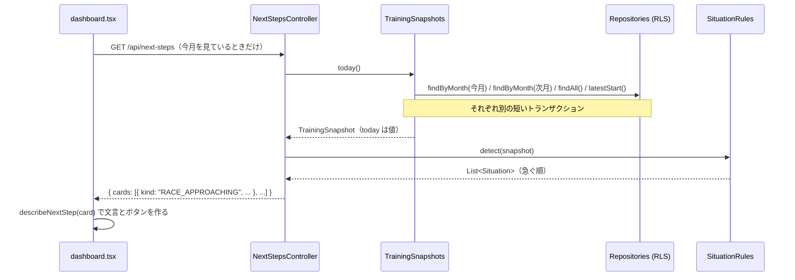

# ダッシュボードの「いまやること」

ダッシュボードを開くと、いちばん上に「いまやるべきこと」がカードで並びます（目標からの遅れ、レース前のテーパリング、しばらく走っていない、次月の計画がない）。このページでは、そのカードが **どこで判定され、どこで言葉になり、どのテストが守っているか** を説明します。設計判断の正は [ADR-0014](../../docs/adr/0014-next-steps-situations-in-code-presentation-by-ai.md) です。

## 問題: 「状況に応じて画面を変える」を何に任せるか

状況に応じた画面を AI に丸ごと生成させる案（Generative UI）は、テストできず、事実と違う数字や壊れた画面も出せてしまいます。ADR-0014 はこれを退け、次の3層に分けました。

| 層 | 責務 | 場所 |
|---|---|---|
| ドメイン | 状況を **決定的に判定** し、急ぐ順に並べる | `backend/src/main/java/com/example/runbuddy/dashboard/SituationRules.java` |
| API | カードの **種類（`kind`）と数値だけ** を返す | `backend/src/main/java/com/example/runbuddy/dashboard/NextStepsController.java`（`GET /api/next-steps`） |
| frontend | **文言とボタンの行き先** を決める | `frontend/src/lib/nextSteps.ts`、`frontend/src/components/NextSteps.tsx` |

ADR が「ステップ2（#28）」として挙げている、AI にカードの順序や言い回しを選ばせる部分は、まだ実装されていません。`SituationRules` のコメントにあるとおり、実装されたときはこのルールの並びが失敗時のフォールバックになります。



## ドメイン: `TrainingSnapshot` と `SituationRules`

### 「今日」は時計ではなく値

`TrainingSnapshot` は判定に必要なものを全部持つ不変の record です。`today` を引数で受け取るので、ルールはどの日付でもテストできます。コンストラクタは `thisMonth` が `today` の月であることを検査します。

```java
// backend/src/main/java/com/example/runbuddy/dashboard/TrainingSnapshot.java
public record TrainingSnapshot(
        LocalDate today, PlanAchievement thisMonth, boolean nextMonthPlanned, List<Race> races, Optional<LocalDate> lastRunDate) {

    public TrainingSnapshot {
        // ...
        if (!thisMonth.month().equals(YearMonth.from(today))) {
            throw new IllegalArgumentException("thisMonth is " + thisMonth.month() + " but today is " + today);
        }
    }
}
```

時計を読み、リポジトリから値を集めるのは Spring の `@Component` である `TrainingSnapshots` です。トランザクションを自分では開かず、リポジトリの呼び出しがそれぞれ短いトランザクションになります（AI を挟む将来のステップでモデル呼び出しをトランザクションの外に置くため）。「次月が計画済み」は、次月の計画に目標距離かワークアウトのどちらかがあることです。

### 状況は sealed interface

`Situation` は4つの record だけを許す sealed interface で、各 record が自分の不変条件を検査します（例: `BehindTarget` は遅れも残りもゼロではない、`NoRunsLately` は今日走っていない）。

```java
// backend/src/main/java/com/example/runbuddy/dashboard/Situation.java
public sealed interface Situation {
    record RaceApproaching(Race race, long daysToGo) implements Situation { ... }
    record BehindTarget(YearMonth month, Distance shortfall, Distance remaining, int daysLeft) implements Situation { ... }
    record NoRunsLately(LocalDate lastRunDate, long daysSince) implements Situation { ... }
    record MonthEnding(YearMonth nextMonth, int daysLeft) implements Situation { ... }
}
```

sealed にしてあるので、`NextStepsController` の `switch` は `default` なしで網羅性をコンパイラが検査します。状況を1つ増やせば、カードに変換していない場所がコンパイルエラーになります。TypeScript 側でも `kind` の判別可能なユニオンが同じ役割を果たします。

### ルールとしきい値

`SituationRules.detect` は副作用のない static メソッドで、同じスナップショットからは常に同じリストを返します。しきい値は定数として1か所にあります。

| 状況 | 条件 | 定数 |
|---|---|---|
| `RaceApproaching` | 今日以降のレースのうち最も近いものが 21 日以内（当日を含む） | `TAPER_DAYS = 21` |
| `BehindTarget` | 経過日数で按分した目標に対し、目標の 1 割以上足りない | `BEHIND_SHARE_OF_TARGET = 0.10` |
| `NoRunsLately` | 最後のランから 7 日以上。取り込み前（ランが1件もない）は出さない | `NO_RUN_DAYS = 7` |
| `MonthEnding` | 月末まで 7 日以内で、次月の計画がない | `MONTH_END_DAYS = 7` |

並び順は `ORDER`（`RaceApproaching` → `BehindTarget` → `NoRunsLately` → `MonthEnding`）の1か所で決まります。

**レースが近いあいだは遅れを出しません。** テーパリング中に走る量が減るのは計画どおりなので、「目標から遅れています」と言うのは誤ったメッセージになるからです。21 日という値は AI 相談のシステムプロンプトが指示する「最後の 2〜3 週のテーパリング」に合わせてあります（[その他のアーキテクチャ上の工夫](../architecture/patterns.md) の AI 相談の節）。

```java
// backend/src/main/java/com/example/runbuddy/dashboard/SituationRules.java
Optional<RaceApproaching> race = raceApproaching(snapshot);
race.ifPresent(found::add);
// Running less before a race is the plan, so a shortfall is not pointed out while tapering.
if (race.isEmpty()) {
    behindTarget(snapshot).ifPresent(found::add);
}
```

遅れの計算は「今日を除いた経過日数」で按分します。そのため月の初日には誰も遅れていません。

```java
int daysPassed = snapshot.today().getDayOfMonth() - 1;
long due = Math.round((double) target * daysPassed / length);
long shortfall = due - actual;
```

## API: 種類と数値だけ

`NextStepsController` は `Situation` を `NextStepCard`（sealed interface）の record に変換します。各カードは `kind` の文字列（`RACE_APPROACHING` など）と、表示に必要な数値（km、日数、日付）だけを持ち、文言は持ちません。OpenAPI では `@Schema(oneOf = ...)` と `allowableValues` によって `kind` で区別できるユニオンになり、`npm run gen:api` で TypeScript の判別可能なユニオンになります。

## frontend: 文言と行き先、そして「保存しない」

- `frontend/src/lib/nextSteps.ts` の `describeNextStep(card, thisMonth)` が `card.kind` の `switch` で、タイトル・本文・ボタンを作ります。ボタンの行き先は「プラン画面を開く」か「AI 相談を `ask` 付きで開く」の2種類だけです。
- `frontend/src/components/NextSteps.tsx` は props（`cards`, `thisMonth`）だけを受け取るコンポーネントで、最初のカードを目立つ callout、残りを控えめなカードで表示します。カードがなければ何も描きません。
- **カードは何も保存しません。** AI 相談へのボタンは `/advisor?month=...&ask=...` へのリンクで、`frontend/src/routes/advisor.tsx` の `validateAdvisorSearch` が `ask` を最大 500 文字に切り詰めて入力欄に入れるだけです。送信するのは人です。`ask` が変わると `remountDeps` で会話が新しく始まります。
- `frontend/src/routes/dashboard.tsx` は `nextStepsQuery` を **今月を見ているときだけ** 有効にします（カードは「今日」のことなので）。取り込みや計画の保存のあと、`frontend/src/api/queries.ts` の mutation が `['next-steps']` のキャッシュを無効化して、カードを最新にします。

## 守っているテスト

| テスト | 守っていること |
|---|---|
| `backend/src/test/java/com/example/runbuddy/dashboard/SituationRulesTest.java` | ルールごとの `@Nested` クラスで境界値を検査する。例: `isNotRaisedWhileTaperingForARace`（テーパリング中は遅れを出さない）、`startsThreeWeeksBeforeTheRace`、`includesRaceDayButNotARaceThatIsOver`、`nobodyIsBehindOnTheFirstDay`、`sixDaysOffIsJustRest`、`saysNothingBeforeTheFirstRunIsImported`、`putsTheMostPressingSituationFirst` |
| `backend/src/test/java/com/example/runbuddy/dashboard/NextStepsControllerTest.java` | `@WebMvcTest` にインメモリのリポジトリと固定の `Clock` を入れ、JSON のカードの並びと数値を検査する（`anApproachingRaceTakesTheTopAndQuietsTheShortfall` など） |
| `frontend/src/lib/nextSteps.test.ts` | カードごとの文言とボタン（レース当日は応援だけ、月末最終日の文言など） |
| `frontend/src/components/NextSteps.test.tsx` | 最初のカードが callout になること、AI 相談が送信せずに入力欄へ入ること（`opens the advisor with the request in the message box, without sending it`）、カードがなければ何も出さないこと |

## 状況を1つ増やすには

1. `SituationRulesTest` に新しいルールの `@Nested` クラスを書き、赤にする。
2. `Situation` に record を足し、`SituationRules` にルールと `ORDER` の位置を足す。
3. コンパイラが `NextStepsController.card` の `switch` を指摘するので、カードの record を足す（`NextStepsControllerTest` で数値を確認）。
4. `npm run gen:api` のあと、TypeScript が `describeNextStep` の `switch` の抜けを指摘するので、文言を足す（`nextSteps.test.ts`）。

## 関連ページ

- [その他のアーキテクチャ上の工夫](../architecture/patterns.md) — AI 相談（テーパリングの指示、`AdvisorTools.upcomingRaces`）、不変のドメインモデル
- [ランの測定値・日別詳細・ラップと地図](run-detail.md)
- [アーキテクチャ概要](../architecture/overview.md)
