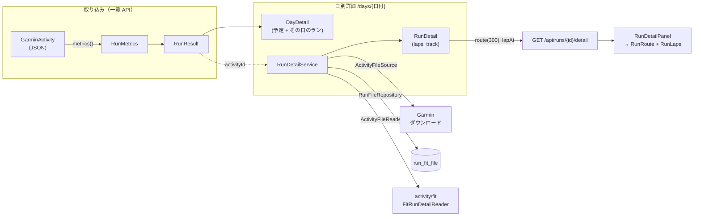
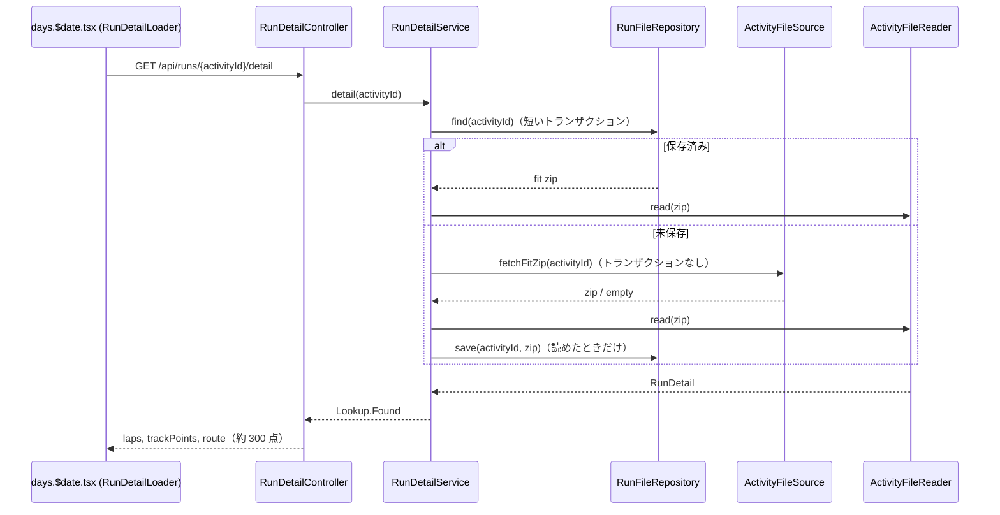

# ランの測定値・日別詳細・ラップと地図

1回のランについて、一覧の数字（距離・時間・心拍・ケイデンスなど）から、日別詳細ページでのラップ表と地図までを、どのクラスが受け持ち、どのテストが守っているかを説明します。設計判断の正は [ADR-0012（FIT ファイル）](../../docs/adr/0012-fit-files-for-laps-and-tracks.md) と [ADR-0013（地図）](../../docs/adr/0013-route-map-with-leaflet-and-osm.md) です。



## 1. ランの測定値: 値オブジェクト `RunMetrics`

### 問題
Garmin の一覧 API は、最大心拍・ケイデンス・歩幅・上昇を返しますが、どれも欠けることがあります（手入力のランには何もない、心拍センサーのない時計など）。センサーがないと `0` が返ることもあり、そのまま信じると「ケイデンス 0」のような値が画面に出ます。

### 工夫
- 任意の測定値を `RunMetrics` という record にまとめ、**自分で不変条件を検査** します。どの値も `null`（記録なし）か正の値で、上昇は 0 以上、最大ケイデンスは平均ケイデンス以上です。何もないランは `RunMetrics.NONE` です。

  ```java
  // backend/src/main/java/com/example/runbuddy/activity/RunMetrics.java
  public RunMetrics {
      requirePositive(maxHeartRate, "maxHeartRate");
      requirePositive(averageCadence, "averageCadence");
      // ...
      if (averageCadence != null && maxCadence != null && maxCadence < averageCadence) {
          throw new IllegalArgumentException(
                  "maxCadence " + maxCadence + " is below averageCadence " + averageCadence);
      }
  }
  ```
- 外部のデータは信用しない入力なので、Garmin からの変換（`backend/src/main/java/com/example/runbuddy/activity/garmin/GarminActivity.java` の `metrics`）は、ドメインが拒む値を **その値だけ** `null` にして捨て、ランそのものは残します。心拍・ケイデンス・歩幅の 0 は「測っていない」として捨て（上昇の 0 は平地での実測なので残し、負の上昇だけ捨てる）、平均を下回る最大値も捨てます。例外でランごと失うことはありません。
- `RunController` の `RunResponse` は測定値を null 許容の整数として返します（OpenAPI では `types = {"integer", "null"}`）。

### 守っているテスト
`backend/src/test/java/com/example/runbuddy/activity/RunMetricsTest.java`（不変条件）、`backend/src/test/java/com/example/runbuddy/activity/garmin/GarminActivityTest.java`（変換でおかしな値だけが捨てられ、ランは残ること）、`GarminActivitySourceTest.convertsTheRunsOfARecordedResponse`（記録した応答からの測定値）。

## 2. 日別詳細: `DayDetail` と `/days/{日付}`

`backend/src/main/java/com/example/runbuddy/day/DayDetail.java` は、その日の予定（`PlannedWorkout`）とランをまとめる record です。1日に朝と夜の2回走ることがあるので、詳細ページの単位は「ラン」ではなく「日」にしています。コンストラクタは、すべての予定とランがその日のものであることを検査し、ランを開始時刻の順に並べます。`DayDetail.of(date, plan, runsOfTheMonth)` は月の計画とランからその日を取り出します。

API は `GET /api/days/{date}`（`DayController`）、画面は `frontend/src/routes/days.$date.tsx` です。ルートがデータを取り、`DayDetailView` は props で受け取ったランを並べ、ランごとの詳細欄は `renderDetail` で差し込まれる `RunDetailLoader` が別に読み込みます（初回は FIT のダウンロードを待つので、ページ全体を待たせないため）。

## 3. ラップと軌跡: FIT ファイルを開いたときに1回だけ取る（ADR-0012）

### 問題
ラップ1本ずつのデータと GPS の軌跡は、Garmin の一覧・詳細の JSON にはなく、FIT ファイル（1件ごとに1リクエスト）にしかありません。レート制限の値は分からないので、取り込みのたびに全ランの FIT を取るのは危険です。

### 工夫
1. **遅延読み込み**: FIT は取り込みでは取らず、日別詳細ページでそのランを **初めて開いたとき** に1件だけダウンロードします。
2. **原本を保存し、毎回読む**: ダウンロードした zip をそのまま `run_fit_file` 表（`backend/src/main/resources/db/migration/V4__create_run_fit_file.sql`、他の表と同じ RLS の規則）に保存し、以後は Garmin を呼ばずに毎回解析します。ラップや軌跡の表は作らないので、後で別の項目を使いたくなってもマイグレーションも再ダウンロードも要りません（詳しくは [永続化: jOOQ と行レベルセキュリティ](../architecture/persistence-rls.md)）。
3. **ポートを分ける**: 取り込み用の `ActivitySource` とは別に、ファイル用のポートを2つ置きます。呼ぶ頻度もコストも違い、ダミーのソースにはファイルがないからです。

   ```java
   // backend/src/main/java/com/example/runbuddy/activity/ActivityFileSource.java
   public interface ActivityFileSource {
       /** @throws ActivitySourceUnavailableException when the source cannot be asked (key, rate limit, outage) */
       Optional<byte[]> fetchFitZip(String activityId);
   }

   // backend/src/main/java/com/example/runbuddy/activity/ActivityFileReader.java
   public interface ActivityFileReader {
       /** @throws UnreadableActivityFileException when the file cannot be read */
       RunDetail read(byte[] zippedFile);
   }
   ```

   `ActivityFileSource` は `GarminActivitySource`（FIT をダウンロードし、失敗は取り込みと同じ `ActivitySourceUnavailableException` に変換。Garmin の ID でないものや 404 は空）と `DummyActivitySource`（常に空）が実装します。保存は `RunFileRepository`（jOOQ 版とメモリ版）です。
4. **FIT SDK を `activity/fit` に閉じ込める**: `ActivityFileReader` の実装 `FitRunDetailReader` だけが Garmin の FIT SDK（`com.garmin:fit`）を使い、外にはドメインの `RunDetail(List<Lap> laps, List<TrackPoint> track)` だけを出します。位置はセミサークルから度に変換し、ケイデンスは両足の歩数/分にします。`RunMetrics` と同じ考え方で、ドメインが拒む値はその値だけを捨て、ラップは残します。zip でない・FIT が入っていない・途中で切れている、は `UnreadableActivityFileException` です。
5. **ダウンロード中にトランザクションを開かない**: `RunDetailService` は意図的に `@Transactional` を付けません。「ランがあるか」「保存済みか」「保存する」はそれぞれリポジトリの短いトランザクションで、その間のダウンロードはトランザクションの外で走ります（AI のモデル呼び出しと同じ規則）。

   ```java
   // backend/src/main/java/com/example/runbuddy/activity/RunDetailService.java
   Optional<byte[]> stored = files.find(activityId);
   if (stored.isPresent()) {
       return new Lookup.Found(reader.read(stored.get()));
   }
   Optional<byte[]> downloaded = source.fetchFitZip(activityId);
   if (downloaded.isEmpty()) {
       return new Lookup.NoFile();
   }
   // Read before keeping it: an unreadable file is not kept, so the next look downloads it again.
   RunDetail detail = reader.read(downloaded.get());
   files.save(activityId, downloaded.get());
   ```

   **読めてから保存する** ので、壊れたファイルは保存されず、次に開いたときにもう一度ダウンロードされます。結果は sealed interface の `Lookup`（`Found` / `NoFile` / `RunNotFound`）で、`RunDetailController` が `switch` で 200 / 200 で `available: false` / 404 に対応づけます。Garmin の失敗と読めないファイルは `ActivitySourceExceptionHandler` が `reason` 付きの ProblemDetail にします（[その他のアーキテクチャ上の工夫](../architecture/patterns.md) の Garmin の節）。



### テスト用の FIT は合成する: `SyntheticFit`
リポジトリは public なので、実際のランの FIT（場所と日時が分かる）はテストに置けません。`backend/src/test/java/com/example/runbuddy/activity/fit/SyntheticFit.java` は FIT SDK のエンコーダでラップと記録点を組み立て、Garmin のダウンロードと同じく zip にします。位置は 0°N 0°E（海の上の「Null Island」）の周りなので、どのテストファイルも実在の場所を示しません。

```java
byte[] fit = new SyntheticFit().lap(0, 1000f, 330f, 150, 140, 0, null, 0, null).zip();
```

### 守っているテスト
| テスト | 守っていること |
|---|---|
| `backend/src/test/java/com/example/runbuddy/activity/RunDetailServiceTest.java` | `theFirstLookDownloadsAndKeepsTheFileAndLaterOnesReadIt`、`aRunTheSourceHasNoFileForHasNoDetailAndNothingIsKept`、`aFailingSourceIsReportedAndNothingIsKept`、`anUnreadableDownloadIsNotKept` |
| `backend/src/test/java/com/example/runbuddy/activity/fit/FitRunDetailReaderTest.java` | `SyntheticFit` で作ったファイルからラップ（両足のケイデンス）と軌跡を読むこと、拒まれる値はラップでなく値だけ捨てること、壊れたファイルは `UnreadableActivityFileException` |
| `RunFileRepositoryContract`（jOOQ 版とメモリ版）、`RowLevelSecurityContract.anotherUserSeesNoActivityFile` | 保存と取得、他のユーザーのファイルが見えないこと |
| `backend/src/test/java/com/example/runbuddy/activity/RunDetailControllerTest.java` | 200 / `available: false` / 404 / ProblemDetail の対応 |
| `backend/src/test/java/com/example/runbuddy/activity/LapTest.java` | `Lap` の不変条件 |

## 4. ランコースの地図とラップの強調（ADR-0013）

### 問題
軌跡は1ランで約 1,800 点あり、地図の線には多すぎます。地図の背景タイルを読み込むと、見ている範囲（自宅付近）がタイルの配信元に伝わります。ラップを選んで地図で区間を見たいが、frontend で時刻の計算はしたくありません。

### 工夫
- **間引きはドメインで**: `RunDetail.route(maxPoints)` は軌跡を均等に間引き、**スタート・ゴールと各ラップの最初の点を必ず残します**。200 m のつなぎのような短いラップの点が消えると、強調する線が描けないからです。API（`RunDetailController.RunDetailResponse`）は `MAX_ROUTE_POINTS = 300` で呼ぶので、点の数は「約 300」（ラップの数だけ増えうる）になります。返すのは緯度・経度とラップ番号だけで、心拍・標高・時刻は返しません。座標はブラウザにだけ送り、AI 相談のツール（`AdvisorTools`）は軌跡を返しません。
- **どの点がどのラップかは backend が決める**: `RunDetail.lapAt(offset)` は「その時点までに始まった最後のラップ」の番号を返します。ラップの開始と記録点の時刻は FIT の同じ起点からの経過時間なので、比較するだけで決まります。最初のラップの前やラップのないランでは空で、API の `RoutePoint.lap` は `null` になります。

  ```java
  // backend/src/main/java/com/example/runbuddy/activity/RunDetail.java
  public OptionalInt lapAt(Duration offset) {
      return laps.stream()
              .filter(lap -> lap.startOffset().compareTo(offset) <= 0)
              .mapToInt(Lap::number)
              .reduce((earlier, later) -> later);
  }
  ```
- **`RunRoute` は props だけ**: `frontend/src/components/RunRoute.tsx` は `route` と `highlightLap` だけを受け取ります。**位置のないラン（`route` が空）では地図を作らず「位置情報なし」と表示する** ので、タイルの要求は一切出ません。位置があれば Leaflet で OpenStreetMap のタイル（帰属表示つき）にコースの線とスタート・ゴールの印を描きます。線の色は SVG の属性に `var(--...)` が書けないため、`className` を付けて `global.css` で DESIGN.md のトークンから決めます。
- **強調しても地図を動かさない**: 強調線は地図を作り直さずに重ねて外します。区間が見えていれば線を変えるだけで、手で拡大していて区間が画面の外にあるときだけ、その区間へ移します。ラップを順に押すたびに拡大・縮小を繰り返すと見づらかったためです。
- **区間の切り出し**: `frontend/src/lib/route.ts` の `lapSegment(route, lap)` は、そのラップの点を **前のラップの最後の点から** 切り出します。強調線がコースから途切れて見えないようにするためです。
- **選択の状態は1か所**: `frontend/src/components/RunDetailPanel.tsx` が「選んでいるラップ」という唯一の状態を `useState` で持ち、`RunRoute` と `RunLaps` には props で渡します。位置のないランではラップを選べません（`onSelectLap` を渡さない）。

  ```tsx
  // frontend/src/components/RunDetailPanel.tsx
  const [selectedLap, setSelectedLap] = useState<number | null>(null)
  const canPick = detail.route.length > 0
  return (
    <>
      <RunRoute route={detail.route} highlightLap={selectedLap} />
      <RunLaps state={{ status: 'ready', detail }}
        selectedLap={canPick ? selectedLap : undefined}
        onSelectLap={canPick ? setSelectedLap : undefined} />
    </>
  )
  ```

### 守っているテスト
| テスト | 守っていること |
|---|---|
| `backend/src/test/java/com/example/runbuddy/activity/RunDetailTest.java` | `aLongTrackIsThinnedToAtMostTheLimitKeepingTheStartAndTheFinish`、`thinningKeepsTheFirstPointOfEveryLapSoAShortLapStillHasALine`、`aPointBelongsToTheLapThatHadStartedByThen`、`aPointBeforeTheFirstLapOrInARunWithoutLapsBelongsToNoLap`、`aRunWithoutPositionsHasNoRoute` |
| `frontend/src/components/RunRoute.test.tsx` | jsdom で地図を作り（タイルは読まれない）、帰属表示・スタートとゴール・強調と解除、強調中に地図が動かないこと、`says there is no position instead of showing a map when the run has no route` |
| `frontend/src/lib/route.test.ts` | `lapSegment` が前のラップの終わりからつながること、最初と最後のラップ、位置のないラップ |
| `frontend/src/components/RunDetailPanel.test.tsx` | 表で選んだラップが地図で強調されること、位置のないランでは選べないこと |

## 関連ページ

- [その他のアーキテクチャ上の工夫](../architecture/patterns.md) — ポート & アダプタ、Garmin 連携とエラー変換
- [永続化: jOOQ と行レベルセキュリティ](../architecture/persistence-rls.md) — `run_fit_file` と `JooqRunFileRepository`
- [ダッシュボードの「いまやること」](next-steps.md)
