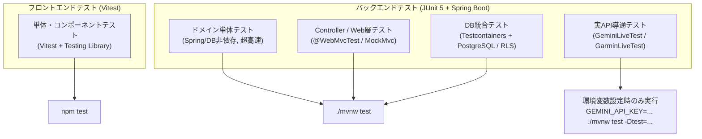

# 開発の始め方とテストの回し方

本ページでは、OpenWiki ドキュメント内の**タスク別ルーティングマップ**、run-buddy の**ローカル開発環境のセットアップ手順**、日常の運用・トラブルシューティング、およびバックエンド・フロントエンドにまたがる**テスト階層の分類と実行方法**を解説します。

---

## 1. タスク別ルーティングマップ (OpenWiki ナビゲーション)

開発目的や疑問点に応じて、以下の OpenWiki 内の各ドキュメントを参照してください。

*   **システム構成・モジュール依存関係の全体像を把握したい場合:**
    *   [`architecture/overview.md`](architecture/overview.md) を参照。モノレポ構造、バックエンドのパッケージ構成（ドメイン中心のパッケージ化と非依存ルール）、統合ビルド（`SpaConfig`）、Tailscale 接続モデルを解説しています。
*   **設計パターンや外部連携メカニズムを確認したい場合:**
    *   [`architecture/patterns.md`](architecture/patterns.md) を参照。Ports & Adapters、契約テスト（Contract Test）、不変ドメインモデル、Spring AI 統合、Garmin API 連携、OpenAPI 型連携（`openapi-typescript`）、およびコンポーネント設計を解説しています。
*   **データベース設計・jOOQ・行レベルセキュリティ（RLS）の詳細を知りたい場合:**
    *   [`architecture/persistence-rls.md`](architecture/persistence-rls.md) を参照。jOOQ 選定理由、リクエストごとの RLS トランザクション制御フロー（`RlsTransactionManager`）、ポートにおける default メソッド禁止原則、jOOQ コード生成と Record/ドメイン変換ルールを解説しています。
*   **ランの測定値・日別詳細ページ・ラップと地図の仕組みを知りたい場合:**
    *   [`features/run-detail.md`](features/run-detail.md) を参照。値オブジェクト `RunMetrics`、`DayDetail`、FIT ファイルを初めて開いたときだけ取って `run_fit_file` に保存する設計（ADR-0012）、Leaflet と OpenStreetMap の地図とラップの強調（ADR-0013）を解説しています。
*   **ダッシュボードの「いまやること」カードを直したい・増やしたい場合:**
    *   [`features/next-steps.md`](features/next-steps.md) を参照。判定はドメイン（`SituationRules`）、API は種類と数値、文言は frontend という分担（ADR-0014）と、状況を1つ増やす手順を解説しています。
*   **新機能を TDD で追加する実践ステップを学びたい場合:**
    *   [`tutorials/add-feature.md`](tutorials/add-feature.md) を参照。CSV エクスポート機能を題材とした TDD 手順（ドメイン層 → リポジトリ/コントローラ層 → UI 層）および DB スキーマ変更の手順を詳細にステップバイステップで説明しています。

---

## 2. ローカル開発環境のセットアップとアプリ起動

詳細なセットアップ手順や挙動の仕組みは [`../README.md`](../README.md) を参照してください。

### 2.1 前提条件

| ツール | 要求バージョン | 用途 |
|---|---|---|
| **JDK** | 25 | バックエンド実行（Maven Wrapper `./mvnw` が自動ダウンロードされるため Maven の個別インストールは不要） |
| **Node.js** | 22.12 以上 | フロントエンド実行・ビルド |
| **Docker** | Docker Desktop 等（Compose v2 必須） | PostgreSQL データベースおよび Testcontainers による DB テスト |

### 2.2 設定ファイル (`.env`) の作成

ローカルの環境変数および秘密情報はリポジトリルートの `.env` で管理します（参照: [`../.env.example`](../.env.example)）。

```bash
cp .env.example .env
```

主要設定項目（詳細: [`../README.md`](../README.md)）:
*   `GEMINI_API_KEY`: AI 相談機能で Gemini を利用する際の API キー（空の場合は開発用 Fake プロバイダのみ利用可）
*   `RUNBUDDY_ACTIVITY_SOURCE`: ランニング記録の取得先（`dummy`［既定値］または `garmin`）
*   `GARMIN_API_KEY`: Garmin Connect Personal API のキー（`garmin` 設定時に必須）
*   `RUNBUDDY_LOG_LEVEL`: バックエンドのログレベル（既定: `INFO`）
*   `RUNBUDDY_BIND_ADDRESS`: バインド制限アドレス（既定: `127.0.0.1`）
*   `RUNBUDDY_DB_PORT`: PostgreSQL ポート（既定: `5432`）

### 2.3 セットアップと起動手順

1. **PostgreSQL データベースの起動**
   リポジトリルート（[`../compose.yaml`](../compose.yaml) がある場所）で実行します。

   ```bash
   docker compose up -d --wait
   ```
   `--wait` オプションにより DB の健全性が確認されるまで待機します。初回起動時にアプリ用ロール `runbuddy_app` が自動作成され、バックエンド起動時に Flyway によりテーブル定義が適用されます（参照: [`../docs/guides/database.md`](../docs/guides/database.md)）。

2. **バックエンドの起動（開発モード）**

   ```bash
   cd backend
   ./mvnw spring-boot:run
   ```
   起動確認: `curl http://localhost:8080/health`（`{"status":"ok"}` 返却）。

3. **フロントエンドの起動**

   ```bash
   cd frontend
   npm install
   npm run dev
   ```
   `http://localhost:5173` で開発サーバーが起動し、`/api` リクエストはバックエンド `http://localhost:8080` へプロキシされます。

4. **統合配信ビルド（任意: モバイル/リモート利用時）**

   ```bash
   cd backend
   ./mvnw spring-boot:run -Papp
   ```
   `-Papp` プロファイル指定によりフロントエンドが自動ビルドされ、バックエンドの静的リソース（`target/classes/static`）として `http://localhost:8080` から一元配信されます。

5. **Tailscale によるリモート利用（任意）**

   ```bash
   tailscale serve --bg 8080
   ```
   `https://<マシン名>.<tailnet名>.ts.net` でアクセス可能となります。セキュリティ上、インターネット全体に公開する `tailscale funnel` は絶対に使用しないでください（参照: [`../docs/guides/tailscale.md`](../docs/guides/tailscale.md)）。

---

## 3. 日常運用とトラブルシューティング

詳細な DB 操作や対話モード手順は [`../docs/guides/database.md`](../docs/guides/database.md) を参照してください。

*   **ポート 5432 の競合が発生する場合:** `.env` 内で `RUNBUDDY_DB_PORT=5433` 等に変更し、`docker compose down && docker compose up -d --wait` を実行。
*   **データベースの完全リセット:**

    ```bash
    docker compose down -v
    docker compose up -d --wait
    ```
*   **ダミー取り込みデータのみの削除:**

    ```bash
    docker compose exec postgres psql -U runbuddy -d runbuddy -c "delete from run_result where activity_id like 'dummy-%';"
    ```
*   **jOOQ コードの自動生成:**

    ```bash
    cd backend
    ./scripts/generate-jooq.sh
    ```
    生成されたコード（`persistence/jooq/generated`）は Git コミット対象となります。

---

## 4. テスト階層の分類と実行ガイド

run-buddy では、検証目的と実行速度に応じてテストを明確に階層化しています。


図1: バックエンドおよびフロントエンドのテスト階層と実行チャネル

### 4.1 バックエンドテスト階層と使い分け

バックエンドのテストは 4 つのレベルに区分され、目的に応じて使い分けます。

| テスト階層 | 対象・特徴 | 用途（いつ使うか） | 主な実装例 / 基底クラス | 実行コマンド |
|---|---|---|---|---|
| **1. ドメイン単体テスト** | 純粋な Java 25 ロジックの検証。Spring や DB に依存せずミリ秒単位で超高速実行 | ドメインモデルのビジネスルール、集約の不変条件、計算ロジックを TDD で実装・検証する際 | `MonthlyPlanTest`, `RunResultTest`, `PlanAchievementTest` | `./mvnw test` |
| **2. Controller / Web層テスト** | `@WebMvcTest` を使用。HTTP 契約、JSON シリアライズ/デシリアライズ、`ProblemDetail`（`reason` 等）の例外ハンドリング構造を検証 | REST コントローラのルーティング、リクエスト/レスポンス変換、エラーレスポンス形式の検証 | `RunControllerTest`, `AdvisorControllerTest`, `ExportControllerTest` | `./mvnw test` |
| **3. DB 統合テスト** | `DatabaseTest` を継承。Testcontainers で本物の PostgreSQL 17（`postgres:17-alpine`）を起動。`runbuddy_app` ロールで接続し RLS 動作およびスキーマ安全性を検証 | Repository / jOOQ クエリの実動作、RLS セキュリティポリシー、DB スキーマ変更の検証 | `DatabaseTest`, `JooqPersistenceTest`, `DatabaseSafetyTest`, `RowLevelSecurityContract` | `./mvnw test` (要 Docker) |
| **4. 実 API 導通テスト (Live Integration Tests)** | 外部 API（Gemini / Garmin）との実導通テスト。`@EnabledIfEnvironmentVariable` により普段の `./mvnw test` では自動スキップ | 外部サービスとのトークン交換や API スキーマ互換性を手動で導通確認する際 | `GeminiLiveTest`, `GarminLiveTest` | `GEMINI_API_KEY=... ./mvnw test -Dtest=GeminiLiveTest` |

#### DB テストのアイソレーション・メカニズム (`DatabaseTest`)
`DatabaseTest` を継承するテストクラスでは、`@BeforeEach` のタイミングで `currentUser.switchToNewUser()` が呼び出され、テストメソッドごとにランダムな新しいユーザー ID コンテキストが設定されます。これにより、PostgreSQL の行レベルセキュリティ（RLS）によってデータが完全に分離されるため、テスト間でのテーブルクリーンアップを行わずに高い並行性と独立性が保証されます。

### 4.2 フロントエンドテストと API 型生成

フロントエンドでは Vitest と React Testing Library を使用し、コンポーネントやロジックの動作を検証します。

*   **テストの実行:**
    *   `npm test`: Vitest による単体テスト一括実行（`vitest run`）
    *   `npm run test:watch`: 変更検知ウォッチモード（`vitest`）
    *   `npm run typecheck`: TypeScript 型チェック（`tsc --noEmit`）
*   **用途（いつ使うか）:** UI コンポーネントの表示・ユーザー操作・ステート遷移の動作確認やリファクタリング時に実行します。
*   **OpenAPI スキーマからの TypeScript 型自動生成:**
    バックエンド起動後、REST API 仕様からフロントエンド用型定義ファイル（`src/api/schema.gen.ts`）を最新化します。

    ```bash
    cd frontend
    npm run gen:api
    ```

---

## 5. この Wiki の更新のしかた

この Wiki（`openwiki/`）は、Claude Code から OpenWiki の連携で更新します（[ADR-0015](../docs/adr/0015-generate-wiki-from-claude-code.md)、手順は [`docs/guides/openwiki.md`](../docs/guides/openwiki.md)）。以前の CI（Gemini）での生成（ADR-0011）を置き換えたものです。

*   **書く方針は人間が [`openwiki/INSTRUCTIONS.md`](INSTRUCTIONS.md) に書きます。** それ以外の `openwiki/` のファイルは生成物なので手で直さず、INSTRUCTIONS.md かソースを直してから更新します。
*   連携はリポジトリにコミットされています: `.mcp.json`（MCP サーバー `openwiki mcp --host claude`）と `.claude/skills/openwiki/`（手順のスキル）。`openwiki` コマンド（0.7.2 に固定）が PATH に必要です。
*   機能をマージしたら、Claude Code に「OpenWiki を更新して（mode は update）」と頼みます。OpenWiki がページのキューと根拠（Claims）の検証・索引を受け持ち、Claude がページを調べて書きます。
*   **抜けは機械で調べます。** `scripts/openwiki-coverage.sh` は、INSTRUCTIONS.md にバッククォートで書いたクラス名・メンバー名（`Class.member` はメンバー名の部分）と ADR 番号が、生成されたページのどこかに出てくるかを調べ、出てこないものを一覧にして終了コード 1 で失敗します。抜けがあれば、もう一度 update して書き足します。

    ```bash
    scripts/openwiki-coverage.sh
    ```

---

## 関連リファレンス

*   [システム構成とモジュール依存関係](architecture/overview.md)
*   [主要設計パターンと連携メカニズム](architecture/patterns.md)
*   [永続化層の設計: jOOQ と行レベルセキュリティ (RLS)](architecture/persistence-rls.md)
*   [チュートリアル: 実機能の追加手順 (TDD)](tutorials/add-feature.md)
*   [ランの測定値・日別詳細・ラップと地図](features/run-detail.md)
*   [ダッシュボードの「いまやること」](features/next-steps.md)
*   [OpenWiki ガイド](../docs/guides/openwiki.md)
*   [ルート README](../README.md)
*   [データベースガイド](../docs/guides/database.md)
*   [Tailscale 利用ガイド](../docs/guides/tailscale.md)
