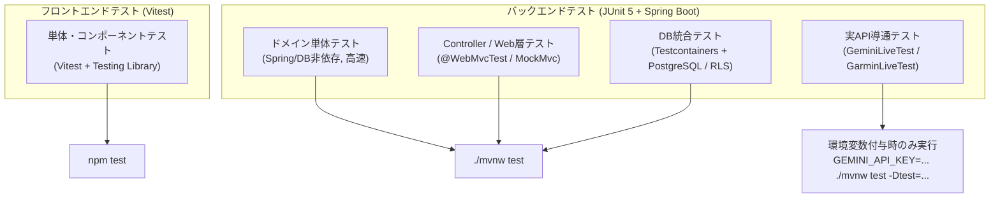

# クイックスタートとテスト実行

本ページでは、OpenWiki ドキュメント内の**タスク別ルーティングマップ**、OpenWiki（run-buddy）の**ローカル開発環境のセットアップ手順**、日常の運用・トラブルシューティング、およびバックエンド・フロントエンドにまたがる**テスト階層の分類と実行方法**を解説します。

---

## 1. タスク別ルーティングマップ (OpenWiki ナビゲーション)

開発目的や疑問点に応じて、以下の OpenWiki 内の各ドキュメントを参照してください。

*   **システム構成・モジュール依存関係の全体像を把握したい場合:**
    *   [`architecture/overview.md`](architecture/overview.md) を参照。モノレポ構造、バックエンドのパッケージ構成（ドメイン中心のパッケージ化と非依存ルール）、統合ビルド（`SpaConfig`）、Tailscale 接続モデルを解説しています。
*   **設計パターンや外部連携メカニズムを確認したい場合:**
    *   [`architecture/patterns.md`](architecture/patterns.md) を参照。Ports & Adapters、契約テスト（Contract Test）、不変ドメインモデル、Spring AI 統合、Garmin API 連携、OpenAPI 型連携（`openapi-typescript`）、およびコンポーネント設計を解説しています。
*   **データベース設計・jOOQ・行レベルセキュリティ（RLS）の詳細を知りたい場合:**
    *   [`architecture/persistence-rls.md`](architecture/persistence-rls.md) を参照。jOOQ 選定理由、リクエストごとの RLS トランザクション制御フロー（`RlsTransactionManager`）、ポートにおける default メソッド禁止原則、jOOQ コード生成と Record/ドメイン変換ルールを解説しています。
*   **新機能を TDD で追加する実践ステップを学びたい場合:**
    *   [`tutorials/add-feature.md`](tutorials/add-feature.md) を参照。CSV エクスポート機能を題材とした TDD 手順（ドメイン層 → リポジトリ/コントローラ層 → UI 層）および DB スキーマ変更の手順を詳細にステップバイステップで説明しています。

---

## 2. ローカル開発環境のセットアップ

### 2.1 前提条件

ローカル開発には以下の環境が必要です（元ドキュメント: [`../README.md`](../README.md)）。

| ツール | 要求バージョン | 用途 |
|---|---|---|
| **JDK** | 25 | バックエンド実行（Maven Wrapper `./mvnw` が自動ダウンロードされるため Maven の個別インストールは不要） |
| **Node.js** | 22.12 以上 | フロントエンド実行・ビルド |
| **Docker** | Docker Desktop 等（Compose v2 必須） | PostgreSQL データベースおよび Testcontainers によるテスト |

### 2.2 セットアップと起動手順

1. **リポジトリのクローンと環境設定ファイルの作成**

   ```bash
   git clone https://github.com/tis-abe-akira/run-buddy.git
   cd run-buddy
   cp .env.example .env
   ```

   `.env` ファイルで設定可能な主要項目:
   *   `GEMINI_API_KEY`: AI 相談機能で Gemini を利用する際の API キー（空の場合は開発用 Fake プロバイダのみ利用可）
   *   `RUNBUDDY_ACTIVITY_SOURCE`: ランニング記録の取得先（`dummy`［規定値］または `garmin`）
   *   `GARMIN_API_KEY`: Garmin Connect Personal API のキー（`garmin` 設定時に必須）
   *   `RUNBUDDY_LOG_LEVEL`: ログレベル（既定: `INFO`）
   *   `RUNBUDDY_BIND_ADDRESS`: バインド制限アドレス（既定: `127.0.0.1`）
   *   `RUNBUDDY_DB_PORT`: PostgreSQL ポート（既定: `5432`）

2. **PostgreSQL データベースの起動**

   ```bash
   docker compose up -d --wait
   ```
   起動時に初回用アプリロール `runbuddy_app` が生成され、バックエンド起動時に Flyway によりテーブル定義が適用されます。

3. **バックエンドの起動（開発モード）**

   ```bash
   cd backend
   ./mvnw spring-boot:run
   ```
   起動確認: `curl http://localhost:8080/health`（`{"status":"ok"}` が返却されます）。

4. **フロントエンドの起動**

   ```bash
   cd frontend
   npm install
   npm run dev
   ```
   ブラウザで `http://localhost:5173` にアクセスして動作確認します（Vite 開発サーバー経由で `/api` リクエストはバックエンドへプロキシされます）。

5. **統合配信ビルド（任意: モバイル/リモート利用時）**

   バックエンドとフロントエンドを1つの静的資産として統合配信する場合:

   ```bash
   cd backend
   ./mvnw spring-boot:run -Papp
   ```
   `-Papp` プロファイル指定によりフロントエンドがビルドされ、バックエンドの静的リソース（`target/classes/static`）に埋め込まれて `http://localhost:8080` から一元配信されます。

6. **Tailscale によるリモート利用（任意）**

   Tailscale を使用して宅内やモバイル端末からセキュアにアクセスする場合（元ドキュメント: [`../docs/guides/tailscale.md`](../docs/guides/tailscale.md)）:

   ```bash
   tailscale serve --bg 8080
   ```
   `https://<マシン名>.<tailnet名>.ts.net` でアクセス可能となります。インターネットへ無制限公開する `tailscale funnel` は利用しないでください。

---

## 3. 運用コマンドとトラブルシューティング

日常の開発作業および DB 操作における代表的コマンドです（元ドキュメント: [`../docs/guides/database.md`](../docs/guides/database.md)）。

*   **ポート 5432 の競合が発生する場合:**
    `.env` 内で `RUNBUDDY_DB_PORT=5433` のように変更し、`docker compose down && docker compose up -d --wait` を実行して再起動します。
*   **データベースを完全にリセットして初期化したい場合:**

    ```bash
    docker compose down -v
    docker compose up -d --wait
    ```
*   **ダミーの取り込みデータのみを削除したい場合:**
    Garmin 連携切替時にデータが重複した場合は、DB 内のダミーデータのみを削除できます。

    ```bash
    docker compose exec postgres psql -U runbuddy -d runbuddy -c "delete from run_result where activity_id like 'dummy-%';"
    ```
*   **jOOQ コードの自動生成:**
    DB マイグレーション（`backend/src/main/resources/db/migration/`）を追加後、型安全な jOOQ コードを再生成します。

    ```bash
    cd backend
    ./scripts/generate-jooq.sh
    ```
    生成されたコード（`persistence/jooq/generated`）はリポジトリにコミットする必要があります。

---

## 4. テスト階層の分類と実行ガイド

OpenWiki（run-buddy）では、テストの目的に応じて厳密に階層化されたテスト構成を採用しています。


*図 1: フロントエンドおよびバックエンドのテスト階層構造*

### 4.1 バックエンドテスト階層

バックエンドのテストは 4 つのレベルに整理されています。

| テスト階層 | 対象・特徴 | 主な実装例 / 基底クラス | 実行コマンド |
|---|---|---|---|
| **1. ドメイン単体テスト** | 純粋な Java 25 ロジックの検証。Spring や DB に依存せず超高速に実行 | `MonthlyPlanTest`, `RunResultTest`, `PlanAchievementTest` | `./mvnw test` |
| **2. Controller / Web層テスト** | `@WebMvcTest` を使用し、HTTP 契約、JSON シリアライズ、ProblemDetail（`reason` 等）のエラーハンドリングを検証 | `RunControllerTest`, `AdvisorControllerTest`, `ExportControllerTest` | `./mvnw test` |
| **3. DB 統合テスト** | `DatabaseTest` を継承。Testcontainers で本物の PostgreSQL 17（`postgres:17-alpine`）を起動。アプリロール `runbuddy_app` で接続し RLS 動作およびスキーマ安全性を検証 | `DatabaseTest`, `JooqPersistenceTest`, `DatabaseSafetyTest`, `RowLevelSecurityContract` | `./mvnw test` (要 Docker) |
| **4. 実 API 導通テスト (Live Tests)** | 外部 API（Gemini / Garmin）との実導通テスト。課金・利用制限防止のため普段の `./mvnw test` では無効化され、環境変数が明示された場合のみ起動 | `GeminiLiveTest`, `GarminLiveTest` | `GEMINI_API_KEY=... ./mvnw test -Dtest=GeminiLiveTest` |

#### DB テストのアイソレーション・メカニズム (`DatabaseTest`)
`DatabaseTest` を継承するテストクラスでは、`@BeforeEach` のタイミングで `currentUser.switchToNewUser()` が呼び出され、テストメソッドごとに異なるランダムなユーザー ID が割り当てられます。これにより、行レベルセキュリティ（RLS）によってデータが分離されるため、テスト間での明示的な DB クリア処理を行うことなく完全な並行性・独立性が保証されます。

### 4.2 フロントエンドテストと API 型生成

フロントエンドでは Vitest と React Testing Library を組み合わせ、コンポーネントおよびユーティリティのテストを実施します。

*   **テストの実行:**

    ```bash
    cd frontend
    npm test              # シングルラン (vitest run)
    npm run test:watch    # ウォッチモード (vitest)
    npm run typecheck     # TypeScript 型チェック (tsc --noEmit)
    ```

*   **OpenAPI スキーマからの TypeScript 型自動生成:**
    バックエンド起動後、REST API の定義からフロントエンド用型定義ファイル（`src/api/schema.gen.ts`）を更新します。

    ```bash
    cd frontend
    npm run gen:api
    ```

---

## 関連リファレンス

*   [システム構成とモジュール依存関係](architecture/overview.md)
*   [主要設計パターンと連携メカニズム](architecture/patterns.md)
*   [永続化層の設計: jOOQ と行レベルセキュリティ (RLS)](architecture/persistence-rls.md)
*   [チュートリアル: 実機能の追加手順 (TDD)](tutorials/add-feature.md)
*   [ルート README](../README.md)
*   [データベースガイド](../docs/guides/database.md)
*   [Tailscale 利用ガイド](../docs/guides/tailscale.md)
