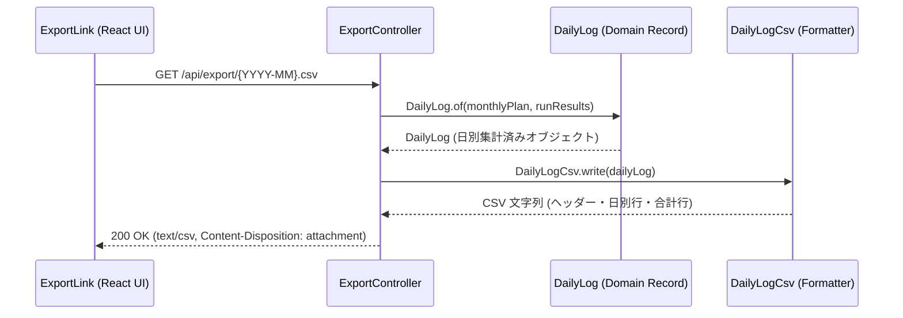
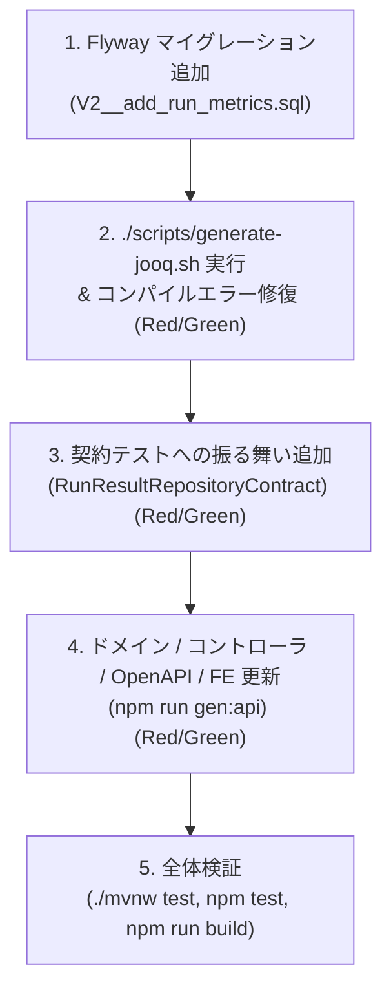

# チュートリアル: 機能の追加

`run-buddy` プロジェクトでは、「型安全性の重視」「契約テストによる品質担保」「行レベルセキュリティ（RLS）の不変条件維持」を基本設計方針としています。本チュートリアルでは、テスト駆動開発（TDD）のサイクル（赤 → 緑 → リファクタリング）に沿って新機能を追加・拡張する実践的な手順を解説します。

本チュートリアルは以下の 2 つのパートで構成されています：
1. **最小機能変更フロー (手本)**: DB スキーマ変更を伴わない既存の**月次 CSV エクスポート機能** (`com.example.runbuddy.export` パッケージ) を手本としたアーキテクチャと変更手順の解説。
2. **DB スキーマ変更を伴う 5 ステップ TDD ワークフロー (課題形式)**: DB テーブルへのカラム追加（`run_result` テーブルへの詳細メトリクス `RunMetrics` 追加）を通じた、Flyway・jOOQ・契約テスト・OpenAPI・フロントエンド同期の通し手順。

システムの全体構成は [アーキテクチャ概要](../architecture/overview.md)、主要設計パターンは [主要設計パターン](../architecture/patterns.md)、永続化と RLS の詳細は [永続化層の設計: jOOQ と行レベルセキュリティ](../architecture/persistence-rls.md) を参照してください。

---

## 1. 手本としての月次 CSV エクスポート機能 (最小機能変更フロー)

データベーススキーマの変更を行わない機能追加や集計ロジックの変更では、ドメインオブジェクト・フォーマッタ・Web コントローラ・UI コンポーネントが直接連携するシンプルな設計を採用します。

### CSV エクスポートの構成とデータフロー

月次 CSV エクスポート機能は、月間計画 (`MonthlyPlan`) と走行実績 (`RunResult`) を結合し、カレンダー日ごとの行および合計行を含む CSV ファイル（`text/csv`）をダウンロード提供します。


月次 CSV エクスポートにおけるコンポーネント間の呼び出しとデータフロー

### レイヤー別の役割と実装

1. **ドメインモデル (`com.example.runbuddy.export.DailyLog`)**:
   - `MonthlyPlan`（計画）と `List<RunResult>`（走行実績）を受け取り、指定月の全日付に対応する `Day` 不変 record のリストを生成します。
   - 計画距離 (`plannedDistance`)、実績距離 (`actualDistance`)、走行回数 (`runCount`)、総時間 (`totalTime`)、走行時間で加重平均した心拍数 (`averageHeartRate`) などのドメイン集計計算を行います。
2. **フォーマッタ (`com.example.runbuddy.export.DailyLogCsv`)**:
   - `DailyLog` オブジェクトをヘッダー行（`日付`, `曜日`, `予定_種別`, `予定_km`, `予定_メモ`, `実績_回数`, `実績_km`, `実績_時間`, `実績_ペース(/km)`, `実績_平均心拍`）、日別行、および「合計」行を含む CSV 文字列へとフォーマットします。
   - 表計算ソフトで数値として直接扱えるよう、`km` 表示（`10.5` など）や `pace` 表示（`5:30` など）を整えます。
3. **コントローラ (`com.example.runbuddy.export.ExportController`)**:
   - 端点 `GET /api/export/{month}.csv` を提供します。
   - `MonthlyPlanRepository` と `RunResultRepository` からデータを取得し、`DailyLog` および `DailyLogCsv` を呼び出して `text/csv` レスポンス（`Content-Disposition: attachment; filename="run-buddy-YYYY-MM.csv"`）を返します。
4. **フロントエンド (`frontend/src/components/ExportLink.tsx` / `DashboardView.tsx`)**:
   - `DashboardView` 内で `ExportLink` コンポーネントを配置し、`/api/export/{month}.csv` への直リンクを提供してブラウザでのダウンロードを可能にします。

### スキーマ変更なしの TDD 追加手順

新規集計値の追加など DB スキーマを変更しない機能改修では、以下の TDD サイクルで進めます：
1. **赤 (Red)**: `ExportControllerTest` や `DailyLogTest` に新しい要件（例: 新規集計列のアサーション）をテストとして記述し、テストが失敗することを確認します。
2. **緑 (Green)**: `DailyLog` や `DailyLogCsv` にドメイン計算・フォーマット論理を実装し、テストを成功させます。
3. **回帰検証**: `./mvnw test` を実行し、既存機能に影響がないことを確認します。

---

## 2. DB スキーマ変更を伴う機能追加の 5 ステップ TDD ワークフロー (課題解説)

データベーススキーマの変更（新規テーブル作成やカラム追加）を伴う機能追加では、Flyway マイグレーション・jOOQ コード生成・契約テスト・OpenAPI スキーマ同期・フロントエンド TypeScript 型更新を連携させた 5 ステップの TDD ワークフローを実行します。

本セクションでは課題形式として、**「走行記録 (`run_result`) に Garmin から取得した追加メトリクス (`RunMetrics`: 最高心拍数、平均/最高ピッチ、ストライド長、獲得標高) を保存・取得・表示できるように拡張する」** タスクをテーマに解説します。


DB スキーマ変更を伴う TDD 機能追加の 5 ステップワークフロー

---

### ステップ 1: Flyway マイグレーションの追加

データベーススキーマ変更の唯一の正解（Single Source of Truth）として、Flyway バージョンマイグレーション SQL ファイルを作成します。

#### 作業内容
`backend/src/main/resources/db/migration/` に新しい SQL ファイル（例: `V2__add_run_metrics.sql`）を追加します。

```sql
-- V2__add_run_metrics.sql
alter table run_result
    add column max_heart_rate           integer check (max_heart_rate > 0),
    add column average_cadence          integer check (average_cadence > 0),
    add column max_cadence              integer check (max_cadence > 0),
    add column average_stride_length_cm integer check (average_stride_length_cm > 0),
    add column elevation_gain_meters    integer check (elevation_gain_meters >= 0);
```

#### RLS (行レベルセキュリティ) に関する必須遵守事項
新規テーブルを追加する場合は、`V1__create_plans_and_runs.sql` の定義パターンを厳密に継承してください：
- **`user_id` 列の定義**: `user_id text not null default app_current_user_id()` を指定する。
- **RLS 有効化と強制**: `alter table <table_name> enable row level security;` および `alter table <table_name> force row level security;` を指定する。
- **`own_rows` ポリシーの設定**:
  ```sql
  create policy own_rows on <table_name>
      using (user_id = (select app_current_user_id()))
      with check (user_id = (select app_current_user_id()));
  ```

---

### ステップ 2: jOOQ コード生成とコンパイルエラーの修復 (Red → Green)

マイグレーション追加後、jOOQ の DSL クラスを再生成して Java の型システムと DB スキーマを同期させます。

#### 1. jOOQ コード生成スクリプトの実行
`backend` ディレクトリで生成スクリプトを実行します。

```bash
cd backend
./scripts/generate-jooq.sh
```
このスクリプトはローカル Docker 上で PostgreSQL 17 コンテナを一時起動し、Flyway マイグレーションを順次適用した後、`src/main/java/com/example/runbuddy/persistence/jooq/generated` 配下に Java DSL クラスを自動生成します。

#### 2. 赤 (Red): コンパイルエラーの発生
コード生成直後に `./mvnw compile` を実行すると、既存のリポジトリコード (`JooqRunResultRepository.java`) やドメインモデルと jOOQ 生成コードの不整合により**コンパイルエラー**が発生します。

- **失敗箇所**: `JooqRunResultRepository.java`（および `RunResult.java` や `RunMetrics.java` のレコード定義修正前）。
- **失敗理由**: jOOQ が生成した `RUN_RESULT` テーブル型に新カラムが追加された一方、`insertInto` や `fetch` のマッピングコードで新カラムが処理されていないため。

#### 3. 緑 (Green): ドメイン record およびリポジトリの修正
1. **ドメイン Record `RunResult.java` / `RunMetrics.java` の更新**:
   `RunMetrics` レコードを導入し、`RunResult` のコンストラクタで受け取るよう修正します。
   ```java
   public record RunMetrics(
           Integer maxHeartRate,
           Integer averageCadence,
           Integer maxCadence,
           Integer averageStrideLengthCm,
           Integer elevationGainMeters) {
       public static final RunMetrics NONE = new RunMetrics(null, null, null, null, null);
   }
   ```
2. **`JooqRunResultRepository.java` の修正**:
   `insertInto` / `onConflict().doUpdate()` および `fetch` マッピングで `RUN_RESULT` の各種メトリクスカラムを設定・還元するよう修正します。

修正後、`./mvnw compile` を実行しコンパイルが成功（緑）することを確認します。

---

### ステップ 3: 契約テストへの振る舞い追加 (Red → Green)

RunBuddy では、リポジトリの永続化仕様をインメモリ実装 (`InMemoryRunResultRepository`) と PostgreSQL / jOOQ 実装 (`JooqRunResultRepository`) の双方で同等に担保するため、**契約テスト (Contract Test)** インターフェースを使用します。

#### 1. 赤 (Red): 契約テストの追加と失敗
`backend/src/test/java/com/example/runbuddy/activity/RunResultRepositoryContract.java` に、新メトリクスが正しく保存・復元されるかを検証するテストメソッドを追加します。

```java
@Test
default void metricsAreStoredAndReadBack() {
    RunMetrics metrics = new RunMetrics(181, 172, 188, 98, 42);
    RunResult measured = new RunResult(
            "a", LocalDateTime.of(2026, 11, 2, 6, 0), Distance.ofKilometers(10), Duration.ofMinutes(55), 150,
            metrics);

    repository().saveAll(List.of(measured));

    assertThat(repository().findByMonth(NOVEMBER)).singleElement()
            .satisfies(run -> assertThat(run.metrics()).isEqualTo(metrics));
}
```

この状態で `./mvnw test` を実行すると、`InMemoryRunResultRepository` 側のデータ保持処理やテストファクトリが新フィールドに対応していないため、テストが失敗（赤）します。

#### 2. 緑 (Green): インメモリ実装およびテストの修復
`InMemoryRunResultRepository.java` を更新し、新フィールドが保持・検索可能となるよう修正します。

`./mvnw test -Dtest=InMemoryRunResultRepositoryTest,JooqPersistenceTest` を実行し、`InMemoryRunResultRepositoryTest` と PostgreSQL を使用する `JooqPersistenceTest` の双方で契約テストが成功（緑）することを確認します。

---

### ステップ 4: Web コントローラ / OpenAPI / フロントエンドの更新 (Red → Green)

バックエンドの API レスポンス型を拡張し、フロントエンドに型安全な変化を伝播させます。

#### 1. バックエンド REST コントローラの更新と Web テスト (Red → Green)
`RunController.java` のレスポンス DTO `RunResponse` に `@Schema` アノテーション付きで新フィールドを追加します。

```java
public record RunResponse(
        String activityId,
        LocalDateTime startedAt,
        double distanceKm,
        long durationSeconds,
        long paceSecondsPerKm,
        @Schema(types = {"integer", "null"}) Integer averageHeartRate,
        @Schema(types = {"integer", "null"}, description = "beats per minute") Integer maxHeartRate,
        @Schema(types = {"integer", "null"}, description = "steps per minute") Integer averageCadence,
        @Schema(types = {"integer", "null"}, description = "steps per minute") Integer maxCadence,
        @Schema(types = {"integer", "null"}, description = "centimeters") Integer averageStrideLengthCm,
        @Schema(types = {"integer", "null"}, description = "meters") Integer elevationGainMeters) {

    public static RunResponse from(RunResult run) {
        RunMetrics metrics = run.metrics();
        return new RunResponse(
                run.activityId(), run.startedAt(), run.distance().toKilometers(),
                run.duration().toSeconds(), run.pace().toSeconds(), run.averageHeartRate(),
                metrics.maxHeartRate(), metrics.averageCadence(), metrics.maxCadence(),
                metrics.averageStrideLengthCm(), metrics.elevationGainMeters());
    }
}
```

- **赤 (Red)**: `./mvnw test` を実行すると `RunControllerTest` や Web 階層の結合テストが JSON 構造の変化により失敗します。
- **緑 (Green)**: テスト用モックおよびアサーションを更新して Web テストをすべて通過させます。

#### 2. OpenAPI 型の自動生成と型同期
Spring Boot バックエンドを起動した状態で、`frontend` ディレクトリにて CLI コマンドを実行します。

```bash
cd frontend
npm run gen:api
```
このコマンドは `openapi-typescript http://localhost:8080/v3/api-docs -o src/api/schema.gen.ts` を呼び出し、バックエンドの OpenAPI スキーマから `src/api/schema.gen.ts` へ TypeScript 型定義を自動生成・同期します。

#### 3. フロントエンドの型エラーとテスト失敗 (Red)
型同期後、`npm run typecheck` または `npm test` を実行すると、フロントエンドのモックデータやコンポーネントで型不整合が発生してテストが失敗（赤）します。

#### 4. フロントエンド UI コンポーネントの修正 (Green)
`client.ts` が参照する `Run` 型 (`RunResponse`) に従って `RunsTable.tsx` や `DashboardView.tsx` などの UI コンポーネントおよびテストモックを更新します。
`npm run typecheck` と `npm test` を実行し、フロントエンドの型チェックとコンポーネントテストがすべて成功（緑）することを確認します。

---

### ステップ 5: フルビルドと総合検証

すべてのレイヤーの改修が完了したら、システム全体でリグレッションがないことを最終検証します。

1. **バックエンドの全テスト実行**:
   ```bash
   ./mvnw test
   ```
   ユニットテスト、リポジトリ契約テスト、jOOQ / RLS データベーステストのすべてが成功することを確認します。

2. **フロントエンドの全テスト実行**:
   ```bash
   npm test
   ```
   Vitest によるコンポーネントテストおよび統合テストがすべて成功することを確認します。

3. **フロントエンドの型チェックとプロダクションビルド**:
   ```bash
   npm run build
   ```
   TypeScript コンパイラ (`tsc --noEmit`) による型チェックと Vite によるプロダクションビルドが正常に完了することを確認します。

---

## 3. トラブルシューティングと開発上の注意点

1. **`generate-jooq.sh` 実行時の Docker エラー**:
   - `generate-jooq.sh` はローカルの Docker デーモンを使用して PostgreSQL 17 コンテナを起動します。Docker デーモンが起動していること、およびローカルの 5432 ポート周辺が他のデータベースプロセスで占有されていないか確認してください。
2. **`app.user_id is not set` 例外の発生**:
   - データベースを操作するテストやリポジトリ処理で `app_current_user_id()` が設定されていない場合、PostgreSQL / RLS から例外がスローされます。DB アクセスを行うテストクラスには `@Transactional` や `RlsTransactionManager` によるコンテクスト設定（または `JooqPersistenceTest` 内のベース構成）が適切に含まれているかを確認してください。
3. **`npm run gen:api` 実行時の接続エラー**:
   - `npm run gen:api` は `http://localhost:8080/v3/api-docs` から OpenAPI JSON を読み込みます。バックエンドサーバーが未起動の場合は、先に `./mvnw spring-boot:run` でバックエンドを起動した状態で実行してください。

---

## 関連ページ

- [アーキテクチャ概要](../architecture/overview.md) - プロジェクト全体の多層アーキテクチャとコンポーネント構成
- [主要設計パターン](../architecture/patterns.md) - Ports & Adapters、契約テスト、不変ドメインモデルの詳細
- [永続化層の設計: jOOQ と行レベルセキュリティ](../architecture/persistence-rls.md) - RLS 設定、jOOQ 選定理由、トランザクション制御の仕組み
- [クイックスタート](../quickstart.md) - 開発環境のセットアップと基本コマンド一覧
