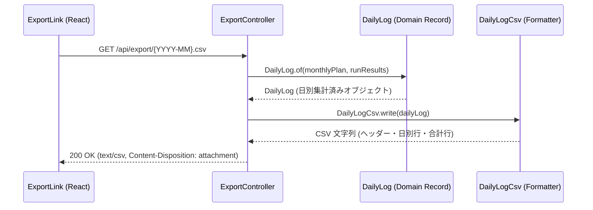
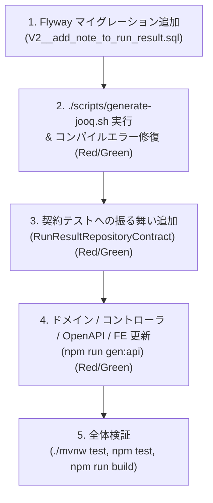

# チュートリアル: 実機能の追加手順 (TDD)

本チュートリアルでは、`run-buddy` プロジェクトにおいて新機能を追加する際の実践的な開発手順を解説します。プロジェクトの設計理念である「型安全性の重視」「契約テストによる品質担保」「行レベルセキュリティ（RLS）の不変条件維持」を遵守しながら、テスト駆動開発（TDD）のサイクル（赤 → 緑 → リファクタリング）に沿って安全に機能を拡張する手順を学びます。

システム全体の構造については [アーキテクチャ概要](../architecture/overview.md)、主要設計パターンについては [主要設計パターン](../architecture/patterns.md)、データベース永続化の詳細は [永続化層の設計: jOOQ と行レベルセキュリティ](../architecture/persistence-rls.md) を参照してください。

---

## 1. 最小機能変更フロー: 手本としての月次 CSV エクスポート

データベーススキーマの変更を伴わない機能追加・変更の最小フローとして、既存の**月次 CSV エクスポート機能**（`export` パッケージ）の構造を参考にします。

### CSV エクスポートの全体構造

月次 CSV エクスポート機能は、ドメインモデルからデータ整形、Web コントローラ、フロントエンド UI までがシンプルに直結した設計になっています。


月次 CSV エクスポートにおけるコンポーネント間の呼び出しとデータフロー

### パッケージ構成とレイヤーの責務

1. **ドメインモデル (`com.example.runbuddy.export.DailyLog`)**:
   - `MonthlyPlan`（計画）と `List<RunResult>`（実績ラン記録）を受け取り、カレンダー日ごとの `Day` レコードを構築する不変 Java `record`。
   - 合計距離、合計走行時間、加重平均心拍数などのドメイン計算ロジックを保持します。
2. **フォーマッタ (`com.example.runbuddy.export.DailyLogCsv`)**:
   - `DailyLog` オブジェクトを可読性の高い CSV フォーマットへ変換します。
   - 表計算ソフトで数値として認識されるように `km` 表示や `pace` 表記の整形を行います。
3. **コントローラ (`com.example.runbuddy.export.ExportController`)**:
   - 端点 `GET /api/export/{month}.csv` を公開します。
   - `MonthlyPlanRepository` と `RunResultRepository` からデータを取得し、`DailyLog` および `DailyLogCsv` を経由して `text/csv` レスポンス（ファイルダウンロード用ヘッダー付き）を返却します。
4. **フロントエンド UI (`frontend/src/components/ExportLink.tsx`)**:
   - `exportCsvUrl(month)` 関数でエンドポイント URL を生成し、`<a href="..." download>` タグとしてダウンロードリンクを提供します。

### TDD による変更手順 (最小フロー)

DB スキーマ変更のない機能追加（例: CSV に新しい集計列を追加する等）では、以下の TDD サイクルで進めます：

1. **赤 (Red)**: コントローラテスト `ExportControllerTest` やドメインユニットテストに、期待する出力仕様をテストケースとして追加し、テストが失敗することを確認します。
2. **緑 (Green)**: `DailyLog` や `DailyLogCsv` に変換ロジックを実装し、テストを通過させます。
3. **検証 (Verify)**: `./mvnw test` および `npm test` を実行して、副作用がないことを確認します。

---

## 2. DB スキーマ変更を伴う機能追加の 5 ステップ TDD ワークフロー

データベーススキーマの変更（新規テーブル作成やカラム追加）を伴う機能追加では、jOOQ の型生成と契約テスト（Contract Tests）、OpenAPI スキーマ同期を連動させた 5 ステップの TDD ワークフローを実践します。

ここではハンズオン課題として、**「ラン記録 (`run_result`) に『メモ (note)』列を追加し、画面に表示・取得できるようにする」** タスクを例に解説します。


DB スキーマ変更を伴う TDD 機能追加の 5 ステップワークフロー

---

### ステップ 1: Flyway マイグレーションの追加

データベース変更の唯一の起点として、Flyway マイグレーション SQL ファイルを作成します。

#### 作業内容
`backend/src/main/resources/db/migration/` ディレクトリ配下に、新しいバージョニング SQL ファイル（例: `V2__add_note_to_run_result.sql`）を追加します。

```sql
-- V2__add_note_to_run_result.sql
alter table run_result add column note text not null default '';
```

#### RLS（行レベルセキュリティ）に関する必須ルール
新規テーブルを作成する場合は、`V1__create_plans_and_runs.sql` と同様に以下のルールを厳密に遵守します：
- **`user_id` 列の定義**: `user_id text not null default app_current_user_id()` を含める。
- **RLS の有効化**: `alter table <table_name> enable row level security;` および `force row level security;` を指定する。
- **`own_rows` ポリシーの設定**:
  ```sql
  create policy own_rows on <table_name>
      using (user_id = (select app_current_user_id()))
      with check (user_id = (select app_current_user_id()));
  ```

---

### ステップ 2: jOOQ コード生成とコンパイルエラー修復

マイグレーション追加後、jOOQ の型安全な Java クラスを再生成します。

#### 1. jOOQ コード生成スクリプトの実行
`backend` ディレクトリで以下のスクリプトを実行します。

```bash
cd backend
./scripts/generate-jooq.sh
```

このスクリプトは Docker 上で一時的な PostgreSQL コンテナを起動し、Flyway マイグレーションを適用した上で `src/main/java/com/example/runbuddy/persistence/jooq/generated` 配下に Java DSL クラスを自動生成します。

#### 2. 赤 (Red): コンパイルエラーの発生
コード生成直後に `./mvnw compile` を実行すると、既存の Java コードと生成コード / ドメインモデルとの型不一致により**コンパイルエラー**が発生します。

- **失敗する箇所**:
  `JooqRunResultRepository.java`（および `RunResult.java` ドメイン record にフィールドを追加した場合）。
- **エラー理由**:
  jOOQ が生成した `RUN_RESULT` テーブル型に `NOTE` 列が追加されたものの、リポジトリ層の `insertInto` や `fetch` のマッピング処理で `NOTE` カラムが正しく扱われていないため。

#### 3. 緑 (Green): コード修正によるコンパイル成功
ドメイン Record および jOOQ リポジトリ実装を更新します。

1. **ドメインモデル `RunResult.java` の更新**:
   ```java
   public record RunResult(
           String activityId,
           LocalDateTime startedAt,
           Distance distance,
           Duration duration,
           Integer averageHeartRate,
           String note) { // note フィールドを追加
       public RunResult {
           Objects.requireNonNull(note, "note");
           // ...
       }
   }
   ```
2. **リポジトリ実装 `JooqRunResultRepository.java` の更新**:
   - `insertInto` に `RUN_RESULT.NOTE` を追加。
   - `onConflict` の `doUpdate()` に `.set(RUN_RESULT.NOTE, excluded(RUN_RESULT.NOTE))` を追加。
   - `fetch` マッピングで `row.getNote()` を `RunResult` に渡す。

修正後、`./mvnw compile` を実行してコンパイルが成功（緑）することを確認します。

---

### ステップ 3: 契約テストへの振る舞い追加

RunBuddy では、リポジトリの永続化動作をインメモリ実装（`InMemoryRunResultRepository`）と PostgreSQL / jOOQ 実装（`JooqRunResultRepository`）の両方で共有・検証するために**契約テスト（Contract Test）** を使用しています。

#### 1. 赤 (Red): 契約テストの失敗
`backend/src/test/java/com/example/runbuddy/activity/RunResultRepositoryContract.java` に新しい振る舞いを検証するテストメソッドを追加します。

```java
@Test
default void storesAndRetrievesRunNote() {
    RunResult runWithNote = new RunResult(
            "r-note", LocalDateTime.of(2026, 11, 5, 7, 0),
            Distance.ofKilometers(5), Duration.ofMinutes(25), 140, "朝の快適ラン");

    repository().saveAll(List.of(runWithNote));

    assertThat(repository().findByMonth(NOVEMBER)).singleElement()
            .satisfies(run -> assertThat(run.note()).isEqualTo("朝の快適ラン"));
}
```

この段階で `./mvnw test` を実行すると、インメモリリポジトリ側のデータ保持処理やテスト用ヘルパーメソッドが新しい `RunResult` に未対応の場合、テストが失敗（赤）します。

#### 2. 緑 (Green): メモリ実装とテストヘルパーの修復
`InMemoryRunResultRepository.java` および契約テスト内のファクトリメソッドを修正し、`note` が保持・還元されるように実装します。

`./mvnw test -Dtest=InMemoryRunResultRepositoryTest,JooqPersistenceTest` を実行し、インメモリおよび PostgreSQL（jOOQ）の両実装で契約テストが成功（緑）することを確認します。

---

### ステップ 4: ドメイン / コントローラ / OpenAPI / フロントエンドの更新

バックエンドの API 端点を更新し、フロントエンドに型安全な変化を伝播させます。

#### 1. バックエンド API コントローラの更新とテスト (Red → Green)
`RunController.java` のレスポンス DTO `RunResponse` に `note` フィールドを追加します。

```java
public record RunResponse(
        String activityId,
        LocalDateTime startedAt,
        double distanceKm,
        long durationSeconds,
        long paceSecondsPerKm,
        @Schema(types = {"integer", "null"}) Integer averageHeartRate,
        String note) { // note を追加

    static RunResponse from(RunResult run) {
        return new RunResponse(
                run.activityId(),
                run.startedAt(),
                run.distance().toKilometers(),
                run.duration().toSeconds(),
                run.pace().toSeconds(),
                run.averageHeartRate(),
                run.note());
    }
}
```

- **赤 (Red)**: `RunControllerTest.java` や `ExportControllerTest.java` を実行すると、レスポンス JSON の構造変化によりテストが失敗します。
- **緑 (Green)**: テストのアサーションおよびモックデータを `note` フィールドに対応するよう修正し、バックエンドの全 Web 階層テストを通過させます。

#### 2. OpenAPI 型の自動生成とフロントエンドの同期
バックエンドサーバーを起動した状態（または OpenAPI JSON を出力させた状態）で、`frontend` ディレクトリにて型生成スクリプトを実行します。

```bash
cd frontend
npm run gen:api
```

このコマンドは `http://localhost:8080/v3/api-docs` から OpenAPI スキーマを取得し、`frontend/src/api/schema.gen.ts` を自動更新します。これにより `RunResponse` の TypeScript 型定義に `note: string` が追加されます。

#### 3. フロントエンドの型エラーとテスト失敗 (Red)
`schema.gen.ts` 更新後、`npm run typecheck` または `npm test` を実行すると型エラーおよびコンポーネントテストの失敗（赤）が発生します。

- **失敗する箇所**:
  `frontend/src/components/RunsTable.tsx`（型ミスマッチまたはメモ未表示）および `frontend/src/components/RunsTable.test.tsx`（テスト用モックデータに `note` が存在しない）。

#### 4. フロントエンドコンポーネントの修正 (Green)
`RunsTable.tsx` にメモ列を追加し、`RunsTable.test.tsx` のモックデータを更新します。

```tsx
// RunsTable.tsx 内でのメモ表示追加例
<td className="cell-note">{run.note}</td>
```

`npm run typecheck` および `npm test` を実行し、フロントエンドの型チェックとコンポーネントテストがすべて成功（緑）することを確認します。

---

### ステップ 5: フルビルドと総合検証

全レイヤーの変更完了後、システム全体で回帰障害が発生していないことを最終検証します。

1. **バックエンドの全テスト実行**:
   ```bash
   ./mvnw test
   ```
   ユニットテスト、リポジトリ契約テスト、jOOQ / RLS データベーステストがすべて通過することを確認します。

2. **フロントエンドの全テスト実行**:
   ```bash
   npm test
   ```
   Vitest による全コンポーネントテストが通過することを確認します。

3. **フロントエンドの型チェックおよびビルド検証**:
   ```bash
   npm run build
   ```
   TypeScript コンパイラ (`tsc --noEmit`) による型チェックと Vite によるプロダクションビルドが正常に完了することを確認します。

---

## 3. トラブルシューティングと開発上の注意点

1. **jOOQ コード生成スクリプト (`generate-jooq.sh`) 実行時の Docker エラー**:
   - `generate-jooq.sh` は PostgreSQL 17 の Docker コンテナをローカルで起動します。Docker デーモンが起動していること、およびポート 5432 周辺で競合がないことを確認してください。
2. **`app.user_id is not set` エラーの発生**:
   - データベーステストや新規リポジトリメソッド追加時、`RlsTransactionManager` によるトランザクション制御の外部でクエリを実行すると、`app_current_user_id()` 関数により例外が発生します。DB アクセスを行うテストクラスには適切なトランザクションアノテーション（`@Transactional` または `DatabaseTest` の継承）を付与してください。
3. **`npm run gen:api` 実行時の接続エラー**:
   - `npm run gen:api` は Spring Boot サーバー（`http://localhost:8080`）が起動している必要があります。サーバー未起動の場合は、先に `./mvnw spring-boot:run` でバックエンドを起動してから実行してください。

---

## 関連ページ

- [アーキテクチャ概要](../architecture/overview.md) - プロジェクト全体の多層アーキテクチャとコンポーネント構成
- [主要設計パターン](../architecture/patterns.md) - Ports & Adapters、契約テスト、不変ドメインモデルの詳細
- [永続化層の設計: jOOQ と行レベルセキュリティ](../architecture/persistence-rls.md) - RLS 設定、jOOQ 選定理由、トランザクション制御の仕組み
- [クイックスタート](../quickstart.md) - 開発環境のセットアップと基本コマンド一覧
